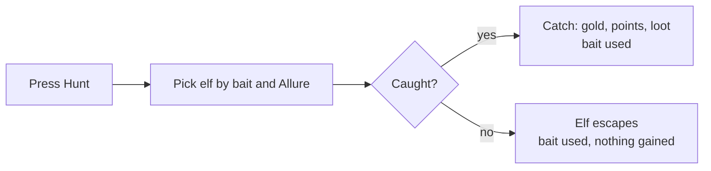

# The Naughty List: developer notes

Living design and discussion document: where game mechanics are planned and debated before they are built, plus how the game is made, deployed and released. Update it in every pull request that changes the game, so it always matches the code. The other two docs are [Balance notes](BALANCE.md) (gear balance check and simulation history) and the [Wiki](WIKI.md) (player-facing reference and walkthrough).
Original review copy: https://claude.ai/artifact/VRKBh16CBkcZuN8FiqeWn9 (this file is now the source of truth).

## Implementation status

| Milestone | Status | PR |
| --- | --- | --- |
| 1. Skeleton: server, client, Docker image, CI | Done | #1 |
| 2. Hunt engine, content files, tests, balance simulator | Done | #1 |
| 3. Playable client on the server: accounts, invites, server-side hunts, SQLite saves | Done | #2 |
| 4a. NAS deploy: compose file, Cloudflare Tunnel option, deploy guide, image smoke test | Done | #3 |
| 4b. Friends: leaderboard and catch feed | Done | #11 |
| Flavour text for every item and elf | Done | #9 (shown in the UI since #11) |
| Art for every UI slot: 97 original SVGs + manifest, named by game id | Done | #10 (shown in the UI since #11) |
| Custom PNG portraits for all 10 cookie-pantry/wrapping-room/toy-workshop/reindeer-stables elves | Done | #13 |
| Custom AI-generated art for every slot except the 24px icons (97 pictures: 29 elves, traps, bases, baits, charms, materials, trap types, ranks, locations, map, brand, how-to), resized and saved as WebP; see [ART_PROGRESS.md](#custom-art-progress) | Done | #14, #40 |
| New phone-first UI (layout D2): bottom menu, hunt log with events and full history, Arsenal, Elf Emporium, Santa's Workshop, More pages, open sign-up with admin switch | Done | #11 |
| Holly power type renamed Starlight; its three traps reworked (Starlit Stocking, Star Lantern, Constellation Wreath) with new text and SVG art, old saves migrated | In review | #17 |
| Intro letter from Santa: the game's backstory as the first hunt-log entry of every new game, and on How to play | In review | #12 |
| Location objectives: a simple Cookie Pantry start, then a unique loop per location (Wrapping Room bait ladder, Toy Workshop parallel order board, Stables sleigh run), plus first-visit intros, a hint button and a mechanic panel on each Hunt screen; see [Location objectives](#location-objectives) | Done | #16 (plan), #18 (build); panel icons, sleigh marker and last-change line in #23 |
| Pantry goals panel on the Hunt screen: main goal (reach the next area's rank, ticked when done) and optional goal (portraits caught, e.g. 3/5) | Done | this PR |
| Pillage on escape: escaped elves may take gold, points and bait (bosses most, mini bosses less, others rarely), with safety rails; see [Pillage on escape](#pillage-on-escape) | Done | #18 |
| Hexed elves: new backstory (Scrinch hexed Santa's elves), 6 renamed elves, General Grimbolt and the new Stables boss Cinderhoof, home power types per location, simple SVG elf portraits, old saves migrated; see [Theme and setting](#theme-and-setting) and [Power types by location](#power-types-by-location) | In review | this PR |
| Welcome popup: shown once when a new game starts (sign-up and Start over); see [Theme and setting](#theme-and-setting) | Done | #19 (plan), #23 (build), #24 (shows again after Start over) |
| Achievements and badges: 55 achievements with Bronze, Silver, Gold and Secret badges, an earn popup and an Achievements tab in My profile; see [Achievements and badges](#achievements-and-badges) | Done | #19 (plan), #23 (build), #24 (design pass) |
| Hunt screen gear card in a 2x2 grid (Trap and Bait over Base and Charm) and 3D medal icons for power types and the gold coin; see [User interface](#user-interface) | Done | #19 (plan), #23 (build) |
| Early-game onboarding: 200 starting gold (first trap costs 300), free charms and better bait for every badge (logged in the hunt log), a close button on achievement banners and one-time beginner tips; see [Early game and tips](#early-game-and-tips) | Done | this PR |
| Frozen top header on every main screen, auto-scroll to the Hunt log when Hunt is pressed, and the New Catch popup for the first catch of each elf (with Quiet toast); achievements show as a non-blocking banner instead of a popup; see [User interface](#user-interface) | Done | #26 |
| Hunt-log rows for rare, mini boss and boss catches glow and shimmer in their tier colour, matching the portraits | Done | this PR |
| Allure: attraction no longer decides whether an elf shows up. Every hunt meets an elf; attraction (now called Allure) scales the rare, mini boss and boss weights; see [Allure](#allure) | Done | this PR |
| Trap effectiveness tiers: attraction and catch chance shown as five-tier power bars (Very weak to Very strong) instead of exact percentages; an admin toggle on More > Admin brings the percentages back for tuning; see [Trap effectiveness tiers](#trap-effectiveness-tiers) | Done | this PR |
| Player feedback: More > Feedback box for signed-in players, saved in its own never-wiped table, readable under More > Admin | Done | this PR |
| Admin speed-run tools for testing: on the Admin page, boost rewards (x1 to x200), always attract and catch with full loot, add gold, jump to a rank, unlock every location, stock up supplies; see [Admin speed-run tools](#admin-speed-run-tools) | Done | this PR |
| Boss keys: the local boss drops a key on its first catch, and the next location needs it to unlock (existing saves are granted the keys they have earned); see [Progression](#progression) | In review | this PR |
| Branching progression (eddy): luck rework (luck helps most against commons, least against bosses), Madame Shredwell weak to a new Carol type, and the Carol Loft side area where the Carol Horn is made; see [Branching progression](#branching-progression) | In review | this PR |
| New bases: two tiers of power, attraction and luck bases, with build affinity and a "good for" line; see [New bases](#new-bases-power-attraction-and-luck) | In review | #21 |
| Playtest and simulation plan: what the simulator must report for Allure, Cheer Meter, events and goals, targets and how to read them (plan only); see [Playtest and simulation plan](#playtest-and-simulation-plan-eddy-27-nov-2026-plan-only). Baseline simulator built (Allure tiers, goals, gold flow, progress feel, `--seeds`, `--trace`); Cheer and events policies and metrics included; findings in [SIMULATION_REPORT.md](BALANCE.md#simulation-history) | In progress | this PR |
| Commons and Grimbolt tuned to the balance bands; balance report gets a Recommended gear tier and a boss-gap flag; walkthrough rewritten as trap 1 / trap 2 per area | Done | this PR |
| Balance check: `npm run balance` flags catch-rate problems for every trap x base x charm against every elf (fresh and endgame profiles), thresholds in `balance/thresholds.json`, report in [Balance notes](BALANCE.md), advisory in CI | Done | this PR |
| Random events after a hunt (Santa and Mrs. Claus boons with a safe or big choice and rare free Grand Gifts; Scrinch's random events were removed again, he stays the story villain), plus a parked-ideas list; see [Random events](#random-events-built-on-integration) | Built on `integration` (test playground), draft numbers | this PR |
| Cheer Meter and boons (eddy): a streak meter, pick 1 of 3 from 14 boons in three rarities, Overcharge and Cheer charms; see [Cheer Meter](#cheer-meter-and-boons-eddy-26-nov-2026-built-on-integration) | Built on `integration` (test playground), draft numbers | this PR |
| Full-game strategy walkthrough: [Wiki walkthrough](WIKI.md#walkthrough), gear, bosses and Cheer Meter use for every location | Done | this PR |
| Docs consolidated into three: Developer notes, Balance notes, Wiki with walkthrough | Done | this PR |
| Area baits (each area has its own bait, a wrong bait always fails), sleigh run costs gold and can be abandoned, net gold per hunt benchmark in `npm run balance`; see [Area baits](#area-baits-and-the-sleigh-run-cost-eddy-28-nov-2026-built-on-integration) | Built on `integration` | this PR |
| 5. Tune from play-test | Planned | |
| Daily branch cleanup: keeps the 10 most recently merged PR branches, deletes older merged ones (`cleanup-branches.yml`) | Done | this PR |
| Versioned releases: semver in `package.json`, `CHANGELOG.md`, merging a new version into `main` publishes version-tagged Docker images, a `vX.Y.Z` tag and a GitHub Release, plus in-game release notes (`content/releases.json`, What's new popup and More screen); first release 1.0.0 (integration promoted to main); see [Deployment](#deployment) and [RELEASING.md](#releasing) | Done | this PR |

The server runs every hunt and saves each player in SQLite. To play locally, follow "Run it locally" below.

## Summary

**The Naughty List** is an original Christmas trap-and-catch browser game for eddy and friends. Scrinch, a horned devil, has taken over Santa's secret lair at the North Pole and hexed Santa's own elves, who now raid it for him. Santa hires you as an elf hunter. You arm a trap, pick a bait, press Hunt, and the game rolls attraction and catch odds against the hexed elf's power. There is no wait timer: every press is a hunt. Bait cost, not a clock, paces progress.

v1 covers 5 ranks and 4 lair locations: 23 hexed elves and bosses in all (Baron Crumblewick and Grizzlewick are parked). The Cookie Pantry is a simple start with common, uncommon and rare elves. Each later location has 3 common elves, a rare elf, a mini boss and a local boss, and its own local objective that decides when the mini boss and boss come (see [Location objectives](#location-objectives)). Bosses drop the loot used to craft stronger gear. Expect roughly 1,500 hunts, or about 1 to 1.5 hours of active play, to reach the last v1 rank.

The stack is one small Docker container (Node.js + SQLite) on the UGREEN NAS, with open sign-up (the admin can close it) and a leaderboard so friends can play. The stamina meter is built but switched off.

**Decided by eddy (25 Nov 2026):** Christmas theme and the name The Naughty List; stamina off but kept as a toggle; for eddy and friends; repository cheesezilla/naughty-list; this plan lives in the repo and is updated with each PR.

## Theme and setting

**Hexed elves (eddy, 26 Nov 2026).** Scrinch, a horned devil who wants Christmas cancelled, crept into Santa's secret lair under the North Pole on the longest night and blew brimstone soot through the vents. Every elf who breathed it turned **hexed**: sour, sneaky and loyal to Scrinch. They wreck the workshops and steal the cookies, paper, toy parts and reindeer gear Santa needs. Santa, Mrs. Claus and the few elves the soot missed (the loyal elves who run Santa's Workshop and the Elf Emporium) escaped to the old ice cellar, and Santa hires you as an elf hunter. Every hexed elf you catch goes on The Naughty List, and Mrs. Claus's cocoa slowly brings them back to their old selves, so catching is also rescuing. This replaced the first story, where Scrinch sent his own imps.

You start in the Cookie Pantry and work deeper into the lair as you rank up. Each room's elves did that room's job before the hex (bakers, wrappers, toymakers, stable hands), and each location has 3 common kinds, a rare one, a mini boss and a local boss who is one of Scrinch's lieutenants. Some bosses are dark takes on familiar Christmas figures, always in our own design: the Gingerbread Rascal (a gingerbread man the hex brought to life; a public-domain folk character), General Grimbolt (a hexed nutcracker soldier; from a public-domain story) and **Cinderhoof**, an original soot-black reindeer with ember antlers that Scrinch hexed to pull his sleigh. Cinderhoof replaces the idea of an evil Rudolph, which is a trademarked and copyrighted character, to keep the game original. Bosses drop the parts the loyal elves use to craft you stronger traps.

**Names in code.** Game data still calls them imps: the `imps` list in `content/locations.json`, the `Imp` type, the `imps` art slot and `imp` in hunt-log entries. Only player-facing text says elves. Six ids changed with their names (`crumb_imp` → `crumb_elf`, `chimney_soot_imp` → `sootcap`, `gingerbread_imp` → `gingerbread_rascal`, `glitter_imp` → `glitterbug`, `windup_imp` → `windup_elf`, `foreman_grimbolt` → `general_grimbolt`) and the Stables boss became `cinderhoof`; Grizzlewick the Horned is parked in `content/parked/grizzlewick.json` for Scrinch's own lair after v1. Saves, badges and hunt-log entries with the old ids are rewritten when the server starts (`RENAMED_ITEMS` in `src/server/db.ts`), so old catches of Grizzlewick count as Cinderhoof.

The tone is a cheeky Christmas storybook. Every elf, place, trap, bait, rank and material name is invented for this game. Art is original vector art in one storybook style, generated by `scripts/art/` and named by game id so any picture can be regenerated or swapped; see [Art](#art).

**Intro letter.** Every new game opens with "A letter from Santa" as the first entry in the hunt log: the lair, Scrinch and his elves, and the player's job as Santa's elf hunter. It is logged when an account is created and again after Start over, shows folded after the first paragraph with "Read the whole letter", and is also at the top of How to play, so players from before it was added can read it there. The text lives in `content/story.json` (title, up to 8 paragraphs of up to 500 characters, sign-off) and can be edited without code changes.

**Welcome popup (eddy 26 Nov 2026, built in #23).** A one-time popup greets the player when a new game starts: right after creating an account, and again after Start over. It sits over the Hunt screen with the key art on top, the game icon, and:

**New Catch popup (built in #26, eddy 26 Nov 2026).** The first time a player catches a particular elf, a popup appears over the Hunt screen right after the hunt, so a first catch feels like an event instead of a line in the log. It shows:

- a header ribbon "NEW ELF ON YOUR NAUGHTY LIST" in the tier's colour (common green, uncommon teal, rare purple, mini boss orange, boss gold);
- the portrait in a tier-coloured frame, with a "Portrait unlocked" pill (the "?" card turns into the real portrait here);
- the name, a tier pill and the location, then the tagline from `content/flavour.json`;
- three small tiles: power, the power type it is weak to (as a medal icon, or "No weakness" if it has none), and the points it gave;
- progress on the Naughty List: this location (for example 4 of 5) with a bar, and all locations (9 of 23).

Buttons: **Open file** closes the popup and opens the elf's file; **Keep hunting** closes it. Esc, Enter and Space also close it, and the first Space press never hunts behind it. The hunt log still gets its usual "Portrait unlocked" mark on that catch. If the same catch also earns achievements, the New Catch popup comes first and the achievement banners drop in over it without blocking it. There is no new save field: "first catch" is already known from the elf's catch count going from 0 to 1 in that hunt. The setting **New catch popups** (On by default; it replaced Achievement popups) turns this into a small toast when Off, with the portrait thumbnail and name. Mockup: the UI canvas, row "Achievements and badges", artboard "New Catch popup".

> **Welcome to The Naughty List!**
> Scrinch's elves are raiding Santa's secret lair, and Santa needs a hunter. Set your trap, catch every elf you can, and put them all on the Naughty List!

Buttons: **Start hunting** closes it; **Read Santa's letter** closes it and opens the intro letter in the hunt log. Space, Enter and Esc also close it, and the first Space press never hunts behind it. The save gets `welcomeSeen: true` once it is closed, so it shows once per game; Start over clears the flag. Old saves load with the flag set, so existing players don't see it. The text is a `welcome` block in `content/story.json` (`title` up to 40 characters, `text` up to 200, `button` up to 20) and is checked by `npm run check-content`. Mockup: the UI canvas, row "Achievements and badges", artboard "Welcome popup".

**Beyond v1:** Scrinch himself is the final boss of a later location. His loot crafts **The Naughty List**, a giant enchanted scroll trap and one of the strongest pieces of gear in the game.

## Core loop

The player spends gold on bait and gear, hunts to earn gold, points and materials, and uses points to rank up and unlock the next location.

**Trap setup** (four slots, changeable any time):

| Slot | What it gives | Consumed? |
| --- | --- | --- |
| Trap | Power, power type, luck, attraction bonus | No |
| Base | Power, luck, attraction bonus | No |
| Bait | Attraction rate, changes which elves show up | 1 per attracted hunt |
| Charm (optional) | A bonus such as +luck or +power % | 1 per attracted hunt |

**One hunt, step by step:**

1. **Elf pick.** Every hunt meets an elf, drawn from the location's table, weighted by the bait in use and by Allure (see [Allure](#allure)). There are no quiet hunts any more.
2. **Bait.** One bait is used on every hunt.
3. **Catch roll.** Trap power and luck are compared with the elf's power.
4. **Catch:** gold, points and a chance at loot. **Escape:** nothing gained. Bait is used either way.



Each hunt is written to the hunt log, the main feedback screen, together with the player's buys, sales, crafts, gear changes and travel. See [User interface](#user-interface).

## Formulas

All constants live in `content/constants.json` and the other content files, so they can be tuned without code changes. Code: `src/engine/odds.ts` and `src/engine/hunt.ts`.

- **Power** = (trap + base + charm power) x (1 + charm power bonus). **Luck** = trap + base + charm luck.
- **Attraction (Allure)** = min(95%, bait attraction x (1 + trap, base and charm attraction bonuses)). In the Reindeer Stables it is halved unless the bait is Hot Cocoa. It no longer rolls for an encounter; it sets the Allure multiplier, see [Allure](#allure).
- **Elf pick**: chance of elf i = its weight / sum of weights for that bait, with rare, mini boss and boss weights times the Allure factor. A location's 3 commons share about 91%, the rare elf 5%, the mini boss 3% and the boss 1%. Fruitcake doubles the rare, mini boss and boss weights.
- **Effectiveness** E of the trap's power type against an elf: 0 (immune), 0.5 (resists), 1 (normal) or 1.5 (weak). Types: Clockwork (toy machines), Starlight (Christmas-star magic, strong against shadowy elves; called Holly before PR #17), Frost (ice magic), and Carol (a fourth type, made in the Carol Loft side area; the Toy Workshop order board and the "Three of a Kind" badge still use only the first three). From the Wrapping Room on, each location has a home type and a rival type; see [Power types by location](#power-types-by-location).
- **Catch chance** = clamp((P x E + f x L^2) / (P x E + M), 0, 98%), where M is the elf's power and f is the luck factor of the elf's tier (`luck` in `content/constants.json`: scale 3 times a tier weight of common 1, uncommon 1, rare 0.5, mini boss 0.25, boss 0.1). Luck ignores weakness and resistance, but only counts when E > 0. See [Branching progression](#branching-progression).
  - Example: a 150 power Clockwork trap on a 20 power base with luck 2 against a normal 90 power common elf: (170 + 3 x 4) / (170 + 90) = 70%. Against a boss the same luck adds only 0.3 x 4.
- **Rewards**: a catch pays the elf's gold and points and rolls its loot list; bosses always drop their crafting part. An escape pays nothing and may pillage gold, bait and points (bosses most); see [Pillage on escape](#pillage-on-escape).
- **RNG**: the engine takes a random source, so the simulator and tests replay exactly from a seed. The server rolls every hunt with a cryptographic random source, so results can't be edited in the browser.

## Allure

*(eddy, 26 Nov 2026.)* Before, a hunt first rolled attraction and a miss was a quiet hunt: no bait used, nothing gained. Now every hunt meets an elf, and attraction sets how strongly your bait pulls the rarer elves.

- **Allure factor** = attraction / `allure.baseline` (0.8 in `content/constants.json`). It multiplies the weights of **rare, mini boss and boss** elves. Commons and uncommons are not changed, so a higher factor pushes rare visits up and the commons share down. Examples: Stale Cookie (70%) 0.88x, Peppermint Bark with gear around 95% 1.19x, Reindeer Stables without Hot Cocoa about 0.4x.
- Bait is used on every hunt (it used to be about 80% of hunts), and a hunt always ends in a catch or an escape.
- Attraction gear (bait, traps, bases, the Jingle Bell Charm) keeps its numbers. In the UI the bar is called **Allure**.
- The Catch bar now shows the overall catch chance of the hunt, averaged over the elves the setup draws.
- Quiet hunts are gone from the engine, but old log rows with outcome `quiet` still display. The secret badge Silent Night changed to "Lose 4 elves in a row" (`bestEscapeStreak`), because nothing can be quiet now.
- The numbers were not retuned (eddy's call): with every hunt now paying out, hunts to rank 5 dropped from 1,652 to 1,289 (see Simulator).
- Code: `allureFactor()` and `impWeights()` in `src/engine/odds.ts`, `hunt()` in `src/engine/hunt.ts`. Admin "always attract and catch" forces the catch (chance 1, even against an elf immune to the armed trap type, such as Cinderhoof vs Starlight) and the loot.

## Pacing without a cooldown

Bait is the clock. With no timer, progress is limited by gold: every attracted hunt burns bait, and a hunt only turns a profit when your trap suits the location.

- **Bait is a real cost.** Each location's best bait costs roughly 40 to 70% of the average gold per attracted hunt with suitable gear. Weak or wrong-type gear in a deeper location loses gold.
- **Steep rank thresholds.** Points needed grow about 4x each rank, while points per catch grow about 2x per location.
- **Bosses drive gear goals.** Mini bosses and bosses drop the parts for the next crafted item.
- **No dead ends.** With no bait and under 50 gold, Mrs. Claus hands over 10 free Stale Cookies.
- **Fair play limits.** The server accepts at most 2 hunts a second per player; the page paces rapid clicks to match.

**Optional stamina meter (built, switched off).** `constants.json` > `stamina.enabled`. When on, a Cocoa meter costs 1 per hunt, holds 100 and refills 1 per minute.

**Left out of v1:** diminishing returns per location (a hidden timer), auto-hunt and idle rewards.

## Playtest and simulation plan (eddy, 27 Nov 2026, plan only)

Nothing here is built and no game number changes. It says what the simulator and a human playtest should report once Allure (#44), the Cheer Meter and random events (#43) and the area goals (#47) are in, how to read the results, and the targets to aim for. Tuning is a separate task. Eddy's rule for this round: the numbers matter less than whether **each hunt makes visible short-term progress toward something**, with the Cheer Meter as the short loop inside the medium loop of finishing an area.

### What exists today

`scripts/simulate.ts` (`npm run simulate`, flags `--players`, `--seed`, `--max-hunts`, `--max-collect-hunts`, `--without`, `--strict`, `--verbose`) plays seeded virtual hunters through the real engine with a greedy strategy (best setup by points plus net gold, buys bait, crafts, takes the Loft detour, plays the objectives) and reports hunts per rank against the targets (150, 250, 400, 600), per-location hunts, Allure rate, catch rate and bait cost share, pillages, gear purchase timing, boss catches, objective counts and badge timing. It does not model the Cheer Meter, events or the Goals panel, and its "attracted" column is meaningless once Allure removes quiet hunts.

### Balance check (standard step for every balance PR)

`npm run balance` ([Balance notes](BALANCE.md)) computes catch rates with the real engine formula for every trap x base x charm against every elf, for a **fresh player** (the traps they could own on entering the area, the area's base, no charm) for **recommended gear** (what docs/WALKTHROUGH.md has the player farm for, including optional crafts) and for **endgame gear** (an over-ranked player with traps and bases from later areas; best setup per elf). It flags commons outside the bands in "Balance targets per location", elves off their stated target (Madame Shredwell about 10% off-type and 30% with Carol, Cinderhoof about 25% with the best gear), bosses and mini bosses too easy or near impossible, cheese (a trap that outclasses the intended gear of an area), obsolete traps gear that adds little for its cost, and a boss that is less than 10 points easier with recommended gear than with beginner gear (eddy: recommended gear should almost always be needed for the local boss). Thresholds live in `balance/thresholds.json`; CI runs it as an advisory step (`continue-on-error`, warnings only).

**Workflow for a PR that changes gear, elf power, luck, effectiveness, prices, recipes or the catch formula:** (1) `npm run balance` before the change, (2) change `content/*.json`, (3) `npm run balance` again and read the new flags, (4) `npm run balance -- --write` to refresh `docs/BALANCE.md`, (5) `npm run check-content`, `npm test`, `npm run simulate`, (6) in the PR description, say which flags the change fixes, adds or leaves. A flag that is a deliberate design choice goes under `accepted` in the thresholds file with the reason. A new elf, area, trap or base needs an entry in `fresh` (and `elfTargets` if it has a stated target). First run (27 Nov, `integration` at PR 75): 19 flags; 13 once PR 76 (Carol Horn luck 1) is merged. `docs/BALANCE.md` section 1b lists every elf's catch rate with the area's recommended beginner gear and with endgame gear; see the findings there.

### Simulator changes needed

1. **Cheer Meter and events in the loop**, with on/off flags (`--no-cheer`, `--no-events`) so each system's effect can be measured against the baseline in one run.
2. **Boon choice policies**, because the pick is a player decision: `random`, `greedy` (rank boons by a fixed value table), and `hold` (use Overcharge up to 15 pips). Report each separately; the design is healthy only if no policy is far ahead of the others.
3. **Event choice policies**: `safe`, `big`.
4. **Fix the Allure columns**: replace "attract rate" with the rare, mini boss and boss share of encounters, and keep catch rate per tier.
5. **Per-hunt event trace** (`--trace out.jsonl`) with one line per hunt: tier met, outcome, pips, active boons, event fired, gold. Aggregates answer "is it balanced"; the trace answers "does it feel good".
6. Use 1,000 players and fixed seeds 1 to 5 for any number that goes into this document. 200 players is for quick checks.

### Numbers to report

| Group | Numbers | What they show |
| --- | --- | --- |
| Pace | Hunts per rank (p10, median, p90), hunts per area, total hunts to rank 5, completion rate | Whether the whole game lands on target and whether the spread between players is fair |
| Hunt outcomes | Catch rate per elf tier and per area; encounter mix per tier; escapes in a row (longest streak) | Allure working as designed, bosses neither a wall nor a formality |
| Cheer Meter | Hunts per fill (p10, median, p90), per area; pips earned per hunt; escape pip loss per fill; boons cashed in per 100 hunts; share of hunts under any boon; share of time spent full (waiting) | The meter's tempo: how often the player gets a reward moment |
| Boon mix | Pick rate per boon and per rarity (offered vs picked); draws per rare and per legendary (pity firing rate); Overcharge use and the average pips at cash-in; boon uptime per area | Whether the 14 boons are all worth picking, and whether Overcharge is a real choice |
| Boon impact | Hunts to rank with and without Cheer; extra gold, points and catches during boons vs outside them | Whether boons speed the game or only decorate it |
| Events | Events per 100 hunts (boon cards, Grand Gifts); hunts between events (min, median, max); safe vs big pick rate under each policy; gold and points swing per event | Frequency and the safe/big choice |
| Economy | Gold in and out per area (catch gold, bait cost, pillage, event gifts and tolls, purchases); gold at each rank-up; share of income from events and boons; bait cost as a share of gold | Whether events and Double Haul inflate gold, and bait stays "the clock" |
| Goals and completion | Hunts to the main goal ("rank up and move on") per area; share finishing the portrait goal (every elf caught) and the hunt it is complete; hunts to first catch of each elf (the rare and mini boss are the long tail); bosses caught per player | Whether the optional completion goal is a real target or a grind or trivial |
| Progress feel | Hunts between "something good happens" (a catch, a pip, a rank, a new portrait, a boon, an event, a crafted item): median and the 90th percentile gap | The one number that tests eddy's rule that every hunt moves toward something |

### What each number can and cannot tell us

- **Hunts per rank and per area** can show a rank that is too fast or too slow against the targets, and which system moved it, by turning Cheer and events off one at a time. They cannot say a rank is fun. Aim: stay within 25% of the targets, and have Cheer plus events speed total hunts by 10 to 20% (they are a reward, not the engine of progress). If Cheer alone moves it more than 25%, the boons are too strong; if under 5%, the meter is decoration.
- **Hunts per Cheer fill** is the key short-loop number. Aim: a median of 15 to 25 hunts per fill early (so a boon arrives every minute or two of play), with p90 under 45 so no one waits too long, and p10 over 8 so it is never spam. If the median is under 10 the boons stop feeling special; over 30 and the meter is forgotten. The share of time spent full should stay under 5% unless Overcharge is being used on purpose.
- **Escape pip loss** says whether the -3 (and -5 while held) hurts: if a typical fill loses more than 40% of its pips to escapes, the meter punishes catching bosses, which are the hunts the player is working for. That would mean the penalty is too high for off-type bosses.
- **Boon pick rate** tests the pool. A boon picked over 40% of the time when offered is too strong; one picked under 5% is dead weight and should be reworked. Compare pick rate with measured value (extra gold, points or catches during the boon). The three policies should finish within 10% of each other. A clear winner means a solved game.
- **Pity firing rate** should be small (under 15% of draws). If pity fires often the base weights are too stingy.
- **Overcharge** is a real choice only if the hold policy beats cash-in-at-10 by something, but not by a lot. Equal means nobody should hold; hold clearly ahead means the escape penalty is too small.
- **Events per 100 hunts** at 1.5% per hunt with the guards should land near 1 (about one per 90 hunts, all Santa and Mrs. Claus).
- **Safe vs big pick rate**: "big gifts are rare and free" is meant to feel powerful and be worth working for. If the big gift is taken under 80% of the time it is not powerful enough; if the big gift moves gold or rank pace more than 5% over a game it is too strong, since there is no cost to hold it back. Confirm it stays rare enough that most players see only a handful per game.
- **Gold flow** answers "is the economy still bait-limited". Event and boon income over 15% of gold means they are carrying the game.
- **Portrait completion** tells us whether the optional goal works: aim for most players to finish it for the Cookie Pantry by the time they rank up, and later areas to need a bit of extra hunting for the rare and mini boss (median 20 to 40% extra hunts after the rank-up is reached). A long tail on one elf means its Allure, power or luck weighting is wrong.
- **Progress feel** (gap between good things): median 3 hunts or less and p90 under 10. A gap longer than that is a stretch where the hunt does nothing visible, and is where a pip, a goal tick or a materials drop should fill in.

What the simulator cannot show: whether the boon cards and event text are clear, whether a decision is interesting, or whether an area is boring in the middle. Those need the human playtest below.

### Human playtest checklist

Run on the `:integration` image (naughty-list-test) with the admin tools. Two or three players, one session each, about 30 minutes, played fresh with no hints.

1. Fresh start through to the first Cheer fill and boon: did they notice the meter without being told, and could they say why it moved?
2. First event: did they understand safe vs big?
3. Count the moments of dead time (hunts where nothing seemed to change).
4. Overcharge: did anyone hold, and did they regret it?
5. The boss-escape retaliation: did it feel fair or like piling on?
6. Goals panel: did they pursue the portrait goal unprompted?
7. Ask: "what are you hunting for right now?" at three random moments. Each answer should name a concrete near target.

Record each result as pass, fail or unsure in the PR for the tuning task.

### Order of work

1. Build the Cheer and events hooks in the simulator (items 1 to 5 above), then check the baseline (everything off) still matches the numbers in this document.
2. Run all three policies for Cheer and all four for events, 1,000 players, seeds 1 to 5, and write the results here.
3. Human playtest on `:integration`.
4. One tuning PR that changes numbers in `content/*.json` with the before and after tables; simulator `--strict` gets Cheer fill and event frequency targets from the table above.

### Open questions for eddy

- Is "more than 25% off target" still the right alarm for ranks now that boons add a deliberate speed-up, or should the targets move to include them?
- Should the human playtest also cover a friend who has never seen the game (recommended), or only eddy?

## Progression

| Rank | Name | Points needed | Unlocks | Target hunts in rank |
| --- | --- | --- | --- | --- |
| 1 | Snow Scout | 0 | Cookie Pantry, starter gear | 150 |
| 2 | Elf Deputy | 2,500 | Wrapping Room (250 gold to unlock) | 250 |
| 3 | Hex Tracker | 12,000 | Toy Workshop (1,500 gold), Nutcracker Jaws trap | 400 |
| 4 | Frost Warden | 46,000 | Reindeer Stables (5,000 gold), rank 4 crafting | 600 |
| 5 | Yule Marshal | 217,000 | End of v1 | |

Ranks depend on points only. Location unlock fees are paid once; travel between unlocked locations is free.

### Boss keys (eddy, 26 Nov 2026)

To unlock a location the player needs three things: the rank, the gold fee **and the boss key** of the location before it. The first time a player catches a location's local boss (tier `boss`), it drops that location's key and the hunt log shows a "Key found" pill. Keys are never spent, and a location that is already unlocked stays open for good.

**Rank is a separate gate (eddy, 28 Nov 2026).** The key never skips the area's minimum rank (the location's `rank` in `content/locations.json`: Wrapping Room 2 Elf Deputy, Toy Workshop 3 Hex Tracker, Reindeer Stables 4 Frost Warden, Carol Loft 2). A player who beats a boss early keeps the key and hunts until they reach that rank. `travel()` checks the rank first and says "needs rank Frost Warden (N more points), even with the boss key". The Travel map shows "Needs rank X (N more points)" and "You already have the key", and the "Key found" hunt-log line says which area the key opens and the rank still needed. The Cookie Pantry has no boss, so the Wrapping Room needs only rank 2 and gold. The Carol Loft is a side area with no key: it needs rank 2, the Wrapping Room unlocked and gold. The simulator prints a "Boss key vs rank gate" block (how often the key arrives before the rank and the median wait): Shredwell's key comes before rank 3 in 2% of runs (median wait 9 hunts), Grimbolt's before rank 4 in 8% (median wait 193 hunts). No numbers changed: 1,697 hunts to rank 5, 2,781 to catch every elf.

| Location | Local boss | Key it drops | Opens |
| --- | --- | --- | --- |
| Cookie Pantry | none (simple start) | none | Wrapping Room needs only rank 2 and 250 gold |
| Wrapping Room | Madame Shredwell | Gift-Tag Key | Toy Workshop |
| Toy Workshop | General Grimbolt | Cog Key | Reindeer Stables |
| Reindeer Stables | Cinderhoof | none (end of v1) | later location |

- **Content:** an optional `key` block (`id`, `name`, `description`) on a location in `content/locations.json`. The key opens the next location in the list; a content test checks that only locations with a boss carry one. A new location only needs the previous location to carry a `key`.
- **Save:** `keys: string[]` (missing in older saves). `travel()` refuses with "needs the Gift-Tag Key" when the location is locked and the key is missing. The Travel map shows which boss to catch.
- **Existing saves:** on load the server calls `grantKeys()`, once. A player gets a key for every boss already caught, and also the key for any location they have already unlocked, so nobody is locked out of a room they have opened or loses progress.
- **Speed-run tools:** "Unlock every location" now also grants every key, so it still skips the whole chain. "Always attract and catch" lets the admin earn a key honestly by catching the boss every time it is attracted (the Wrapping Room boss still needs the top bait of the bait ladder). Rank jumps and gold do not grant keys.
- **Pacing:** the old gates were rank and gold, so a player could be rich and ranked and walk straight in. Now they must beat the boss first. The boss only shows up under each location's own objective, so the key is what the objective is for.

## v1 content

The numbers below mirror `content/*.json`. Types: C = Clockwork, S = Starlight, F = Frost, Carol = Carol; unlisted types are normal (x1).

**Elves**

| Location | Elf | Tier | Power | Gold | Points | Weak (x1.5) | Resists (x0.5) / immune (x0) | Drops |
| --- | --- | --- | --- | --- | --- | --- | --- | --- |
| Cookie Pantry | Crumb Elf | Common | 130 | 12 | 20 | | | |
| Cookie Pantry | Sprinkle Snatcher | Common | 230 | 18 | 30 | C | | Candied Peel 10% |
| Cookie Pantry | Sootcap | Uncommon | 330 | 25 | 45 | S | | |
| Cookie Pantry | Jarbelly the Glutton | Uncommon | 590 | 40 | 70 | C | | Cookie Tin 30% |
| Cookie Pantry | Gingerbread Rascal | Rare | 520 | 60 | 100 | F | | Sugar Glass 50%, Brass Spring 15% |
| Wrapping Room | Ribbon Tangler | Common | 350 | 40 | 60 | F | | Sugar Twist 25%, Ribbon Candy 2% |
| Wrapping Room | Tape Biter | Common | 510 | 55 | 85 | S | | Sugar Twist 20%, Ribbon Candy 2% |
| Wrapping Room | Bow Burglar | Common | 660 | 70 | 100 | S | C | Candied Peel 30%, Ribbon Candy 2% |
| Wrapping Room | Glitterbug | Rare | 820 | 110 | 160 | S | C | Sugar Glass 50% |
| Wrapping Room | Spoolwick | Mini boss | 960 | 160 | 300 | S | C | Golden Ribbon 100% |
| Wrapping Room | Madame Shredwell | Boss | 1,100 | 300 | 550 | Carol | C | Enchanted Wrapping 100%, Jingle Bell Charm x5 25% |
| Carol Loft (side area) | Tin Whistler | Common | 200 | 30 | 42 | C | | Hymn Reed 20% |
| Carol Loft (side area) | Hoarse Caroller | Common | 260 | 38 | 55 | F | | Hymn Reed 20% |
| Carol Loft (side area) | Mistletoe Mumbler | Common | 320 | 48 | 70 | S | | Hymn Reed 20% |
| Carol Loft (side area) | Silver Piper | Rare | 500 | 85 | 130 | Carol | | Hymn Reed 100% |
| Carol Loft (side area) | Choirmaster Hollowvoice | Mini boss | 1,000 | 180 | 250 | Carol | C | Carol Songsheet 100% |
| Toy Workshop | Cog Pincher | Common | 1,200 | 140 | 150 | C | | |
| Toy Workshop | Paint Smudger | Common | 1,500 | 180 | 190 | S | | |
| Toy Workshop | Stuffing Ripper | Common | 1,850 | 220 | 230 | C | F | |
| Toy Workshop | Wind-up Elf | Rare | 900 | 300 | 320 | C | F immune | Sugar Glass 50% |
| Toy Workshop | Hammerhand | Mini boss | 1,600 | 400 | 650 | F | | Toymaker's Gear 100% |
| Toy Workshop | General Grimbolt | Boss | 5,900 | 700 | 1,300 | C | F | Clockwork Heart 100% |
| Reindeer Stables | Hay Hoarder | Common | 3,000 | 300 | 350 | F | | |
| Reindeer Stables | Bell Thief | Common | 3,900 | 380 | 420 | F | S | |
| Reindeer Stables | Harness Snipper | Common | 4,800 | 450 | 480 | C | S | |
| Reindeer Stables | Carrot Crook | Rare | 3,200 | 600 | 650 | F | S | Sugar Glass 50% |
| Reindeer Stables | Antler Ripper | Mini boss | 5,700 | 800 | 1,200 | F | S | Silver Sleighbell 100% |
| Reindeer Stables | Cinderhoof | Boss | 20,500 | 1,500 | 3,000 | F | S immune | Brimstone Coal 100% |

Baron Crumblewick, the old Pantry boss, is parked in `content/parked/baron_crumblewick.json` and Grizzlewick the Horned, the old Stables boss, in `content/parked/grizzlewick.json` (not loaded) for a later location or event. Elf weights and which elves a bait draws are in `content/locations.json`; the Wrapping Room's rare, mini boss and boss come only for ladder baits, and the Toy Workshop and Stables mini bosses and bosses only through their objective (weight 0 otherwise). Jarbelly, Bow Burglar and Bell Thief always pillage one bait when they escape; other elves pillage by tier (see [Pillage on escape](#pillage-on-escape)). Brimstone Coal has no use in v1; it is saved for later recipes, including The Naughty List.

### Power types by location

**Rule (eddy, 26 Nov 2026):** the elves you meet should suit the room, and their weaknesses should make sense from their story, so early players can reason about which trap to bring. Not a hard rule: every location keeps one or two exceptions, so players still read each elf's text, the Toy Workshop order board can fill every slot type, and the Clockwork capstone keeps a job in the Stables.

From the Wrapping Room on, each location has a **home type** most of its elves are weak to (x1.5) and a **rival type** they resist (x0.5). The three types rotate, and each home type arrives with the trap you can buy or craft at that rank.

| Location | Home type (weak) | Rival type (resists) | Why, in the story | Trap that arrives with it | Exceptions |
| --- | --- | --- | --- | --- | --- |
| Cookie Pantry | none, a teaching room | none | Each elf teaches one rule with an obvious tell, using the two types a rank 1 player can own | Starlit Stocking, Jack-in-the-Box | Gingerbread Rascal is weak to Frost (warm from the oven), a reason to come back later |
| Wrapping Room | Starlight | Clockwork | The wrappers spent years making presents shine and can't look away from a star; ribbon and scissors jam springs | Star Lantern (rank 2) | Ribbon Tangler is weak to Frost (its ribbons freeze stiff), so the Icicle Jar has a use |
| Toy Workshop | Clockwork | Frost | The toymakers can't keep their hands off a wind-up; tin, wood and wool don't feel the cold | Nutcracker Jaws (rank 3) | Paint Smudger is weak to Starlight (works in the dark); Hammerhand is weak to Frost (forge-hot) |
| Reindeer Stables | Frost | Starlight | The hex left the stable hands craving warmth, so they bolt from the cold; they squint away the snow glare | Snow Globe Prison (rank 4) | Harness Snipper is weak to Clockwork (its shears snag in springs) |

The home types are data (`homeTypes` per location in `locations.json`; the Cookie Pantry lists Clockwork and Starlight, the two types a rank 1 player can own) and drive the Best traps overlay on the location banner (verified on all four locations), and the same medals on each Travel map card and above each Naughty List location tab. Each elf's description in `content/flavour.json` names its weakness, and each location's hint sheet in `content/story.json` names the room's home type and exceptions.

**Traps**

| Trap | Type | Power | Luck | Attraction | Rank | Price |
| --- | --- | --- | --- | --- | --- | --- |
| Starlit Stocking | S | 60 | 0 | | 1 | Starter |
| Jack-in-the-Box | C | 150 | 1 | | 1 | 300 gold |
| Star Lantern | S | 300 | 2 | | 2 | 1,200 gold |
| Carol Horn | Carol | 600 | 1 | | 2 | Crafted (Carol Loft) |
| Icicle Jar | F | 500 | 2 | +5% | 2 | 3,000 gold |
| Nutcracker Jaws | C | 900 | 3 | | 3 | 9,000 gold |
| Constellation Wreath | S | 1,400 | 5 | +5% | 3 | Crafted |
| Snow Globe Prison | F | 1,800 | 4 | | 4 | 25,000 gold |
| Sleigh-Bell Snapper | C | 2,600 | 6 | +5% | 4 | Crafted (v1 capstone) |

**Bases**

| Base | Power | Luck | Attraction | Rank | Price |
| --- | --- | --- | --- | --- | --- |
| Cardboard Box | 20 | 0 | | 1 | Starter |
| Gingerbread Slab | 80 | 1 | | 1 | 500 gold |
| Candy Cane Platform | 200 | 1 | +5% | 2 | 2,500 gold |
| Ice Block | 400 | 3 | | 3 | 8,000 gold |
| Yule Log Base | 800 | 5 | +10% | 3 | Crafted |

**Baits**

| Bait | Attraction | Effect | Rank | Price |
| --- | --- | --- | --- | --- |
| Stale Cookie | 70% | Works everywhere | 1 | 8 gold |
| Sugar Cookie | 78% | Draws more Sootcaps in the Pantry | 1 | 20 gold |
| Peppermint Bark | 82% | | 3 | 50 gold |
| Fruitcake | 85% | Doubles uncommon, rare, mini boss and boss odds (cannot skip the Wrapping Room ladder) | 2 | Crafted |
| Hot Cocoa | 88% | Stable elves show up at half rate with any other bait | 4 | 90 gold |
| Ribbon Candy | 82% | Wrapping Room tier 2: draws the Glitterbug and Spoolwick | 2 | Crafted |
| Golden Bow Bonbon | 86% | Wrapping Room tier 3: the only bait Madame Shredwell takes | 2 | Crafted |

**Charms** (one used per attracted hunt)

| Charm | Effect | Rank | Price |
| --- | --- | --- | --- |
| Mistletoe Charm | +4 luck | 1 | 30 gold |
| Jingle Bell Charm | +15% attraction | 2 | 25 gold |
| Wind-up Key Charm | +35% power | 3 | 60 gold |

## New bases: power, attraction and luck

Built in #21. Six optional bases in two tiers. In each tier there is one base for each leaning, so a player picks a base to suit the job, or saves the gold and skips it. The Yule Log Base stays a strong all-rounder: each new rank 4 base beats it at one thing and is level with it or a little behind it overall.

**What each leaning is for.** These follow from the catch formula C = (P·E + f·L²) / (P·E + M), where f is the luck factor of the elf's tier (3 for commons, 1.5 for rares, 0.75 for mini bosses, 0.3 for bosses, from the luck rework in #32):

- **Power** raises P. It helps most against tough elves with a high M, so it's the boss and mini boss pick, especially with the location's home type (E = 1.5).
- **Attraction** multiplies the bait's attraction, up to the 95% cap. More hunts end in an encounter, so it's the pick with cheap bait, and in the Reindeer Stables when you hunt without Hot Cocoa (other baits attract half as well there).
- **Luck** adds f·L², isn't scaled by the trap's type, and counts ten times more against a common than against a boss. It's the pick for farming commons and for elves that resist your trap (E = 0.5), and the worst pick against a boss. It goes well with luck traps such as the Carol Horn.

**Build affinity.** Each rank 4 base also has an `affinity` in `items.json`: +10% total power when the trap's power type matches (`setupStats` in `odds.ts`). The Sleigh Runner suits Clockwork traps, the Gingerbread Cottage Frost, and the Wishing Star Pedestal Starlight and Carol. So a build is picked by type as well as by stat. Bases also carry a `goodFor` line shown on the item card and in the shop list ("Bosses and mini bosses", "Cheap bait", and so on).

### The six bases

| Base | Leaning | Power | Luck | Attraction | Affinity | Rank | How to get it |
| --- | --- | --- | --- | --- | --- | --- | --- |
| Toffee Anvil | Power | 300 | 0 | | | 2 | 3,500 gold |
| Chestnut Brazier | Attraction | 100 | 1 | +15% | | 2 | 3,500 gold |
| Wishbone Plinth | Luck | 50 | 4 | | | 2 | 4,500 gold |
| Sleigh Runner | Power | 1,300 | 2 | | Clockwork +10% power | 4 | Crafted: 2 Silver Sleighbell, 2 Toymaker's Gear, 12,000 gold |
| Gingerbread Cottage | Attraction | 1,550 | 4 | +30% | Frost +10% power | 4 | Crafted: 3 Cookie Tin, 2 Golden Ribbon, 1 Candy Cane Platform, 8,000 gold |
| Wishing Star Pedestal | Luck | 300 | 9 | | Starlight or Carol +10% power | 4 | Crafted: 1 Clockwork Heart, 2 Enchanted Wrapping, 4 Sugar Glass, 12,000 gold |

The rank 2 shop bases sit beside the Candy Cane Platform as sidegrades; none of them replaces the Ice Block (400 power, 3 luck, 8,000 gold), which stays the all-round rank 3 shop base. The rank 4 bases are crafted from loot of the mini bosses and bosses, so they come once a player has farmed the Toy Workshop and the Stables. The Gingerbread Cottage uses up a Candy Cane Platform, so a player who wants it keeps the platform until then. Names are working titles. They follow the theme and copy nothing from other games.

In the game, attraction is shown as a five-tier power bar, not a percentage (exact rates are behind the Admin toggle from #30). The percentages here are the real values.

### How they compare

Worked out with `huntOdds` on the current content, with no charm and before location objectives change which elves show up. "Catch/hunt" is the average over the setups listed. "Boss catch" is the average catch chance against the mini bosses and bosses in those locations. "Resisted" is the average catch chance against the elves that resist the trap (Jack-in-the-Box in the Wrapping Room for rank 2, Constellation Wreath in the Stables with Hot Cocoa for rank 4). "Cheap bait" is catches per hunt with a weaker bait (Stale Cookie in the Wrapping Room; Peppermint Bark in the Stables, where it attracts half as well).

Rank 2 tier. Setups: Jack-in-the-Box, Star Lantern and Icicle Jar in the Wrapping Room with Sugar Cookie, and Nutcracker Jaws in the Toy Workshop with Peppermint Bark.

| Base | Catch/hunt | Boss catch | Resisted | Cheap bait |
| --- | --- | --- | --- | --- |
| Candy Cane Platform (today) | 0.620 | 37% | 28% | 0.553 |
| Toffee Anvil | 0.603 | **40%** | **32%** | 0.540 |
| Chestnut Brazier | **0.644** | 33% | 22% | **0.570** |
| Wishbone Plinth | 0.630 | 32% | 26% | 0.568 |

Rank 4 tier. Setups: Constellation Wreath in the Toy Workshop with Peppermint Bark, and Snow Globe Prison and Sleigh-Bell Snapper in the Stables with Hot Cocoa. The Sleigh Runner's and Wishing Star Pedestal's affinity bonuses count here only where the trap matches (the Snapper for the Runner, the Wreath for the Pedestal).

| Base | Catch/hunt | Boss catch | Resisted | Cheap bait |
| --- | --- | --- | --- | --- |
| Yule Log Base (today) | **0.780** | 46% | 42% | 0.339 |
| Sleigh Runner | 0.733 | **52%** | 45% | 0.313 |
| Gingerbread Cottage | 0.771 | 46% | 40% | **0.391** |
| Wishing Star Pedestal | 0.777 | 44% | **49%** | 0.336 |

Each base wins its own column and gives something up elsewhere. The Wishbone Plinth was the one to watch: at luck 5 it won catch per hunt and cheap bait outright while losing only a little against bosses, so it's now luck 4. The Wishing Star Pedestal came out at luck 10 beating the Yule Log Base nearly everywhere, so it's luck 9 (and luck 8 would leave it behind on every column but resisted elves). If play-testing shows one base in a tier is the only one people buy, lower its luck or power by one step before touching prices.

**Grind or skip.** The simulator buys every base that helps (a greedy player). With all six available the median run to rank 5 is 1,608 hunts, and with `--without` leaving all six out it is 1,458, so a player who skips the optional bases is about 10% faster to rank 5 and loses nothing needed to finish. A player who buys one or two for a build pays a little pace for a better setup in their chosen job. Run it again with `npm run simulate -- --without toffee_anvil,chestnut_brazier,wishbone_plinth,sleigh_runner,gingerbread_cottage,wishing_star_pedestal`.

### Still to do

Art for the six bases is generated SVG (600×450, standing on the y = 340 line) and queued for custom pictures with the rest of the art.

## Branching progression

**Why (eddy, 26 Nov 2026):** MouseHunt's progression is interesting because players choose what to prioritise: a detour for a trap that makes the main area easier, or push on with what they have. Before this change every boss shared its room's type, luck was a rounding error (a luck of 15 added 225 against a boss of 6,000 power) and the unlock chain was a straight line, so the best play was always "buy the next trap and go on". Three changes, all data driven:

### Luck rework

Luck adds a bonus of **scale x luck squared x tier weight** to the catch chance's numerator (see [Formulas](#formulas)), and it ignores weakness and resistance. Constants in `content/constants.json`: scale 3, tier weights common 1, uncommon 1, rare 0.5, mini boss 0.25, boss 0.1.

- **Luck for minions, power for bosses.** Against a common elf luck counts in full. Against a boss it counts a tenth, so only power (and the right type) beats one.
- **The choice:** the Mistletoe Charm (+4 luck) and the Wind-up Key Charm (+35% power) compete for one slot, and so do luck-leaning bases and power traps. Example in the Toy Workshop with a Nutcracker Jaws and a Yule Log Base: the power build (Wind-up Key, 1,800 power, luck 8) catches Paint Smudger 83% of the time, the luck build (Mistletoe, 1,500 power, luck 12) 92%; against General Grimbolt the power build wins by roughly 4 points (checked in `test/hunt.test.ts`).
- Luck still only counts when the elf is not immune.

### One off-type boss: Madame Shredwell

The Wrapping Room's elves are weak to Starlight, but **Madame Shredwell is now weak to Carol** (x1.5) and **resists every other type (x0.6 for Clockwork, Starlight and Frost)**. Her power is now 2,900 (was 1,100). Targets from eddy: about 10% without Carol and about 30% with Carol, with the gear a player has when they normally reach her at rank 2 (trap + Candy Cane Platform, no Toffee Anvil). Results: Star Lantern + Candy Cane Platform 9.5% (Mistletoe Charm 9.8%), Icicle Jar + Candy Cane Platform 12.7%; Carol Horn + Candy Cane Platform 30.2% (31% with a Mistletoe Charm). Optional Toffee Anvil: 14% without Carol, 32% with. Late gear overpowers her (best rank 4 gear: 51% without Carol, 55% with Carol Horn). The best answer is a Carol trap, made in the Carol Loft. Her flavour, the Wrapping Room hint sheet and her stats row are updated. The other bosses are unchanged (one off-type boss for now, as eddy asked).

### Carol Loft: a side area

| | |
| --- | --- |
| Where | Carol Loft, the attic above the Wrapping Room (`side: true`, `after: wrapping_room` in `content/locations.json`) |
| Opens at | Rank 2, 600 gold, and the Wrapping Room must already be unlocked. **No boss key**, and nothing later needs it, so skipping it is always allowed |
| Elves | 3 commons (each weak to a different core type, so any trap works), a rare (Silver Piper) and a mini boss (Choirmaster Hollowvoice, weight 5), weak to Carol. No boss. Rewards are about 70% of the Wrapping Room's, so it is a detour, not a farm |
| Drops | Hymn Reed (commons 20%, Silver Piper 100%) and Carol Songsheet (Choirmaster, 100%) |
| Trap | Carol Horn: 5 Hymn Reed + 1 Carol Songsheet + 600 gold at rank 2. New power type **Carol** (a gold music note on rose pink), 600 power and luck 1 (was 600 and 10 until 27 Nov 2026): a power trap that also hits Shredwell, the Piper and the Choirmaster for x1.5 |
| Later | The Carol type is built to be reused: a later location can make its elves weak to Carol and reward Carol traps. The order board counts a Carol trap as a joker, and "Three of a Kind" still uses the core three types |

**The choice for a rank 2 player:** spend about 600 gold and roughly 100 hunts on the Loft for a Carol Horn (a cheap trap that is also the best answer to Shredwell), or buy an Icicle Jar and push through the Wrapping Room with a neutral trap, or build luck and skip the detour. Key chain code ignores side areas: `keyNeeded` and `grantKeys` walk only the main chain.

**Not built yet:** a badge for the Carol type or the Loft, a Carol charm, and extra Loft rooms. Art is generated SVG like the other rooms.

**Simulator (200 players):** the simulated player takes the Loft detour once it can afford it and hunts there until it owns the Horn. All reached rank 5. Median hunts in ranks 1 to 4: 164, 338, 486, 461 (targets 150, 250, 400, 600). Rank 2 is over the 25% band because the detour sits in it; without the detour it is 276, so the cost of the detour is the choice. Shredwell is caught 1.3 times per player (1.4 before), the Choirmaster 1.5. Median 48 of 55 badges.

## Location objectives

**Rules (eddy, 25 and 26 Nov 2026):** the first location, the Cookie Pantry, is a simple start with no special objective. From the second location on, every location has its own local objective, a loop that only exists there, and the tiered bait ladder starts in the second location. **Built in #18.** Code: `src/engine/objectives.ts` (state, weight hook, after-hunt hook, `objectiveAction`), `POST /api/objective`, the `objective` block per location in `content/locations.json`, text in `content/story.json` > `locations`, and the panels in `src/client/screens/objective.tsx`. The numbers below are the built ones, tuned with the simulator. Every loop counts hunts and catches, never minutes, so it works with no wait timer and behaves the same with the stamina meter on or off (stamina only changes how fast a player can press Hunt in real time).

| Location | Rank | Local objective | Boss comes when |
| --- | --- | --- | --- |
| Cookie Pantry | 1 | None: hunt for gold, buy better gear and bait, rank up | No boss here |
| Wrapping Room | 2 | Bait ladder: three bait tiers, each crafted from the last tier's drops | Tier 3 bait is armed |
| Toy Workshop | 3 | Order board: three standing orders (Clockwork, Starlight, Frost); every catch fills the one for your trap's type | A Rush order is finished |
| Reindeer Stables | 4 | Sleigh run: 40 hunts to make the sleigh ready | The sleigh launches |

The Tangle Meter, first planned for the Wrapping Room, is kept as a spare loop for a later location.

**What the engine did before #18 (checked on `main`, kept for reference):**

| Piece | Status | Where |
| --- | --- | --- |
| Per-elf loot list with a chance and amount; loot can name any item, including a bait | Built | `imps[].loot`, `src/engine/hunt.ts` |
| Bait changes which elves show up: `baitWeights` overrides an elf's weight for one bait, and a weight of 0 is allowed, so an elf can be locked behind a bait | Built, only used for Sugar Cookie → Sootcap | `imps[].baitWeights`, `impWeights()` in `src/engine/odds.ts` |
| Bait that raises rare, mini boss and boss odds | Built (Fruitcake, x2) | `baits[].rareMultiplier` |
| Location that prefers one bait | Built (Reindeer Stables halves attraction without Hot Cocoa) | `preferredBait`, `otherBaitPenalty` |
| Crafting a bait from drops | Built, one recipe (Fruitcake from Candied Peel and Cookie Tin) | `content/recipes.json` |
| A chain of bait tiers where each tier's elves drop the next tier's ingredients and only the top tier draws the boss | Not built | |
| Any per-player, per-location progress (meters, orders, countdowns) | Not built: the save has no place for it | `src/engine/player.ts` |
| A location panel on the Hunt screen showing that progress | Not built | |

So the bait ladder is mostly content (new materials, baits, recipes and `baitWeights`); the order board and sleigh run need a small objective system in the engine.

**Shared engine design (built).** Each location in `content/locations.json` gets an optional `objective` block with a `type` (`bait_ladder`, `order_board`, `sleigh_run`, and later `tangle_meter`) and its numbers. The save gets `objectives: { [locationId]: state }`, created lazily on the first hunt or action there, so old saves load unchanged. The hunt runs two hooks: `objectiveWeights()` adjusts elf weights before the elf is picked (a forced next elf, and elves that only come at certain moments), and `afterHunt()` updates the state after a quiet hunt, catch or escape and pays rewards. Objective changes go into the hunt's journal entry (for example "Readiness 58 → 62"), and the Hunt screen shows a small panel for the current location under the banner. Gear swaps stay free, as now. The simulator gets a strategy per objective so balance can be checked.

### Cookie Pantry: a simple start (no local objective)

The first location teaches the basic loop and nothing else: catch elves, earn gold, buy a better trap, base and bait in the Elf Emporium, rank up and unlock the Wrapping Room. It has common, uncommon and rare elves and no mini boss or boss.

| Elf | Tier | Power | Weight (Stale Cookie) | Weight (Sugar Cookie) | Drops |
| --- | --- | --- | --- | --- | --- |
| `crumb_elf` | Common | 130 | 40 | 40 | |
| `sprinkle_snatcher` | Common | 230 | 30 | 30 | Candied Peel 10% (as now) |
| `sootcap` | Uncommon (was common) | 330 | 15 | 22 | |
| `jarbelly` | Uncommon (was mini boss) | 590 (was 300 before the Pantry rework) | 10 | 10 | Cookie Tin 30% (was 100%); gold 40 and points 70; always pillages a bait on escape |
| `gingerbread_rascal` | Rare | 520 | 5 | 8 | Sugar Glass 50% (as now), Brass Spring 15% (new) |

- **New tier, uncommon.** The engine, the content schema, the hunt log and the Naughty List gain an `uncommon` tier between common and rare, with its own portrait frame. Fruitcake doubles every tier above common.
- **Baron Crumblewick leaves the Pantry** and is parked for a later location or event; his art and text stay. His Brass Spring now comes from the Gingerbread Rascal, so Constellation Wreath can still be crafted.
- **Sugar Cookie** is the "better bait" step: more uncommon and rare elves for 20 gold instead of 8.
- No panel on the Hunt screen. The hint and first-visit intro still apply.
- Rank 1 took a median 166 hunts in the simulator (target 150, within 25%).

### Wrapping Room: the Bait Ladder (bait tiers)

eddy's loop, starting in the second location: common bait catches common elves, who drop tier 2 ingredients; tier 2 bait draws new elves, who drop tier 3 ingredients; tier 3 bait draws the boss, who drops trap parts and a little general help. It reuses the Wrapping Room's existing drops where it can.

**Panel (UI).** The Hunt screen's ladder panel lets the player tap any tier to browse it, independent of the armed bait. A "Prepare before the faceoff" line under it says Madame Shredwell is weak only to the Carol power type (Clockwork resisted) and hints at the Carol Horn without naming the Carol Loft: the Workshop elves can make one from bent reeds and a torn songsheet, and singing drifts down from somewhere above (an in-world hint, not directions). The selected tier lists its baits with owned counts and an Equip button, plus a Craft button (tiers with a recipe) that opens the Workshop filtered to that one recipe.

| Tier | Bait (how you get it) | Elves it draws (weight) | What they drop toward the next tier |
| --- | --- | --- | --- |
| 1 | Any shop bait (Stale Cookie, Sugar Cookie, later Peppermint Bark) | `ribbon_tangler` 36, `tape_biter` 30, `bow_burglar` 25. `glitterbug`, `spoolwick` and `madame_shredwell` 0 | `ribbon_tangler`: Sugar Twist 25%. `tape_biter`: Sugar Twist 20%. `bow_burglar`: Candied Peel 30% (was 10%). Any common: 2% for 1 Ribbon Candy outright |
| 2 | **Ribbon Candy** (new bait, 82% attraction, not sold). Recipe: 2 Sugar Twist + 1 Candied Peel + 30 gold → 3 Ribbon Candy | commons 50 in total, `glitterbug` 30, `spoolwick` 20, `madame_shredwell` 0 | `glitterbug`: Sugar Glass 50% (as now). `spoolwick`: Golden Ribbon 100% (as now) |
| 3 | **Golden Bow Bonbon** (new bait, 86% attraction, not sold). Recipe: 1 Sugar Glass + 1 Golden Ribbon + 100 gold → 2 Bonbons | commons 30, `glitterbug` 10, `spoolwick` 10, `madame_shredwell` 50 | `madame_shredwell`: Enchanted Wrapping 100% (trap part for Constellation Wreath, as now) and 25% for 5 Jingle Bell Charms |

- New ids: material `sugar_twist`; baits `ribbon_candy`, `golden_bow_bonbon`; recipes `ribbon_candy_x3`, `golden_bow_bonbon_x2`.
- Fruitcake uses the tier 1 weights here, so it can't skip the ladder (2 x 0 is still 0).
- Candied Peel and Golden Ribbon are also used by Fruitcake and the Yule Log Base, so players choose between bait and gear.
- Simulator: a simulated player catches Spoolwick 1.8 times and Madame Shredwell 0.3 times on average before moving on; most players rank up before reaching the top of the ladder.
- Panel: three bait tiers with what you own of each, and the next recipe's have / need.

### Toy Workshop: the Order Board (parallel orders)

The elves pin three standing toy orders to the board, one for each core trap type (Clockwork, Starlight, Frost). Eddy found the first design (three slots filled in order, each needing a given type) too fiddly, because it wanted a trap swap almost every hunt, so on 27 Nov 2026 it became parallel orders. You can stay on your best trap and still make progress; swapping is now an optional bonus, not a chore.

- **Orders:** each type's order needs 3 catches (`slots` in `content/locations.json`). **Every catch fills the order for the type of the armed trap**, in any order. A Carol trap (the fourth type) is a joker and fills whichever order is furthest along. Escapes and quiet hunts change nothing, and nothing is ever undone.
- **Order done:** a Toy Crate: 400 gold and one of Peppermint Bark x5, Wind-up Key Charm x3 or Sugar Glass x1. That type's order starts again from 0, so a one-trap player just finishes the same order over and over.
- **Triple Crate:** the first time all three types have finished an order since the last Triple Crate, a bonus of 800 gold (`tripleGold`) and every crate reward (Peppermint Bark x5, Wind-up Key Charm x3 and Sugar Glass x1). This is the reason to own and swap to all three types: an optional decision, worth about one extra crate every 9 catches.
- **Cheer:** every catch the board counts adds 1 Cheer pip (`constants.cheer.orderPips`, was 2 per slot when only matching catches counted).
- **Inspection:** every 3rd finished order (of any type), the next attracted hunt is Hammerhand (mini boss; weight 0 otherwise). He drops Toymaker's Gear as now.
- **Rush order:** after an Inspection, the player can take a Rush order instead: 5 catches with any trap (`rushSlots`). The three standing orders pause while it runs. Finishing it makes the next attracted hunt General Grimbolt (boss; weight 0 otherwise), who drops Clockwork Heart as now.
- **Old saves:** a save with the old ordered-slots board keeps its finished order count, Rush offer and forced elf; the three new orders start at 0.
- **Rebalance:** with swapping gone, catch rates here rose from the simulated 46% to about 90%, so the Workshop commons were made much stronger to keep rank 3 near its target: Cog Pincher power 450 to 1,200, Paint Smudger 600 to 1,500 and Stuffing Ripper 750 to 1,850 (it was 380, 510 and 640 after the 27 Nov tuning round, which was meant to offset the order board's slow fill).
- Panel: three type medals with their catch counts (the armed trap's type is marked, finished types are marked done), orders until the next Inspection, and the Rush button.
- Simulator: the bot never swaps for the board, only brings its best trap for an inspecting Hammerhand or General Grimbolt, and buys the cheapest trap of any type it lacks. About 30 orders per player, 4.3 Hammerhand and 2.5 General Grimbolt catches.

### Reindeer Stables: the Sleigh Run (countdown in hunts)

Get the sleigh ready before the countdown runs out, while thieves undo your work. The countdown is a number of hunts, not a clock.

- **Start a run** from the panel (free). The run lasts 40 hunts; every hunt counts, and Hot Cocoa's stronger pull on rarer elves helps here.
- **Readiness** 0 to 100: a common catch adds 5, the rare adds 12, Antler Ripper adds 20 (first pass was 4 and 10; tuned in the simulator). A Bell Thief escape takes 8 (it runs off with the bells); a Harness Snipper escape takes 5.
- Antler Ripper's weight is 0 below 50 Readiness and 6 from 50 up.
- **Launch:** reaching 100 before the countdown ends launches the sleigh: 2,000 gold and 1 Silver Sleighbell, and Cinderhoof ambushes it, so the next attracted hunt is Cinderhoof (weight 0 otherwise). It drops Brimstone Coal as now.
- **Run fails** when the countdown ends below 100: the player gets Readiness x 10 gold and can start another run straight away.
- Outside a run the Stables hunt as now, without the mini boss and boss.
- Panel: Readiness bar, hunts left, and a Start run button when no run is active.
- Simulator: about 13 runs per player, 3.7 of them launched; 2.4 Antler Ripper and 1.4 Cinderhoof catches.

### Spare loop for a later location: the Tangle Meter (push your luck)

Parked on 26 Nov 2026, when the Cookie Pantry became a simple start and the bait ladder moved to the Wrapping Room. It is still written with the Wrapping Room's elves, as a ready design to re-skin for a later location and its own elves and boss.

The room gets messier the longer you hunt, and a messy room pays better but is harder. The player chooses when to tidy up.

- **Tangle** runs 0 to 100 and starts at 0. Each attracted hunt adds 5; an escape adds 5 more; catching a Ribbon Tangler adds 10.
- **Tidying:** catching a Tape Biter cuts 15 (it chews through the knots; it is weak to Starlight). New charm **Sharp Shears** (`sharp_shears_charm`, shop, 35 gold, rank 2) cuts 25 on each attracted hunt it is used. Catching Madame Shredwell resets Tangle to 0.

| Band | Tangle | Elf power | Gold and points | Rare and mini boss weight | Madame Shredwell |
| --- | --- | --- | --- | --- | --- |
| Tidy | 0–39 | x1 | x1 | x1 | weight 0 |
| Messy | 40–79 | x1.15 | x1.25 | x2 | weight 0 |
| Knotted | 80–100 | x1.3 | x1.5 | x2 | weight 6 |

- The choice: stay tidy for safe catches, or let it knot up for richer hunts and a chance at the boss, then cut back down with Starlight or Shears.
- Spoolwick (mini boss) drops Golden Ribbon as now; Madame Shredwell drops Enchanted Wrapping as now.
- Panel: Tangle bar with the band name and what the band does.

### Location screens (UI plan)

eddy (25 Nov 2026): each location's Hunt screen should feel different. Three additions, all in the phone-first layout D2. **Status: built in #18.** An audit against this plan and the canvas in #23 added what was missing: each panel's icon in its title (Ribbon Candy, Toymaker's Gear, Silver Sleighbell), the small sleigh moving along the Readiness bar, and the "Last: Bell Thief escaped −8" line under it.

**1. First-visit intro in the hunt log.** The first time a player arrives in a location, the hunt log gets an "Arrived: <location>" entry with a short intro to the area: what the room is, which elves raid it and what's different here. It shows folded after the first sentence, like Santa's letter. The Cookie Pantry intro is logged right after Santa's letter when a game starts (sign-up and Start over); the others are logged the first time the player travels there. It is a new journal event, `arrival`, logged when a location is first unlocked by travel, so old saves get intros only for new places. Changes from the panel (start a sleigh run, take a Rush order) are logged as an `objective` event. The Full history "Events" filter includes it.

**2. Hint button.** A round "?" button next to Travel, opens a bottom sheet "How to clear <location>" with 2 to 5 short steps, the location's intro again (for players who skipped it) and a Close button. The hint never shows exact odds.

**3. Mechanic panel.** From the second location on, a card between the gear stats and the hunt log, styled per location (its own colour and icon), showing the local objective's state. Its "How does this work?" link opens the same sheet as the hint button. It updates after every hunt, and a hunt that changes the objective gets a one-line note in its log entry (for example "Readiness 58 → 62").

Text lives in a new `locations` block in `content/story.json`, keyed by location id: `intro` (up to 400 characters) and `hint` (up to 5 steps of up to 120 characters). `npm run check-content` fails if a location has no intro or hint, or names an unknown location. Texts as first drafted (the built text is in `story.json`):

| Location | Intro (first visit) | Hint steps |
| --- | --- | --- |
| Cookie Pantry | Santa's pantry: jars to the ceiling and crumbs on every shelf. The hexed baker elves raid it all night. Catch them, earn your pay, and kit yourself out before heading deeper into the lair. | 1. Hunt here to earn gold and points. 2. Each elf's description hints at the trap type it is weak to. Sootcap hides in shadow; Jarbelly can't resist a box. 3. Buy a better trap and base in the Elf Emporium as soon as you can afford them. 4. Sugar Cookies draw more uncommon and rare elves. 5. Reach Elf Deputy to unlock the Wrapping Room. |
| Wrapping Room | Miles of ribbon and paper. The hexed wrappers still can't resist anything that shines, so Starlight traps work best here. The commons grab anything, but Glitterbug and Spoolwick only come for proper sweets, and Madame Shredwell only for the finest. Bake your way up. | 1. Most elves here are weak to Starlight and dodge Clockwork. Ribbon Tanglers freeze stiff in Frost. 2. Catch commons with shop bait to collect Sugar Twists and Candied Peel. 3. Make Ribbon Candy in Santa's Workshop. 4. Ribbon Candy draws Glitterbug and Spoolwick. Their drops make Golden Bow Bonbons. 5. Bonbons are the only bait Madame Shredwell will take. |
| Toy Workshop | The hexed toymakers can't keep their hands off a wind-up, so Clockwork traps work best here. The loyal elves pin toy orders to the board, and there is an order for each kind of trap, and every catch fills the one that matches yours. Finish enough orders and the bosses come to inspect. | 1. Most elves here are weak to Clockwork and shrug off Frost. Paint Smudgers fear Starlight; Hammerhand is forge-hot. 2. Check the order board: every catch fills the order for your trap's type, so stay on your best trap. 3. Finish all three types for a Triple Crate, or just stick with one. 4. Every 3rd order brings Hammerhand. Then take a Rush order to bring General Grimbolt. |
| Reindeer Stables | The sleigh must be ready by Christmas Eve, and the hexed stable hands keep pinching the bells and snipping the harness. They crave warmth and bolt from the cold, so Frost traps work best here. Load the sleigh in time and Cinderhoof will try to stop the launch. | 1. Most elves here are weak to Frost and squint away Starlight. Harness Snippers snag in Clockwork. 2. Start a sleigh run: you have 40 hunts, and every hunt counts. 3. Catches build Readiness. Escaped Bell Thieves and Harness Snippers take it away. 4. Hot Cocoa pulls the rarer elves in, so more of your hunts count. 5. Reach 100 to launch the sleigh and face Cinderhoof. |

**Hunt screen with the new parts (all locations):**

```
┌──────────────────────────────────┐
│ [banner art]          [?] [Travel]│  ← "?" opens the hint sheet
│ rank · name · points · gold       │
├──────────────────────────────────┤
│   trap on base     [bait] [charm] │
│   Power 230 · Luck 3 · Attr 78%   │
├──────────────────────────────────┤
│ ┌ MECHANIC PANEL (per location) ┐ │  ← tap = hint sheet
│ └────────────────────────────────┘ │
├──────────────────────────────────┤
│ Hunt log …                        │
│  ★ Arrived: Wrapping Room  (more) │  ← first-visit intro entry
├──────────────────────────────────┤
│           [   HUNT   ]            │
└──────────────────────────────────┘
```

**Mechanic panels, one per location:**

Cookie Pantry: no panel. The gear card is followed straight by the hunt log.

Wrapping Room, ribbon red with a candy icon. Three tier steps; the armed tier is highlighted, and the next recipe shows have / need. A "Make" link goes to that recipe in the Workshop.
```
┌ Bait Ladder ───────────────────────┐
│ ① Shop bait ▸ ② Ribbon Candy ▸ ③ Bonbon
│   owned 84       owned 2     owned 0│
│ Next: Golden Bow Bonbon            │
│ Sugar Glass 1/1 ✓ Golden Ribbon 0/1 ✗
│ Madame Shredwell: Bonbons only [Make]
└────────────────────────────────────┘
```

Toy Workshop, workshop green. Three standing orders as trap-type badges with catch counts (parallel orders, 27 Nov 2026); the armed trap's type is marked.
```
┌ Order Board ───── 3 catches each ──┐
│ [⚙ 2/3 armed] [★ 1/3] [❄ 0/3]      │
│ Every catch fills your trap's type │
│ Hammerhand inspects in 2 orders    │
└────────────────────────────────────┘
```

Reindeer Stables, frosty blue. Before a run: a "Start sleigh run" button. During a run: a Readiness bar and hunts left, with a small sleigh moving along the bar.
```
┌ Sleigh Run ──────── 23 hunts left ─┐
│ Readiness [■■■■■■■■■■■■░░░░] 62/100 │
│ Antler Ripper is about (50+)       │
│ Last: Bell Thief escaped −8        │
└────────────────────────────────────┘
```

The Cookie Pantry, and any future location without a local objective, shows no panel; the hint and intro are still required.

**Visual mockups** of these screens are on the UI canvas (https://claude.ai/artifact/7A6Y6w37aCDXneVGDSDCDs), in the row "Location screens".

### Build order

All five steps were built in #18.

1. Location intros, hint button and the empty panel slot (shared by all locations).
2. Cookie Pantry simple start: the uncommon tier and the new elf table.
3. Objective system in the engine and save, and the Wrapping Room bait ladder (content plus `baitWeights`).
4. Toy Workshop order board.
5. Reindeer Stables sleigh run.

Each step re-runs `npm run simulate` and updates the balance numbers in this file.

## Pillage on escape

**Rule (eddy, 26 Nov 2026):** an elf that escapes may pillage the player, taking gold, points and/or bait. Bosses pillage more than mini bosses, and regular elves only rarely. Built in #18. Code: `rollPillage()` in `src/engine/hunt.ts`; numbers in `content/constants.json` > `pillage`.

**When it happens.** Only after an escape: an elf was attracted, the bait was used, and the catch roll failed. Quiet hunts and catches never pillage. The server rolls a pillage chance for the elf's tier; on a hit it rolls what is taken. Like everything else it counts hunts, not time, so it works the same with the stamina meter on or off.

| Tier | Chance on escape | What it takes |
| --- | --- | --- |
| Common | 3% | One of: 1 of the armed bait, or gold equal to the elf's gold reward |
| Uncommon | 5% | One of: 1 to 2 of the armed bait, or gold equal to 1.5 x the elf's gold reward (added with the uncommon tier) |
| Rare | 8% | One of: 1 to 2 of the armed bait, or gold equal to 2 x the elf's gold reward |
| Mini boss | 35% | Two of: 5% of your gold (at most 10 x its gold reward), 2 to 3 of the armed bait, 1% of your points (at most 2 x its points reward) |
| Boss | 60% | All three: 8% of your gold (at most 15 x its gold reward), 3 to 5 of the armed bait, 2% of your points (at most 3 x its points reward) |

Example: Madame Shredwell (gold 300, points 550) escapes from a player with 6,000 gold, 20 Golden Bow Bonbons and 9,000 points. If she pillages: −480 gold (8%, under the 4,500 cap), −4 Bonbons, −180 points (2%, under the 1,650 cap).

**Bait thieves.** The old rule "some elves steal one extra bait when they escape" becomes part of pillage: Jarbelly, Bow Burglar and Bell Thief keep a guaranteed 1-bait pillage on every escape (`pillage: { chance: 1, bait: [1, 1] }` on the elf), shown and logged the same way as any other pillage. That rule replaces their tier's roll.

**Safety rails** (so it stings but never dead-ends a player):
- Gold never drops below 100 from a pillage.
- Points never drop below the current rank's threshold, so a pillage can't take a rank away. Rank 1 players lose no points.
- When a rail stops a loss the elf still counts as having pillaged, and the log says what was safe. A bait thief that comes away empty on the bait-save roll while the player still has bait is logged as "the thief fumbled and came away empty-handed" (`pillage.fumbled`); "no bait left to take" is only for a player with none.
- Every hunt log entry ends with a fixed line, "Bait: <name> x<left> remaining" (`entry.baitLeft`), the armed bait count after the hunt.
- Only the armed bait is taken, never more than is owned. Charms, gear and materials are never taken.
- Mrs. Claus's free Stale Cookies (no bait and under 50 gold) are unchanged and still catch anyone who runs dry.
- With the gold floor at 100, a player can always buy bait again (Stale Cookie is 8 gold).

**Content.** `content/constants.json` > `pillage` has `goldFloor` (100) and one rule per tier: `chance`, `takes` (the kinds it picks from), `kinds` (how many it takes), `goldPct` and `goldCap` (gold = goldPct of the player's gold, at most goldCap x the elf's gold; without goldPct, goldCap x the elf's gold), `bait` ([min, max]), `pointsPct` and `pointsCap`. An elf's own `pillage` field replaces its tier rule; `stealsBait` is gone. The player's `stats.pillaged` counts pillages. The simulator reports pillages and the gold and bait they cost per location (see Economy).

**Hunt log.** An escape that pillages gets a red border, a "Pillaged" pill and the losses on one line:
- Common: "Bow Burglar escaped and pillaged you: −1 Sugar Cookie."
- Boss: "Madame Shredwell escaped and pillaged you: −480 gold, −4 Golden Bow Bonbons, −180 points."
- When a safety rail stops a loss, the line says so: "… −0 points (your rank is safe)."
The Full history gets a **Pillaged** filter. The Hunters catch feed adds boss pillages ("Madame Shredwell escaped and pillaged eddy") next to boss catches, without the amounts.

**On screen.**
- The gold and points in the player bar flash red when a pillage lands, the Hunt button shakes once (not with reduced motion) and the phone buzzes if vibration is on.
- Caught elves' files show a "Pillage risk" line: Rarely, Sometimes, Often or Very often with the chance, or "always steals a bait" for the three thieves.
- How to play has a "Pillage" section with its own diagram (`howto/pillage.svg`, queued for a custom picture).

**Fits with the location objectives.** Pillaged bait counts against the bait ladder (losing crafted Ribbon Candy or Bonbons hurts, which makes a stronger trap worth it before trying for Madame Shredwell). In the Sleigh Run, Bell Thief and Harness Snipper escapes still take Readiness as planned, separately from pillage.

## Early game and tips

**Starting gold (eddy, 26 Nov 2026):** a new hunter starts with 200 gold (was 300), so the first shop trap (Jack-in-the-Box, 300 gold) takes a few hunts of saving instead of being bought on hunt 1. Start over resets to 200 as well. `startingGold` in `content/constants.json`.

**Badge rewards:** every badge now also gives free items, so gear arrives before the shop prices allow it. Defaults per frame in `achievementRewards` in `content/constants.json` (a badge can override with its own `reward` in `achievements.json`): Bronze 1 Mistletoe Charm and 5 Sugar Cookie; Silver 1 Jingle Bell Charm and 8 Peppermint Bark; Gold 1 Wind-up Key Charm and 10 Hot Cocoa. The reward is granted by `checkAchievements`, stored on the `achievement` log event as `rewards`, and shown in the hunt log ("🎁 Rewards: ...") and on the banner. Old saves' one-time backfill grants the rewards for badges they already qualify for.

**Banner close button:** the achievement banner has a ✕ that dismisses it at once (the 4 second timer still applies if ignored).

**Beginner tips:** a light one-line tip card above the gear card on the Hunt screen, never a popup, so it never stacks with the New Catch popup or banner. Each tip shows once and is remembered per hunter in the browser (`nl_tips_<user id>`): (1) once the player can afford the cheapest shop trap for their rank and still uses the starter trap, "buy it in the Elf Emporium, then equip it from the Arsenal" with an Open Emporium button; (2) once the player owns a charm and has none equipped, "equip it in the Charm slot" with a button that opens the charm sheet. Dismissing, pressing the button, or doing the thing hides it for good.

**Simulator (200 players):** 200/200 reach rank 5, median 1,652 hunts (1,608 before; 1,604 with 300 starting gold and the rewards, so the lower gold costs about 3% and the rewards roughly cancel out). Hunts in ranks 1 to 4: 170, 355, 606, 480. Ranks 2 and 3 were already over target before this change (338, 598). Badge rewards are in the simulator.

## Achievements and badges

**Rules (eddy, 26 Nov 2026):** players earn achievements, each with its own badge. When one is earned, a popup shows the achievement's name, description and badge. Every achievement is listed on an Achievements screen in the player's profile: earned badges in colour, unearned badges greyed out. **Built in #23** (eddy, 26 Nov 2026: "include the achievements with game logic integrated"). The list lives in `content/achievements.json` and can be edited without code changes.

**Principles.**

- Achievements are for fun and bragging rights. In v1 they give a badge only, no gold or items, so they can't change the balance or the simulator results. A small one-off reward per achievement can be added later as a single field per entry if eddy wants it.
- Every condition counts hunts, catches, gold, ranks or crafted items, never minutes, so it works with no wait timer and the same with the Cocoa (stamina) meter on or off.
- Each badge has a frame by difficulty: **Bronze** (comes with normal play in the first hour or so), **Silver** (takes a full play-through of v1 or a deliberate effort), **Gold** (hard, or past the end of v1). **Secret** achievements show as "?" until earned; their frame is shown once they are.
- The location objectives and pillage on escape were built in #18, so all 55 achievements can be earned as soon as achievements ship. Achievements for any later feature stay hidden until that feature is built, rather than shown greyed.
- Start over wipes achievements with the rest of the save, like everything else.

### Earnable achievements

Ids are proposed. Badge concepts are briefs for the badge art (emblem only; the client draws the frame).

**First steps**

| Id | Name | How to earn | Frame | Badge concept |
| --- | --- | --- | --- | --- |
| `first_catch` | Caught One! | Catch your first elf | Bronze | A jingle-bell net with one small pointed elf hat poking out |
| `first_escape` | Slippery Little Thing | An elf escapes your trap for the first time | Bronze | Tiny pointed-boot footprints running off the edge of the badge through snow |
| `first_purchase` | Elf Emporium Regular | Buy your first item in the Elf Emporium | Bronze | A red-and-white striped shopping bag with an elf hat on top |
| `first_upgrade` | New Trap Smell | Equip a trap other than the starter Starlit Stocking | Bronze | A trap with a gift tag and a little sparkle |
| `first_craft` | Workshop Apprentice | Craft your first item in Santa's Workshop | Bronze | A small mallet resting on a half-wrapped present |
| `first_travel` | Deeper into the Lair | Unlock and travel to a second location | Bronze | A lantern-lit arched door in an ice wall, slightly open |

**Hunting**

| Id | Name | How to earn | Frame | Badge concept |
| --- | --- | --- | --- | --- |
| `hunts_100` | Warming Up | Hunt 100 times | Bronze | A mitten with "100" stitched on it |
| `hunts_500` | Night Shift | Hunt 500 times | Silver | A crescent moon over a frosted workshop window |
| `hunts_1500` | Tireless Hunter | Hunt 1,500 times | Silver | A steaming cocoa mug with a tally of marks on the side |
| `hunts_5000` | Never Sleeps | Hunt 5,000 times | Gold | An alarm clock buried in snow, ringing, with a nightcap hung on it |
| `catches_50` | Pocketful of Elves | Catch 50 elves | Bronze | A coat pocket bulging, three pointed elf hats sticking out |
| `catches_250` | Sackful of Elves | Catch 250 elves | Silver | A drawstring sack wriggling with hexed elves |
| `catches_1000` | Sleighload of Elves | Catch 1,000 elves | Gold | A small sleigh piled high with a tied-down, wriggling sack |
| `streak_10` | On a Roll | Catch 10 elves in a row (an escape breaks the run) | Silver | A snowball rolling downhill, growing, with "10" on it |
| `streak_25` | Unstoppable | Catch 25 elves in a row | Gold | A huge snowball flattening a fence, "25" on it |
| `gold_1000` | Pocket Money | Earn 1,000 gold from catches | Bronze | Three gold coins with holly on them |
| `gold_25000` | Stocking Stuffed | Earn 25,000 gold from catches | Silver | A stocking overflowing with gold coins |
| `gold_250000` | Santa's Treasurer | Earn 250,000 gold from catches | Gold | A brass-bound treasure chest with a candy-cane lock |

**Ranks**

| Id | Name | How to earn | Frame | Badge concept |
| --- | --- | --- | --- | --- |
| `rank_2` | Deputised | Reach Elf Deputy (rank 2) | Bronze | The rank 2 badge art on a red ribbon |
| `rank_3` | On the Trail | Reach Hex Tracker (rank 3) | Bronze | The rank 3 badge art on a green ribbon |
| `rank_4` | Keeper of the Cold | Reach Frost Warden (rank 4) | Silver | The rank 4 badge art on an icy blue ribbon |
| `rank_5` | Marshal of Yule | Reach Yule Marshal (rank 5, end of v1) | Gold | The rank 5 badge art on a gold ribbon with a star |

**Naughty List (collection)**

| Id | Name | How to earn | Frame | Badge concept |
| --- | --- | --- | --- | --- |
| `first_uncommon` | A Bit Unusual | Catch your first uncommon elf | Bronze | A magnifying glass over a single odd-coloured footprint |
| `first_rare` | Rare Find | Catch your first rare elf | Bronze | A glass bauble with a tiny hexed elf trapped inside |
| `all_rares` | Rare Collector | Catch every rare elf in v1 | Silver | A shelf of four baubles, each with a hexed elf inside |
| `list_cookie_pantry` | Pantry Swept Clean | Catch every Cookie Pantry elf at least once | Bronze | A cookie jar with a lid and a tick mark |
| `list_wrapping_room` | All Wrapped Up | Catch every Wrapping Room elf at least once | Silver | A tied ribbon bow with a tick mark in the knot |
| `list_toy_workshop` | Every Last Cog | Catch every Toy Workshop elf at least once | Silver | A brass cog with a tick mark cut out of its centre |
| `list_reindeer_stables` | Stable Hand | Catch every Reindeer Stables elf at least once | Silver | A horseshoe hung over a stable door, with a tick |
| `list_all` | Checked Every Name | Catch every elf in v1 at least once (a full Naughty List) | Gold | A long scroll unrolled, every line ticked, a wax seal at the bottom |

**Bosses**

| Id | Name | How to earn | Frame | Badge concept |
| --- | --- | --- | --- | --- |
| `first_miniboss` | Big Trouble | Catch your first mini boss | Bronze | A cracked cage with one big pointed boot showing |
| `first_boss` | Boss Hunter | Catch your first local boss | Silver | A small crown with horns, lying in a trap |
| `boss_madame_shredwell` | Unwrapped | Catch Madame Shredwell | Silver | A pair of shears snapped in half over torn wrapping paper |
| `boss_general_grimbolt` | At Ease | Catch General Grimbolt | Silver | A nutcracker soldier's shako hat knocked off, with a dent in it |
| `boss_cinderhoof` | Grounded | Catch Cinderhoof | Gold | An ember antler doused in a puff of frost, tied with sleigh-bell harness |
| `bosses_10` | Bigger They Come | Catch 10 mini bosses or bosses in total | Gold | A stack of three tiny horned crowns |

**Power types and gear**

| Id | Name | How to earn | Frame | Badge concept |
| --- | --- | --- | --- | --- |
| `type_clockwork_25` | Tick-Tock Trapper | Catch 25 elves with a Clockwork trap | Bronze | A brass gear with a key in its side |
| `type_starlight_25` | Wish Upon a Trap | Catch 25 elves with a Starlight trap | Bronze | A five-pointed star with a soft glow and a tiny net |
| `type_frost_25` | Cold Snap | Catch 25 elves with a Frost trap | Bronze | A snowflake with an icicle hanging from each point |
| `type_all_owned` | Three of a Kind | Own a trap of every power type at once | Silver | The three power-type symbols in a triangle |
| `weakness_100` | Know Thy Elf | Catch 100 elves with a trap type they are weak to | Silver | An open field guide with a pointing finger on one entry |
| `craft_capstone` | Ring the Bells | Craft the Sleigh-Bell Snapper | Gold | Two crossed sleigh bells with a brass jaw beneath |

**Location objectives** (see [Location objectives](#location-objectives))

| Id | Name | How to earn | Frame | Badge concept |
| --- | --- | --- | --- | --- |
| `ladder_tier_2` | Sweet Tooth | Wrapping Room: craft your first Ribbon Candy | Bronze | A twisted ribbon candy on a stick |
| `ladder_tier_3` | Top of the Ladder | Wrapping Room: attract Madame Shredwell with a Golden Bow Bonbon | Silver | A little ladder with a bonbon on the top rung |
| `order_first` | Order Up | Toy Workshop: finish your first order | Bronze | A paper toy order pinned to a cork board, all boxes ticked |
| `orders_10` | Workshop Favourite | Toy Workshop: finish 10 orders | Silver | A full cork board with ten pinned orders |
| `rush_order` | Rush Job | Toy Workshop: finish a Rush order | Gold | A toy order with a red "RUSH" stamp and speed lines |
| `sleigh_launch` | Liftoff! | Reindeer Stables: launch the sleigh | Silver | A sleigh lifting off a snowy runway with a trail of sparkles |
| `sleigh_express` | Express Delivery | Reindeer Stables: launch the sleigh with 10 or more hunts left on the countdown | Gold | A sleigh with motion streaks and a stopwatch |

**Secret** (shown as "?" until earned; the hint on the screen is only "Secret achievement")

| Id | Name | How to earn | Frame | Badge concept |
| --- | --- | --- | --- | --- |
| `secret_butterfingers` | Butterfingers | 5 escapes in a row | Bronze | A slippery bar of soap with a hexed elf riding on it |
| `secret_silent_night` | Silent Night | 4 hunts in a row with nothing attracted | Bronze | A sleeping trap with a nightcap and "zzz" |
| `secret_robbed` | Robbed Blind | Be pillaged by an escaping elf for the first time (see [Pillage on escape](#pillage-on-escape)) | Bronze | An empty sack turned inside out, one coin falling |
| `secret_boss_starter` | Lucky Stocking | Catch a mini boss or boss with the starter Starlit Stocking | Gold | A worn old stocking with a big boot sticking out of it |
| `secret_top_hunter` | Top of the List | Be first on the Hunters leaderboard by points after a hunt | Silver | A podium with a candy-cane "1" |
| `secret_sleigh_fail` | Grounded Again | Reindeer Stables: let the countdown run out on a sleigh run | Bronze | A sleigh nose-down in a snowdrift |

That is 55 achievements: 24 Bronze, 19 Silver and 12 Gold, including 6 secret and 7 for the location objectives. With today's content, a player who reaches rank 5 (a median 1,503 hunts in the latest simulator run) should hold roughly 30 to 35 of them; the rest are for completionists. The simulator will report how many each strategy earns when this is built.

### Earn banner (eddy, 26 Nov 2026: too many popups at the start)

Early in a game the first catch, the New Catch popup and a handful of easy Bronze badges all land in the first few hunts, so achievements no longer open a popup. Each one shows a **banner** instead: it drops in under the pinned header on whatever screen the player is on, never dims or blocks the screen, and leaves by itself after 4 seconds (a thin bar runs down) or at once with its ✕ button, and lists the free items the badge gave. Hunt, Space and every button keep working while it shows; the first Space press is no longer swallowed. It shows the badge (48 px, in its frame), "ACHIEVEMENT EARNED", the name and the frame, and tapping it opens that badge. Several at once show the first with a "+2 more" pill, then the rest follow one after another. Sound and vibration still play if on. The old full-card popup, described below, now appears only as the one-time **Welcome back** for old saves.

### Earn popup (Welcome back only)

Shown on whatever screen the player is on, as soon as the server says an achievement was earned (after the hunt result, purchase, craft or travel that earned it).

```
┌────────────────────────────────────┐
│       ✦  ACHIEVEMENT EARNED  ✦     │
│                                    │
│           ╭────────────╮           │
│           │   (badge   │  ← 128 px badge in its frame,
│           │    art)    │    pops in with a shine sweep
│           ╰────────────╯           │
│            Caught One!             │  ← name, Lilita One
│      Catch your first elf.         │  ← description
│        Bronze · First steps        │
│                                    │
│   [ View badges ]     [ Nice! ]    │
│              1 of 2  ›             │  ← only when several at once
└────────────────────────────────────┘
```

- A centred card over a dimmed screen, with a short confetti burst in the frame's colour, the achievement sound and a vibration if those settings are on.
- **Nice!** (or tapping outside, Enter, Esc or Space) closes it. **View badges** opens the Achievements screen with that badge's detail open.
- Several achievements at once (for example a first catch that is also a first rare) queue in one card with "1 of 2 ›"; Nice! moves to the next.
- Space bar hunting: the first Space press closes the popup instead of hunting. Banners do not do this.
- Setting: the old **Achievement popups** toggle is now **New catch popups** in Settings (On = popup, Off = small note); achievements have no setting because the banner is already non-blocking.
- Every earned achievement is also a hunt-log event, "🏅 Achievement: Caught One!" with the badge thumbnail, so nothing is lost if the popup is closed fast. Silver, Gold and Secret achievements also go into the Hunters feed ("eddy earned Grounded").

### Achievements screen (player profile)

The More menu's **My stats** becomes **My profile**, with two tabs: **Stats** (today's stats page) and **Achievements**. Tapping your own rank badge or username in the player bar also opens My profile. A **rank hero** sits above the tabs: a large rank badge, the player's name, rank name, points, and a line such as "9,500 more points to Hex Tracker" ("Top rank for now" at max rank) with the rank progress bar. Built in this PR.

```
┌────────────────────────────────────┐
│ ‹ My profile                       │
│   [ Stats ]  [ Achievements ]      │
│  13 of 55 badges  ███░░░░░░░░░ 24% │
│  Bronze 13/24 · Silver 0/19 · Gold 0/12
│ (All)(First steps)(Hunting)(Ranks) │ ← filter chips, scroll sideways
│ (Naughty List)(Bosses)(Gear)(Secret)
│ ┌──────┐ ┌──────┐ ┌──────┐         │
│ │ 🏅   │ │ 🏅   │ │ grey │         │ ← 3 per row
│ │colour│ │colour│ │ 40%  │         │
│ └──────┘ └──────┘ └──────┘         │
│ Caught   Elf Emp. New Trap         │
│ One!     Regular  Smell            │
│                   0 / 1            │ ← progress under unearned
│ ┌──────┐ ┌──────┐ ┌──────┐         │
│ │ grey │ │  ?   │ │ grey │         │
│ └──────┘ └──────┘ └──────┘         │
│ Night    Secret   Sackful          │
│ Shift             of Elves          │
│ 312/500           188/250          │
└────────────────────────────────────┘
```

- **Earned** badges are in full colour in their Bronze, Silver or Gold frame, with the name underneath.
- **Unearned** badges are greyed out (greyscale at 40% opacity) with the name and, where the goal is a count, progress such as "312 / 500".
- **Secret** unearned badges show a "?" badge and the text "Secret achievement"; earned ones look like any other earned badge.
- Badges keep the catalogue order above, grouped under small category headings in the All view. A toggle **Earned first** lifts earned badges to the top.
- **Tap a badge** for a bottom sheet: large badge, name, description, frame and category, the earned date and time (in the viewer's time zone) or a progress bar, and "Earned by 2 of 5 hunters".
- Achievements for a feature that isn't built yet are left out until it ships, so the totals only count what can be earned (today that is all 55).
- Later: tapping a hunter on the Hunters page opens their profile with the same Achievements tab (their earned badges in colour, the rest greyed, their secrets still "?").

**Visual mockups** of the Welcome back popup, the banner, the Achievements screen and the badge detail sheet are on the UI canvas (https://claude.ai/artifact/7A6Y6w37aCDXneVGDSDCDs), in the row "Achievements and badges" (popup, quiet toast, Achievements tab, badge detail not earned and earned).

### How it is built (#23)

- **Content:** `content/achievements.json`, one entry per achievement: `id`, `name`, `description`, `category`, `frame` (`bronze`, `silver`, `gold`), `secret`, `badge` (the art brief) and a `when` rule. `npm run check-content` checks ids and names (unique, names at most 30 characters, descriptions at most 100) and that each rule names real elves, items, ranks and locations.
- **Rules** are a small set of types, so new achievements need no code: `stat` (a stat reaches `n`: `hunts`, `caught`, `escapes`, `goldEarned`, `bossesCaught`, `weaknessCatches`, `bought`, `crafted`, `newTrap`, `unlocked`, `pillaged`, `ordersDone`, `rushOrders`, `launches`, `expressLaunches`, `sleighFails`, `ladderBoss`, `starterBoss`, `catches_<type>` and the best `bestCatchStreak`, `bestEscapeStreak`, `bestQuietStreak`), `rank`, `catch` (an elf id or a tier), `collection` (every elf in a location, of a tier, or in the game), `craft` (an item id), `own_all_types` and `leaderboard`. Code: `src/engine/achievements.ts` (`checkAchievements`, `achievementProgress`, `statValue`).
- **Save:** `achievements: { [id]: earnedAtMs }`, `achievementHunts: { [id]: huntNumber }` for badges a hunt earned (the badge sheet says "Earned 4:18 AM on hunt #1") and a `tally` of counters the engine bumps (purchases, crafts, a non-starter trap equipped, catches by trap type, catches against a weakness, streaks, the ladder boss attracted, a boss caught with the starter trap, Rush orders, express launches and failed runs). Hunts, catches, gold, ranks, collections, orders, launches and pillages are read from the save itself, so old saves count them too.
- **Server:** after every hunt and every buy, sell, craft, equip, travel and objective action, the server checks achievements, writes one `achievement` row to the hunt log for whatever was earned, and returns `newAchievements`. The leaderboard rule is checked after hunts: there must be at least one other hunter, and the player must have more points than every one of them.
- **Old saves:** the first `GET /api/me` for a save without achievements awards everything it already qualifies for in one log row marked `backfill`, and the client shows "Welcome back! You've already earned N badges" in the popup.
- **Client:** the earn banner (the full popup only for Welcome back), the hunt-log row, the Hunters feed entry (Silver, Gold and Secret only), and **My profile** with Stats and Achievements tabs and the badge sheet. Code: `src/client/screens/achievements.tsx`, `src/client/lib/medal.tsx`.
- **Badge look (eddy, 26 Nov 2026): a 3D medal**, drawn in CSS: a brushed-metal rim in the frame's metal (a conic gradient in light, mid and dark bronze, silver or gold), a dashed inner ring, a recessed cream face with an inner shadow, the emblem embossed into it (a light and a dark drop shadow), a glossy highlight across the top and a drop shadow under it. Gold medals glow softly, a light sweep runs across the face in the earn popup, and unearned badges are greyscale at 45% opacity. Secret badges are a dark iron medal with an embossed "?". No WebGL, so it stays light on phones. The same medal draws the three **power type icons** (Clockwork: brass rim, gold face, gear; Starlight: blue rim, night-blue face, gold star; Frost: icy rim, pale ice face, snowflake) on the Hunt screen gear card, the trap type chips and the order board, and the **gold coin** (gold rim with a dotted edge, a star over a smile-shaped laurel) in the player bar and Santa's Workshop ingredient rows.
- **Badge emblems:** every badge has its own line emblem, embossed on the medal (#24), following the canvas mockups: a net for Caught One!, footprints for Slippery Little Thing, a shopping bag, a trap, a hammer, a door, a mitten, a moon, a mug, a basket, a sack, coins, a ledger, a shield with one, two or three chevrons for the ranks, gems, a cookie jar, a gift, a horseshoe, a crown, scissors, a wrench, a bell, a trophy, a candy, a ladder, a clipboard, a stopwatch, a sleigh and a podium. Secret badges stay "?" until earned. Painted per-badge art (`art/badges/<id>`) from the badge briefs is still to do, with the Gemini art backlog.
- **Progress text:** the grid shows `312 / 500` (streaks: `Best run 7 / 10`); the badge sheet adds the unit, `312 / 500 hunts`.
- **Simulator:** reports how many achievements players hold at the end, by frame, and with `--badges` the share of players and median hunt for each one.

**Simulator (200 players, to rank 5):** median 42 of 55 badges (p10 39, p90 47): Bronze 24 of 24, Silver 14 of 19, Gold 4 of 12. That is more than the 30 to 35 first guessed. Easy ones worth a look: Butterfingers (5 escapes in a row) and Robbed Blind come for every player in the first 70 hunts, and Rush Job (Gold) for every player at a median hunt 666. Never earned by the simulated players: Never Sleeps, Sleighload of Elves and Santa's Treasurer (past the end of v1, as meant) and Top of the List (needs other players).

## Trap effectiveness tiers

The exact attraction rate and catch chance are hidden from players (eddy, 26 Nov 2026), so gear choices feel like discovery rather than arithmetic. Power and luck stay as numbers.

| Tier | Rate | Bar |
| --- | --- | --- |
| Very weak | under 20% | 1 of 5 segments |
| Weak | 20% to 39% | 2 of 5 |
| Medium | 40% to 59% | 3 of 5 |
| Strong | 60% to 79% | 4 of 5 |
| Very strong | 80% and up | 5 of 5 |

Where it shows: the two bars (Attraction, Catch) under the gear on the Hunt screen, the quick bait and charm sheet preview ("Weak → Medium", or "stays Strong") and the Arsenal before and after compare. Item cards, the shop, Arsenal lists and the item detail screen no longer list attraction percentages for traps, bases, bait and charms (power, luck and the other numbers stay). The thresholds are in `src/client/lib/effectiveness.tsx`; the engine and simulator still use exact rates.

Admin toggle: More > Admin > "Odds display (testing)" > "Show exact attraction and catch rates". It adds the percentage next to each tier name and in the previews, and brings the attraction numbers back on item cards, the shop and item details. Admin accounts only, stored on that device (`exactOdds` in local prefs), off by default. The hunt log escape line follows the same rule (tier name, or the percentage with the toggle on).

## Admin speed-run tools

For eddy's own testing of later zones. A "Speed run (testing)" card on the Admin page (More > Admin), shown only to the admin account.

| Tool | What it does |
| --- | --- |
| Always attract and catch | Every hunt finds an elf, catches it (unless it is immune to the trap type) and drops all its loot. No pillage. |
| Gold and points x1 / 10 / 50 / 200 | Multiplies the gold and points of each catch (any whole number 1 to 1000 via the API). |
| +1,000 / 10,000 / 100,000 gold | Adds gold. |
| Jump to rank | Raises points to that rank's threshold; never lowers them. |
| Unlock every location | Skips rank, gold and boss key requirements, and grants every boss key. |
| Unlock all elf portraits | Sets 1 catch for every elf that has none, so every Naughty List portrait and description unlocks. Only the `catches` map changes (no hunts, points, gold or loot). Collection badges it earns are awarded silently (no banner or log row), and the caught bosses grant their boss keys. Start over resets it. |
| Stock up | Tops every bait and charm up to 200 and every material up to 50. |

Rules: all tools change only the calling admin's own save (`POST /api/admin/speedrun`, behind the admin check, so non-admins get 403). The boost setting is stored on that save as `speedRun` and `/api/hunt` only honours it when the logged-in user is an admin. The simulator and normal balance numbers are unaffected. Start over also clears it.

## Flavour text

Every trap, base, bait, charm, material and elf has text for its detail screen, in `content/flavour.json`, keyed by id. At load the text is copied onto each entry as a `flavour` field, so `GET /api/content` already returns it. The slots and limits come from the phone-first UI layout (option D):

| Field | Who has it | Limit | Shown |
| --- | --- | --- | --- |
| `tagline` | Items and elves | 60 characters | Under the name on cards and detail screens |
| `description` | Items and elves | 160 characters, 1 to 2 sentences | Detail screens and Elf Emporium (shop) cards; says what the thing does |
| `backstory` | Items and elves | 400 characters, 3 to 4 sentences | Detail screens; for elves, only after the first catch |
| `rumour` | Elves only | 100 characters | Before the first catch, in place of the portrait text |

Elf descriptions and rumours hint at each elf's weaknesses and resistances, so players can work out the right trap type from the text. Loading fails if any item or elf has no text, if text names an unknown id, or if a field is over its limit. The text is a first pass; edit `flavour.json` freely, no numbers live there.

## Cheer Meter and boons (eddy, 26 Nov 2026, built on integration)

**Built (27 Nov 2026, on the `integration` playground, draft numbers, untuned).** Code: `src/engine/cheer.ts` (meter, draw, pity, Overcharge, pick, reroll), `src/engine/mods.ts` (what active boons and buffs change in a hunt), `content/boons.json` (14 boons) and `constants.cheer` (all meter numbers and the draw table); UI in `src/client/screens/cheer.tsx`; server route `POST /api/cheer` (`draw`, `hold`, `reroll`, `pick`). `constants.cheer.enabled: false` switches the whole system off for baselines. Where the build reads the design below slightly differently: a full meter that is not held, or an open draw, neither fills nor drains (so waiting to pick costs nothing); the held state is a flag, and only a held meter takes the -5 escape (a held 10 still pays 5); the carry-over is stored as `carry` and becomes the next meter's starting pips (capped at 9). Cheer charms are three new charms (Cheer Bauble rank 2, Tinsel Cheer Charm rank 3, Gold Star Cheer Charm rank 4) with simple generated art. Admin tool: More > Admin > Speed run > Fill the Cheer Meter. UI: the Cheer card lists everything with a countdown as compact chips ("in play"): boons ("Name · 8 hunts left"), Santa and Mrs. Claus gifts and event buffs (green, hunts and/or uses left, e.g. "Golden Ticket · 5 uses left") and Scrinch penalties (red, e.g. Hexed trap, Frosted floor). **Travel resets the meter (eddy, 27 Nov 2026):** changing location drops pips, a held Overcharge, the carry-over, an open (unpicked) draw and every boon in play, so a meter built in an easy area cannot be cashed in at a harder one. Pity counters are kept. Boons end too, because they are the cashed-in perk. The travel screen says so, and the travel log line reads "the Cheer Meter starts fresh" (with the number of boons that ended) when something was lost. Code: `resetCheerOnTravel` in `src/engine/cheer.ts`, called from `travel`. Simulator, 200 players: median 1,234 hunts to rank 5 and all 28 elves by a median of 1,243 hunts (mean 1,253, p90 1,374), 3.3 Cheer draws per 100 hunts, unchanged from before the reset. Not built: the Cheer book screen, badges for boons, and simulator policies (a separate thread).

A streak meter that rewards catching in a row. When it fills, the player picks 1 of 3 random boons, roguelike style, from a pool of 14 with three rarity tiers. Not built yet. It is separate from the random events plan (#43) (those are rare surprise encounters; this is a meter the player fills) and works with Allure (#44) because every boon is applied after Allure's odds are worked out.

### The meter

- Shown as a 10-pip bar on the Hunt screen under the gear card.
- **Fills:** +1 pip per catch, **+2 for a rare, mini boss or boss**. Uncommons and commons give +1.
- **Escape:** -3 pips (never below 0). One bad roll hurts but never wipes the streak. (eddy tried -2 on 27 Nov 2026: the meter filled too fast, so it stays at -3; the Toy Workshop fills through its order board instead.) One bad roll hurts but never wipes the streak.
- **Full at 10:** the bar glows and a "Cash in" button appears. Pips above 10 from the same catch carry over into the next meter.
- **Cash in:** a sheet shows 3 boon cards drawn from the pool. The player picks one, the boon starts, and the meter drops to 0. Closing the sheet keeps the meter full and the draw saved (the meter stops filling until a boon is picked, so there is no reason to delay except Overcharge, below).
- Boons count in **hunts** (every hunt, caught or escaped). A boon of the same id picked again refreshes its hunts; different boons stack. A boon never outlasts a Start over.
- The meter and active boons are saved per player (`cheer`: pips, held flag, active boons with hunts left, draws since the last rare, draws since the last legendary).

### The draw

- Weights: **Common 70, Rare 25, Legendary 5** (per card, before Overcharge).
- Three different boons per draw; the boon just picked cannot appear in the next draw, so the pool keeps rotating.
- **Pity:** if the last 3 draws showed no rare or legendary, one card of the next draw is forced to be rare or better. If the last 8 draws showed no legendary, one card is forced to be legendary.
- Boons that do nothing right now are never drawn: Boss Bell needs an unlocked area with a boss or mini boss, Mulligan needs at least one escape chance (always true).

### The boon pool (14)

Durations are hunts. Numbers are a first guess and get tuned with the simulator.

| # | Boon | Rarity | Hunts | Effect |
| --- | --- | --- | --- | --- |
| 1 | **Double Haul** | Common | 5 | Gold from catches x2. |
| 2 | **Free Bait** | Common | 6 | The armed bait is not used up. Its Allure still counts. |
| 3 | **Steady Hands** | Common | 5 | +30% power. |
| 4 | **Lucky Stocking** | Common | 5 | +6 luck. |
| 5 | **Sweet Tooth** | Common | 6 | +25% Allure (Allure bonus, so it still caps at 95% like every other source). |
| 6 | **Cosy Mittens** | Common | 8 | No pillage on escape (nothing is stolen). |
| 7 | **Starfall** | Rare | 4 | Rare, mini boss and boss weights x2 after Allure. Pairs with a high-Allure bait. |
| 8 | **Full Sack** | Rare | 4 | Loot drops x2 and every catch drops at least one material. |
| 9 | **Cocoa Rush** | Rare | 3 | +50% power. |
| 10 | **Points Parade** | Rare | 5 | Rank points from catches x2. |
| 11 | **Mulligan** | Rare | 5 | An escape is rolled again once, and the better result counts. |
| 12 | **Santa's Blessing** | Legendary | 3 | A big trap power boost for the boon's duration (draft: trap power x2.5, tuned later) instead of a flat catch-rate bump, so strong gear and the right power type still matter and bosses stay a real fight (eddy, 27 Nov 2026). |
| 13 | **Boss Bell** | Legendary | 1 | The next hunt meets the area's boss (or the strongest mini boss where the area has no boss, such as the Cookie Pantry and Carol Loft). Boss keys still come only from a catch. |
| 14 | **Cheer Surge** | Legendary | 5 | Meter pips from catches x2 and escapes cost nothing, so the next boon comes fast. |

Each boon needs a name, a one-line flavour text in `content/flavour.json` and an icon (a candy-cane-striped medal, rarity-coloured like the Naughty List cards: grey, blue, gold).

### Overcharge (optional, works alongside everything)

At 10 the player can **Hold the charge** instead of cashing in and keep filling up to **15 pips**.

| Pips | Name | Draw changes |
| --- | --- | --- |
| 10 | Full | Weights 70 / 25 / 5, 3 cards |
| 11-12 | Warm | Weights 55 / 35 / 10, 3 cards |
| 13-14 | Hot | Weights 40 / 42 / 18, 3 cards |
| 15 | Blazing (Overcharge) | Weights 0 / 55 / 45 (only rare and legendary), 2 cards (rare or legendary only), plus one reroll of the whole draw, you pick one, and you may take one **Overcharge perk** once: a second pick (two more cards, keep two), boons that last 50% longer, or two Santa's Blessings back to back (they do not stack, so six hunts of x2.5 power) |

- **Harsher escape while held:** above 10 pips an escape costs **-5** (not -3) and can drop the meter below 10, so the player loses the full state and has to refill. The risk is the price of better odds.
- Pity counters still apply. Cheer Surge pips count toward Overcharge.
- It is a choice each time: cash in early and safe, or push for a better draw.

### Cheer charms (a separate, independent source)

Cheer charms sit in the charm slot, are used one per hunt like other charms, and work with or without a boon in play. They only fill the meter faster, so the player trades a luck, power or Allure charm for streak speed.

| Charm | Rank | Price | Effect |
| --- | --- | --- | --- |
| **Cheer Bauble** | 2 | 40 gold | +1 pip on rare, mini boss and boss catches. |
| **Tinsel Cheer Charm** | 3 | 90 gold | +1 pip on every catch. |
| **Gold Star Cheer Charm** | 4 | 180 gold | +1 pip on every catch, and an escape costs 1 pip less. |

Rails: a Cheer charm adds at most +1 pip to a catch and never refills a meter that is already full. They cannot be crafted into anything else, and Cheer Surge's x2 applies after the charm's +1. Art follows the existing charm style (image slot per charm id, same size).

### Compatibility

- **Allure (#44):** every hunt meets an elf and uses one bait, so no boon is lost to a "quiet hunt". Starfall multiplies the rare weights after Allure's factor. Sweet Tooth adds to the Allure bonus before the 95% cap.
- **Random events (#43):** event boons are separate from Cheer boons and never change the meter. If an event boon and a Cheer boon change the same stat, only the higher one counts. Events do not draw on this pool.
- **Pillage, objectives, boss keys:** Cosy Mittens turns pillage off; objectives such as the Order Board and Sleigh Run still count caught elves as normal; Boss Bell never skips a key requirement.
- **Stamina toggle:** unaffected.

### Open questions

- **Decided (eddy, 27 Nov 2026):** the meter resets on Start over (player reset) only and carries across locations; an escape costs 5 pips while Overcharged, as proposed. Tuning is a separate task.
- **Decided (eddy, 27 Nov 2026):** Santa's Blessing is a great trap power boost, not a guaranteed or flat catch-rate boost.
- Do players want to see the pool and drop weights in a "Cheer book" screen? (Proposed: yes, a simple list under More > Cheer book, with unseen boons shown as "?".)
- Simulator rule for a boon pick: the first draw card by rarity, so it does not skew balance. Real balance needs a play-test.

### Build order (later)

1. `content/boons.json` and `cheer` constants (fill, penalty, draw weights, Overcharge table, pity), validated in `check-content`; three Cheer charms in `items.json`.
2. Engine `src/engine/cheer.ts`: meter updates, draw with pity, boon effects applied in the hunt and odds code; tests for each boon and for Overcharge.
3. Server endpoints for cash in, hold and reroll; `cheer` in the save.
4. UI: meter on the Hunt screen, draw sheet, active boon chips, Cheer book.
5. Simulator: add a boon policy and check the median hunts to rank 5.

## Economy

Gold comes in only from catches and sales, and goes out on bait, charms, gear, location unlocks and crafting fees.

- **Sources:** 200 starting gold and 100 Stale Cookies; elf gold on each catch; selling materials (5 to 200 gold each; the new Sugar Twist sells for 8) and gear (40% of its price).
- **Sinks:** bait and charms every attracted hunt; gear; one-time unlock fees; crafting fees.

**Santa's Workshop recipes**

| Item | Ingredients | Gold fee | Rank |
| --- | --- | --- | --- |
| Mistletoe Charm x10 | 1 Sugar Glass | 150 | 1 |
| Fruitcake x5 | 3 Candied Peel, 1 Cookie Tin | 100 | 2 |
| Ribbon Candy x3 | 2 Sugar Twist, 1 Candied Peel | 30 | 2 |
| Golden Bow Bonbon x2 | 1 Sugar Glass, 1 Golden Ribbon | 100 | 2 |
| Carol Horn (trap) | 5 Hymn Reed, 1 Carol Songsheet | 600 | 2 |
| Constellation Wreath (trap) | 3 Enchanted Wrapping, 2 Brass Spring | 6,000 | 3 |
| Yule Log Base | 3 Toymaker's Gear, 1 Golden Ribbon, 2 Sugar Glass | 4,000 | 3 |
| Sleigh-Bell Snapper (trap) | 3 Silver Sleighbell, 1 Clockwork Heart, 1 Nutcracker Jaws (used up) | 15,000 | 4 |

**Balance targets per location**

| Location | Meant-for gear | Bait cost / gold per attracted hunt | Catch rate (commons) |
| --- | --- | --- | --- |
| Cookie Pantry | Jack-in-the-Box + Gingerbread Slab | about 60% | 60 to 70% |
| Wrapping Room | Star Lantern + Candy Cane Platform | about 25% (Glitter Gumdrop 16) | 55 to 65% |
| Toy Workshop | Nutcracker Jaws + Ice Block | about 45% | 55 to 65% |
| Reindeer Stables | Snow Globe Prison or Sleigh-Bell Snapper + Yule Log Base | about 45% | 45 to 55% |

**How we check it:** `npm run simulate` plays virtual hunters through v1 with the real engine and content, reports hunts per rank, catch rates and bait cost per location, and with `--strict` fails if a rank target is missed by more than 25%.

**Latest simulator run (commons and Grimbolt tuned, then small gear buffs, 300 players, seed 42): median 1,448 hunts to rank 5 (1,234 before); all 28 elves caught by 100% of players, mean 2,794 hunts, median 2,386, p10 1,544, p90 4,237 (1,243 median before, so the collection now has a real tail: about 950 extra hunts after rank 5); ranks 128, 270, 428, 616 (targets 150, 250, 400, 600, all ok). Commons caught with the intended gear: Pantry 74%, Wrapping Room 64%, Toy Workshop 57%, Stables 54% (bands above; before 88, 79, 57, 77). Elf power (Pantry x2.2, Wrapping Room x2.0, Stables x2.55) and General Grimbolt (2,800 to 5,900: 59.1% with endgame gear, ceiling 60%) changed; gear buffs so recommended gear is at least 10 points better than beginner gear on every boss (Wind-up Key Charm +20% to +35% power, Yule Log Base 600 to 800, Gingerbread Cottage 550 to 1,550, Cinderhoof 16,800 to 20,500: 26% with best gear); gold and points per elf in those rooms x1.35 (Pantry, Wrapping Room) and x1.45 (Stables) keep rank pace. A first attempt at the band middles without the reward bump gave a median 2,258 hunts to rank 5 and only 18 of 60 test players finishing, which is why the commons sit at the easy end of their bands.**

Previous run (Carol Horn luck 10 to 1, 1,000 players, seed 42: median 1,355 hunts to rank 5 (1,264 before); all 28 elves caught by 100% of players, mean 1,384 hunts, median 1,366, p10 1,236, p90 1,556 (1,300, 1,277, 1,161, 1,439 before); ranks 117, 248, 405, 581 (117, 237, 333, 575 before; rank 3 now 1% over its 400 target); commons catch rate Wrapping Room 77% (88%), Toy Workshop 44% (56%), Stables 78% (80%), Carol Loft 58% (61%); Report 10). Previous run (Cinderhoof power 7,000 to 16,800, 1,000 players, seed 42: median 1,266 hunts to rank 5 (1,226 before); all 28 elves caught by 100% of players, mean 1,301 hunts, median 1,279, p10 1,162, p90 1,461 (1,252, 1,240, 1,123, 1,400 before); ranks 117, 237, 333, 577 (538 before for rank 4); Stables boss catch rate 19% (35%), Cinderhoof 2.9 catches per player (5.0), 94% of players ever catch him (100%); Report 9). Previous run (full-collection benchmark added, 1,000 players, seed 42, PR 66 included: median 1,226 hunts to rank 5; all 28 elves caught by 100% of players, mean 1,252 hunts, median 1,240, p10 1,123, p90 1,400; Report 7). Previous run (Shredwell power 2,900 and x0.6 off-type: median 1,220 hunts to rank 5, ranks 117, 241, 329, 540, Wrapping Room 168 hunts at 86% catch rate, 5% pillage cost there, Shredwell 1.1 catches per player). Previous run (Scrinch events removed: median 1,208 hunts to rank 5, ranks 117, 236, 325, 533, 0.92 boon cards and 0.23 Grand Gifts per 100 hunts; see Report 6). Previous run (parallel Toy Workshop orders, 1,000 players, seed 42, Cheer and events on):** all reached rank 5, median 1,212 hunts (1,359 in the 27 Nov tuning round; the Workshop is a little faster because the simulated player no longer swaps traps for the board). Median hunts in ranks 1 to 4: 118, 237, 324, 532 (targets 150, 250, 400, 600, all ok). Toy Workshop: catch rate 54% (46% before, when the bot swapped to off-best traps for slots), bait 8% of gold, pillage 15% of gold earned there, about 30 orders per player, Hammerhand 4.3 and General Grimbolt 2.5 catches per player, and 3.6 Cheer fills per 100 hunts there (4.2 before; each counted catch now adds 1 pip, not 2). Overall Cheer: 3.4 draws per 100 hunts. It needed a rebalance: with no swapping the Workshop commons were caught about 90% of the time and rank 3 took only about 210 hunts, so their power went to 1,200, 1,500 and 1,850. See `docs/SIMULATION_REPORT.md` Report 5.

Previous run (Allure, 200 players, no retune): all reached rank 5, median 1,289 hunts (1,652 before, because every hunt now meets an elf). Median hunts in ranks 1 to 4: 122, 266, 468, 404 (targets 150, 250, 400, 600); rank 4 is flagged "too fast". Bait cost per gold earned: 65%, 13%, 11%, 3%, 36% in the Pantry, Wrapping Room, Toy Workshop, Stables and Carol Loft. Mini boss and boss catches per player: Spoolwick 3.2, Madame Shredwell 1.3, Hammerhand 2.6, General Grimbolt 1.2, Antler Ripper 3.8, Cinderhoof 2.6, Choirmaster Hollowvoice 1.6. Median 48 of 55 badges. A retune (cheaper pace or higher bait cost) is left for eddy to decide.

Previous run (early-game onboarding, 200 players): all reached rank 5, median 1,652 hunts; details in [Early game and tips](#early-game-and-tips).

Previous run (new optional bases, 200 players): all reached rank 5, median 1,608 hunts (1,458 when the six optional bases are skipped); details in [New bases](#new-bases-power-attraction-and-luck) and [Branching progression](#branching-progression).

Previous run (boss keys, 200 players): all reached rank 5, median 1,447 hunts. Median hunts in ranks 1 to 4: 166, 288, 487, 515 (targets 150, 250, 400, 600). The simulated player now stays in a location until it has caught the boss and got the key, so Madame Shredwell catches per player rose from 0.3 to 1.4 and General Grimbolt from 2.2 to 1.9. Median 47 of 55 badges.

Previous run (hexed elves and home power types, 200 players): all reached rank 5, median 1,403 hunts (1,503 before). Median hunts in ranks 1 to 4: 166, 288, 457, 497 (targets 150, 250, 400, 600, all within 25%, so no power or price retune was needed). Pillages per player by location: 8, 33, 13, 60, costing 5%, 6%, 14% and 10% of the gold earned there. Mini boss and boss catches per player: Spoolwick 1.8, Madame Shredwell 0.3, Hammerhand 3.9, General Grimbolt 2.2, Antler Ripper 2.4, Cinderhoof 1.4. Toy orders 34.8 per player; sleigh runs 13.3, 3.7 launched. Every player buys the Icicle Jar (for the order board) and 94% buy Snow Globe Prison, which nobody bought before; Sleigh-Bell Snapper is crafted by 81% (was 41%). Median 44 of 55 badges. Known gap: Constellation Wreath is still rarely crafted (1%). The simulated player now buys the cheapest trap of any power type it lacks before hunting at the order board.

Before the home types, with the old buying rule, the simulator never bought a Frost trap for the Workshop and finished only 0.5 toy orders per player; that was a gap in the simulated player, not in the game, and the buying rule above fixed it.

## Area baits and the sleigh run cost (eddy, 28 Nov 2026, built on integration)

### Why

Every hunt uses one bait, but the bait was almost free: a Stale Cookie (8 gold) was 2% of a Reindeer Stables hunt's gold, so gold was a non-issue past rank 2 and nothing made a player spend on the area they were in. The "bait cost / gold per hunt" targets in [Economy](#economy) (about 60%, 50%, 45%, 45%) were never reached once Allure made every hunt meet an elf.

### The rules (eddy's decisions, 28 Nov)

1. **Each area has its own baits** (`baits` on the location). Any other bait is still used up, but **the catch always fails** (Allure is irrelevant; the hunt log says why, and the Hunt screen shows a "Wrong bait" warning with a Change bait button). Admin "exact odds" speed-run still wins.
2. **The sleigh run costs gold.** While a run is on, every hunt costs **100 gold upkeep** (taken from what you have, never below 0) on top of bait, and catches pay only **25% of their gold** (`upkeep` and `catchGoldMult` on the sleigh run objective). Launch (2,000 gold and a Silver Sleighbell) and the 10-gold-per-Readiness payout for a timed-out run are unchanged. The run is the only road to Cinderhoof (two launches), so fighting Cinderhoof costs gold; hunting with the run off still earns.
3. **A player can abandon a run at any time** (`abandon_run` action, "Abandon run and restart" button with a second tap to confirm): the run ends, Readiness goes to 0, no payout, launches already made stay, and a new run can be started at once.
4. **Stranded players** (no bait and under 50 gold) get 10 of the cheapest shop bait that works in their area, not always Stale Cookies.

### Baits

| Area | Baits that work | Shop price | New or changed |
| --- | --- | --- | --- |
| Cookie Pantry | Stale Cookie, Sugar Cookie, Fruitcake (crafted) | 8, 20 | unchanged |
| Wrapping Room | **Glitter Gumdrop** (ladder tier 1), Ribbon Candy, Golden Bow Bonbon (crafted) | 16 | Glitter Gumdrop new: attraction 0.80, rank 2 |
| Carol Loft (side) | **Honey Lozenge** | 8 | new: attraction 0.78, rank 2 |
| Toy Workshop | Peppermint Bark | 40 | price 50 to 40 |
| Reindeer Stables | Hot Cocoa | 45 | price 90 to 45; the old half-attraction penalty for other baits is gone (replaced by the always-fail rule) |

**Warnings before the hunt:** a red "Wrong bait" card on the Hunt screen (with a Change bait button), baits that will not work in the current area are marked "Won't work" in the bait sheet and equipping one needs "Use ... anyway", the Travel map lists each area's baits, and arriving in an area with the wrong bait armed shows a toast naming the bait to buy. The Bait Ladder's tier 1 is now Glitter Gumdrop only. New bait art is placeholder SVG drawn by `npm run art` (a gold-glittered gumdrop with a bow, a honey lozenge); the real art can come from ChatGPT later and replaces the SVG through the manifest. Flavour text for both baits is in `content/flavour.json`.

### The benchmark and the numbers

Section 1c of [Balance notes](BALANCE.md) gives **net gold per hunt** (expected gold minus the bait used) per area with Beginner, Recommended and Endgame gear, plus a **farm index**: endgame net gold in this area divided by recommended net gold in the Reindeer Stables. Section 1d solves the Stables with the sleigh run off and on (exact, over every Readiness and hunts-left state). Before and after:

| Area | Net gold / hunt before (beginner / recommended / endgame) | After | Farm index before to after |
| --- | --- | --- | --- |
| Cookie Pantry | 9 / 9 / 20 | 9 / 9 / 20 | 6% to 7% |
| Wrapping Room | 37 / 55 / 62 | 29 / 47 / 54 | 19% to 18% |
| Carol Loft | 24 / 25 / 37 | 25 / 26 / 37 | 11% to 12% |
| Toy Workshop | 96 / 120 / 145 | 65 / 89 / 114 | 43% to 38% |
| Reindeer Stables, run off | 289 / 335 / 335 | 261 / 304 / 304 | 100% |
| Reindeer Stables, run on | about 308 / 368 / 368 | **-47 / -23 / -23** | |

A run on recommended gear costs about 850 gold (36.7 hunts at -23); on beginner gear about 1,800 (38.8 hunts at -47), about 3 and 7 hunts of ride-off income. Only 18% (beginner) to 43% (recommended) of runs launch, so two launches need roughly 5 to 11 runs. Bait is now 18 to 33% of a hunt's gold in the Pantry-to-Stables range at recommended gear, within the 25 to 35% rule, except the Pantry (47%, left as the starter area).

### Simulator results (200 players, seed 42, bot starts a run only with its whole cost in hand and a Frost trap that can win it, and abandons a run it can no longer pay for)

| Metric | Before | After |
| --- | --- | --- |
| Hunts to rank 5 | median 1,460 | **median 1,697** |
| Hunts to catch every elf | median 2,433 (p10 1,562, p90 4,251) | **median 2,781 (p10 1,798, p90 5,308)** |
| Ranks 1 to 4 (median hunts) | | 127, 291, 444, 810 (targets 150, 250, 400, 600) |
| Sleigh runs per player / launched | | 6.9 / 0.9 |

Rank 4 is now flagged too slow (810 vs 600): the Snow Globe Prison costs 25,000 and the Stables bait and run upkeep slow the saving. The full collection takes about 350 more hunts because Antler Ripper needs runs. Not retuned: levers if eddy wants it faster are Hot Cocoa 45 to 30, upkeep 100 to 70, or launch gold 2,000 to 3,000.

### Build notes

`Location.baits`, `baitWorksHere()` (odds.ts, used by `hunt` and `huntOdds`), `entry.wrongBait`, `entry.upkeep`, sleigh `catchGoldMult` and `upkeep`, `abandon_run` in `/api/objective`, hunt-log lines for all three. The balance check and simulator only use baits that work in the area. Not built: a farm-index flag in `thresholds.json` (suggested: warn if endgame net gold at a lower area exceeds 60% of the top area's recommended net).

## Art

Every picture has a fixed name, `src/client/public/art/<slot>/<id>.<ext>`, where the id is the game-data id (`traps/jack_in_the_box.webp`, `imps/crumb_elf.webp`, `locations/cookie_pantry.webp`). `art/manifest.json` lists each one with its size, a description and a prompt for regenerating it with an image tool. Full rules, sizes and how to swap in a PNG: [docs/ART.md](#art-reference).

| Slot | Count | Size (px) | Notes |
| --- | --- | --- | --- |
| `brand` | 2 | icon 1024², key art 1170×1290 | Game icon, login key art |
| `traps`, `bases` | 9, 11 | 600×450, transparent | Same canvas; the trap stands on the base's top line (y = 340), so the two layer; in the UI the base is drawn 30% of the frame lower than the trap (`.trap-stack` in styles.css) so it sits under it |
| `baits`, `charms`, `materials` | 7, 3, 13 | 512², transparent | Thumbnails |
| `trap_types` | 4 | 256², transparent | Clockwork, Starlight, Frost, Carol badges |
| `locations` | 5 | 1170×470 | Hunt banners; centre floor left clear for the trap |
| `map` | 1 | 1600×900 | Travel map; manifest has pin positions per location |
| `imps` | 28 + `_locked` | 512² | Hexed-elf portrait cards (the slot keeps its old name); frame shows tier (common, uncommon, rare, mini boss, boss); `_locked` is the "?" card. Custom pictures since this PR; the old imp PNGs are kept in `art-archive/imps/` |
| `ranks` | 5 | 256², transparent | `rank_1` … `rank_5` |
| `icons` | 19 | 24², `currentColor` | Bottom nav, More menu, stat labels |
| `howto` | 8 | 640×360 | One diagram per How-to-play section |

**Custom art (this PR).** All 97 pictures outside the icons are custom AI-generated art, saved as lossy WebP (the whole art folder went from 9.4 MB to about 5.7 MB). Originals were 1254–1983 px; they were resized to the slot sizes above. Traps, bases, baits, charms and materials were cut to transparent PNG-style alpha, trimmed and re-centred (traps and bases bottom-anchored on the same line so they still layer); trap type and rank badges had a flat grey background removed. The old generated SVGs for these slots were deleted; the 19 icons stay SVG. The browser tab and home-screen icon now use `brand/icon.webp`.

`npm run art` regenerates the SVGs and the manifest. It never overwrites a custom file (a PNG/WebP/JPG with the same name, or an SVG without the generator's marker comment). `npm test` fails if any item, elf, location or rank has no picture. The client loads `/art/manifest.json` at start and looks every picture up by slot and id, so a PNG that replaces an SVG shows up after `npm run art` and a rebuild, with no code change.

## User interface

Phone first (layout D2, chosen by eddy on 25 Nov 2026; mockups: https://claude.ai/artifact/7A6Y6w37aCDXneVGDSDCDs). On a computer the same layout is centred in a phone-width column. Fonts are Lilita One (titles) and Nunito (text), bundled with the page.

**Frame.** Every main screen starts with one **frozen top header** (eddy, 26 Nov 2026) that stays pinned while the page scrolls under it: the game icon on the left; beside it, "The Naughty List" on the first line with the gold ("3,412 Gold" and the medal-style gold coin) on the right; the rank badge, username, rank and points on the second line; and the rank progress bar along the bottom edge. Everything below it scrolls; on the Hunt screen the location banner is the first thing under the header. A bottom menu with icon and text: **Hunt**, **Naughty List**, **Emporium**, **Workshop**, **More**. Pages have their own address (`#/emporium/bait`), so the phone's back button works.

| Screen | What it shows |
| --- | --- |
| Hunt | Location banner under the frozen header, with the location name, the "?" hint button and Travel, and a small **Best traps** overlay in the top right corner: the power type medal (or two, in the Cookie Pantry: Clockwork and Starlight) the location's elves are weak to, from `homeTypes` in `locations.json`. Trap art drawn standing on its base, on the left of the gear card with no names on the art (tap for the Arsenal); on the right, spread evenly down the art's height, power and luck as numbers, then **Attraction** and **Catch** as five-tier power bars (see [Trap effectiveness tiers](#trap-effectiveness-tiers)). Under both, four boxes in a 2x2 grid, Trap and Bait on the top row and Base and Charm below: **Trap** (icon is the trap's power type, Clockwork, Starlight or Frost, with the type and trap name), **Bait** (thumbnail, name and amount), **Base** (base thumbnail and name) and **Charm** (thumbnail, name and amount). Trap and Base open the Arsenal; Bait and Charm open the quick sheet. The hunt log, then a sticky Hunt button. Space bar hunts on a computer |
| Hunt log | Starts with Santa's intro letter. Then the last 50 hunts plus the events between them: buy, sell, craft, gear change (equip or swap), travel and unlock, and rank-ups. Hunts show their number and time, events their time, in the viewer's own time zone. Uncaught elves show the "?" card; a first catch is marked "Portrait unlocked". Tapping an elf opens its file |
| Full history | Every saved row, newest first, grouped by day, with filters All, Catches, Escapes, Events, Bosses, and Load older |
| Quick bait and charm sheet | Owned bait or charms as picture cards, a preview of catch chance and attraction before and after, Use. Crafted bait asks once more if the setting is on |
| Arsenal | Full screen with Trap, Base, Bait, Charm tabs. Tap an item to preview the setup and power, luck, attraction and catch before → after, then Equip. Unowned shop items are listed with their price |
| Item details | Picture, stats, how you get it, tagline, description and backstory from `flavour.json`, Compare and Equip |
| Naughty List | Portrait grid per location with caught counts. **Opens on the tab of the player's current location, and an All tab (first, with caught/total) lists every elf from every location rarest first: boss, mini boss, rare, uncommon, common, keeping location order within a tier (eddy, 27 Nov 2026).** **Cards are styled by rarity (eddy, 26 Nov 2026), same tier colours as the New Catch popup:** common green, uncommon teal, rare purple, mini boss orange, boss gold. Each tier has its own card background, portrait border and rarity label (uppercase, coloured; rare ✦, mini boss ◆, boss ★ with gold text). Effects escalate: common a plain border, uncommon a soft glow, rare a stronger glow and a slow shine, mini boss a double border, orange glow and shine, boss a gold gradient border, strong glow, gradient background and shine (shine off with reduced motion). Locked cards stay grey with a dashed portrait border and a muted label, so nothing is spoiled. Uncaught elves show "?" and "seen N times, never caught". Every card, locked ones too, shows a **Weak to** row with the medal of each power type the elf is weak to (x1.5), or "none" |
| Elf file | Caught: portrait, power, gold, points, catches, weaknesses, drops, first-catch time, tagline, description, backstory. Not caught: the name and weaknesses always show; the portrait is the "?" card, power, gold and points are "???", and the description and backstory stay behind "File sealed" (only the rumour shows). The Naughty List cards show the name and Weak to medals for every elf |
| Elf Emporium | Traps, Bases, Bait, Charms, Sell tabs. Cards with thumbnail, stats, description, price and amount owned. Bait and charms have an amount picker and "Buy for N"; gear is bought once. Next-rank items are greyed with the rank that unlocks them |
| Santa's Workshop | Type filters with counts and "Only show what I can craft now". Each recipe: result, amount, owned, rank needed, ingredient thumbnails with have / need (green or red), gold fee, and a button that says what is missing or "Craft ×N" |
| More | Travel map (lair map with pins, unlock and go), Hunters (leaderboard by points or Naughty List size, and a feed of rare and boss catches and rank-ups; elves the viewer hasn't caught stay "?"), My profile (Stats and Achievements tabs; tapping your rank badge or name in the player bar opens it too), How to play (one picture per topic), Settings, Admin (admin only), Account, Log out |
| Settings | Kept on the device: sound effects (synthesised, no sound files), vibrate on a catch, ask before using rare bait, 24-hour clock, Space bar hunts. Shows whether the Cocoa meter is on |
| Admin | Players with rank, hunts, points and last active; **Allow new accounts** switch; Cocoa meter (shown, kept off: it is set in `constants.json`); restart log |
| Account | Change password, Start over (with the confirmation dialog), Log out |
| Login | Full-bleed key art, large game icon and title, a form card. "Create account" asks for a username and the password twice. The first account on a new server becomes the admin |

## Tech stack and architecture

| Part | Choice |
| --- | --- |
| Language | TypeScript everywhere; the engine is shared by server, client, tests and simulator |
| Server | Node.js 22 + Fastify, serving the API and the built page |
| Database | SQLite (Node's built-in `node:sqlite`) in the mounted `/data` folder |
| Web client | Vite + Preact, plain CSS, phone first (about 24 KB of script and 10 KB of CSS gzipped, plus the bundled fonts and the SVG art) |
| Game content | JSON in `content/` (numbers in the per-kind files, player-facing text in `flavour.json` and `story.json`), validated against a schema and cross-checked at startup |
| Accounts | First account is the admin; anyone with the address can create an account while the admin's **Allow new accounts** switch is on; username + password and a session cookie |
| Tests | Vitest for engine and server; the simulator for balance |

**API:**

| Call | What it does |
| --- | --- |
| `GET /api/health`, `GET /api/content`, `GET /api/setup-status` | Public: health, game content, whether the admin account exists yet and whether sign-up is open |
| `POST /api/auth/signup` | Create an account. The very first account becomes the admin; later ones are refused while the admin has closed sign-up |
| `POST /api/auth/login`, `POST /api/auth/logout` | Session cookie, 30 days, token stored hashed |
| `GET /api/me` | User, player state and the hunt log: the last 50 hunts plus the events between them |
| `GET /api/history?filter=&before=&limit=` | One page (up to 200 rows) of the full history, newest first; filter `all`, `catches`, `escapes`, `events`, `bosses` or `pillaged`; `before` is a row id |
| `GET /api/stats` | Join date, rank-up times and first-catch times still in the log |
| `GET /api/achievements` | How many hunters have earned each achievement, for "Earned by 2 of 5 hunters" |
| `POST /api/welcome` | The welcome popup of a new game was closed: sets `welcomeSeen` |
| `GET /api/hunters` | Leaderboard (username, rank, points, Naughty List size) and the latest 20 rare or boss catches and rank-ups from everyone |
| `POST /api/account/password` | Change password; needs the current one |
| `POST /api/hunt` | One hunt, rolled on the server; limited to `maxHuntsPerSecond` (2) per player |
| `POST /api/setup`, `/api/buy`, `/api/sell`, `/api/craft`, `/api/travel` | Engine actions on the saved player; each also writes an event to the hunt log and returns it (`log`, plus `logs` when one action writes more than one row, such as travel and a first-visit arrival) |
| `POST /api/objective` with `{"action": "start_run" \| "rush_order"}` | Start a sleigh run in the Stables or take a Rush order in the Toy Workshop; logged as an `objective` event |
| `POST /api/restart` with `{"confirm": true}` | Start over: wipes this player's progress and journal, keeps the account, logs the restart |
| `GET /api/restarts` | This player's own restart log |
| `GET /api/admin/players` | Admin only: every player with rank, points, hunts and last active time |
| `GET/POST /api/admin/settings` | Admin only: read or set `allowSignups` |
| `GET /api/admin/restarts` | Admin only: every player's restart log |
| `POST /api/feedback` | Saves a feedback note (3 to 2,000 characters, one every 5 seconds per player) |
| `GET /api/feedback` | This player's own notes |
| `GET /api/admin/feedback` | Admin only: every player's feedback, newest first |

**Storage:** one SQLite file, `naughty-list.db`, in `DATA_DIR` (`/data` in Docker, `./data` locally), using Node's built-in `node:sqlite` so there are no native modules to compile. Tables: users, sessions, settings (`allowSignups`), players (state as JSON), journal (the hunt log: hunts and events, marked by a `kind` column, up to 10,000 rows per player, pruned every 100 hunts), feedback (player notes with the username copied in; own table with no foreign keys, so Start over, admin tools and resets never touch it; never deleted), restarts (one row per Start over, with the player's gold, points, rank, hunts, catches and Naughty List count at that moment; never deleted). Passwords are hashed with scrypt. The old invites table is left in place, unused, so saves from earlier versions open unchanged; the server adds the journal's `kind` column to old saves on start.

**Data stored per player:** gold, points, rank, current location, unlocked locations, setup, inventory counts, the hunt log, lifetime catch counts per elf (the Naughty List), lifetime encounters per elf (`seen`, for "seen, never caught") and gold earned from catches, progress on each location's objective (`objectives`) a pillage count (`stats.pillaged`), earned achievements with their times (`achievements`), the counters they read (`tally`: purchases, crafts, catches by trap type, weakness catches, streaks, Rush orders, express launches and failed runs) and `welcomeSeen`. `seen` and gold earned start counting from this version for older saves.

**Start over:** any player can wipe their own run from **More > Account > Start over**. A confirmation dialog lists what will be lost, and nothing is wiped unless the player confirms; the server also refuses a restart without an explicit confirm flag. The wipe replaces that player's state with a fresh one and deletes their journal in one transaction. Their account, other players and the restart log are untouched. The admin sees every restart on the Admin page.

**Playing with friends:** eddy is the admin and shares the game address privately. Anyone with it can create an account while **Allow new accounts** is on (More > Admin); eddy turns it off once everyone has joined. The Hunters page ranks players by points or Naughty List size and shows a feed of rare and boss catches and rank-ups. No trading in v1.

## Run it locally

Needs Node.js 22 or newer and git.

```sh
git clone https://github.com/cheesezilla/naughty-list
cd naughty-list
npm install
npm run play        # builds, then serves on http://localhost:8080
```

The first account you create is the admin. Friends create their own accounts from the login screen; close sign-up under More > Admin. Saves go to `./data/naughty-list.db`; deleting that file resets the whole server. For development with hot reload, use `npm run dev` and open http://localhost:5173.

## Deployment

The game ships as one Docker image (`ghcr.io/cheesezilla/naughty-list`), built and published by GitHub Actions: each push to `main` publishes `:latest`, each push to `integration` publishes `:integration`, and a `main` push with a new `package.json` version also publishes `:1.0.0` and `:1.0`, tags `v1.0.0` and creates a GitHub Release. Release process: [docs/RELEASING.md](#releasing); player-facing history: [CHANGELOG.md](../CHANGELOG.md). The UGREEN DXP4800 has an Intel x86 processor, so the amd64 image works.

Step-by-step guide: [Deployment guide](#deployment-guide-nas). In short:

1. Make the GitHub package public once, or log the NAS in to ghcr.io with a `read:packages` token.
2. In the UGOS Docker app, create a project from `compose.yaml`. Saves go to `/volume1/docker/naughty-list`.
3. Open `http://<nas-address>:8081` and create the admin account. The container listens on 8080; compose maps it to 8081 on the NAS.
4. Optional: uncomment the `cloudflared` service and paste a tunnel token for a public HTTPS address.

The container starts as root only to fix the save folder's ownership, then drops to the unprivileged `node` user (`docker/entrypoint.sh`). If the `node` user still can't write the folder or the save files, it keeps running as root and logs a warning. The server checks the save folder and files before opening them and prints a plain explanation (who owns what, which user the game runs as, how to fix it) instead of a raw SQLite error. Pull requests build the image and smoke-test it with a root-owned save folder: sign up, hunt, restart, and check the save survived.

**Integration branch (test track):** `integration` is a long-lived branch that threads may push to directly, with no approval, so eddy can test at once. `main` stays pull-request only. CI runs on both branches; each push to `integration` publishes `ghcr.io/cheesezilla/naughty-list:integration` (and the commit sha), while only `main` publishes `:latest`. eddy runs a second NAS project, `naughty-list-test`, on host port 8082 with its own save folder `/volume1/docker/naughty-list-test`, so it never shares a database with the main project on 8081 (sample compose in DEPLOY.md). Work on `integration` reaches `main` through a normal pull request, and `integration` is kept up to date with `main` by merging `main` into it.

**Branch cleanup (eddy, 28 Nov 2026):** `.github/workflows/cleanup-branches.yml` runs daily (03:17 UTC) and on demand (Actions > Clean up merged branches > Run workflow, with an optional dry run). It keeps the branches of the 10 most recently merged pull requests and deletes older merged ones. It never deletes `main`, `integration`, branches with an open PR, or branches that were never merged. GitHub only runs scheduled workflows from the default branch, so the daily run starts once this reaches `main`; the manual run works from `main` too.

**Letting friends in (chosen):** eddy uses a WireGuard VPN to the home network and plain HTTP at `http://<nas-address>:8081`. HTTPS was considered and dropped: the VPN already encrypts traffic, and a trusted certificate would need a paid domain. **Alternative:** a Cloudflare Tunnel gives the game a public HTTPS address without opening router ports, as a second small container in the same Compose project. It needs a free Cloudflare account and a domain on Cloudflare. Tailscale is the alternative if every friend installs it.

**Telegram mini app (later, optional):** needs the same public HTTPS address plus a bot from BotFather. The client is already a small mobile-first page, so it's about a day of work.

**Backups:** the save is one SQLite file (plus its `-wal` file) in the data folder; a UGOS scheduled backup of that folder is enough.

## Random events (built on integration)

**Built (27 Nov 2026, on the `integration` playground, draft numbers, untuned).** Code: `src/engine/events.ts` (roll, offer, answer, Grand Gifts, buffs), content in `content/events.json` (5 boons, 5 Grand Gifts) and `constants.events` (1.5% per hunt, 30-hunt start guard, 20-hunt gap, Grand Gift 10% +5% per boon without one). UI in `src/client/screens/cheer.tsx` (boon card, an always-visible Santa's favour bar); server route `POST /api/event` (`a`, `b`, `decline`). `constants.events.enabled: false` switches events off. Differences from the design: Mrs. Claus's three Cocoa Flasks are one timed +4 luck buff for 30 hunts; "best-affordable bait" is the best bait the shop sells at the player's rank. Admin tool: More > Admin > Speed run > Trigger an event (boon or Grand Gift). Not built: event badges (Good Elf, Santa's Favourite). **Scrinch events removed (27 Nov 2026, eddy):** the threats, gold toll, mini objectives, boss-escape grudge and their penalty buffs and UI are gone; Scrinch stays the story villain. Old saves still load: the pending challenge, its counters, the escape tracker and any penalty buffs are dropped when a player's events state is read. The chance per hunt went from 2.5% to 1.5% so boons come as often as before (they were 60% of the old 2.5%).

**Ask (eddy, 26 Nov 2026):** rare random events after a hunt. Santa or Mrs. Claus offer boons. **Answers (27 Nov 2026):** **big gifts are rare and free, with no sacrifice**, so the player feels powerful and has something to work toward; events can happen in every location including the Cookie Pantry. eddy's focus is refinement, not balance: every hunt should make tangible short-term progress toward something. Written for Allure (PR #44): every hunt meets an elf, so triggers are per hunt. **Update (27 Nov 2026, eddy):** Scrinch events (threats, tolls, fights, grudge) were dropped from the design; the sections below describe only what is kept.

**Relationship to the Cheer Meter.** The [Cheer Meter](#cheer-meter-and-boons-eddy-26-nov-2026-built-on-integration) is the player-earned, streak-driven pick-1-of-3 boon system, the medium-term mini game. Random events are the unscheduled layer on top. They share the hunt-log card and pending-prompt plumbing, but have separate triggers and pools. Event rewards and losses never fill or drain Cheer pips, and an event boon does not use an Overcharge. Only one prompt is open at a time (`pendingEvent` and the Cheer draw share a slot).

### How the system works

- **Trigger.** After any hunt, roll 1.5%. Guards: none in the first 30 hunts of a game, at least 20 hunts between events, never while another is open. That is about one event per 90 hunts. All numbers go in `content/constants.json` > `events`; the roll uses the server random source.
- **Who.** Always a boon from Santa or Mrs. Claus. No rank limit, so the Cookie Pantry gets events too.
- **Scale.** Rewards and penalties are multiples of **H**, the average gold of the current location's common elves, so an event matters equally everywhere.
- **Boon card (the decision).** The sender's portrait and **two small gifts of different kinds** (for example gold or bait), at low or no cost, so the player picks what they need now. No sacrifice is asked. A "No thanks" link does nothing. The card survives a reload.
- **Grand Gift (rare, free, no choice).** Each boon has a 10% chance to be a Grand Gift instead: a big, free reward shown with a gold-framed card and a sparkle (see table below). **Santa's favour** is the thing to watch: every boon without a Grand Gift adds +5% (a pity counter). The chance resets to 10% after one is given. The next-boon chance is visible as a small "Santa's favour" bar.
- **Rails** (same spirit as pillage): gold never drops below 100, points never cost a rank, gear, keys and Naughty List cards are never touched, and a penalty only takes what the player has.
- **Log and badges.** Every offer and choice is a hunt-log event. Badge ideas: "Good Elf" (take 5 boons), "Santa's Favourite" (get a Grand Gift).
- **Build.** `events.json` plus `src/engine/events.ts` (roll, offer, apply, resolve), `pendingEvent` and the favour counter in the save, one POST route to answer, a card and the favour bar in the UI. Simulator gets an events flag and a policy (always the first gift, or always the second).

### Boons (Santa and Mrs. Claus)

Two small gifts per boon; the player takes one.

| # | Event | Gift A | Gift B |
| --- | --- | --- | --- |
| 1 | Mrs. Claus's Cookie Tin | 8 H gold | 5 of your best-affordable bait |
| 2 | Santa's Gift Sack | 1 random charm | 4 H gold and 2 bait |
| 3 | Mrs. Claus's Warm Mittens | +10% power for the next 10 hunts | +10% luck-strength (luck x1.1) for the next 10 hunts |
| 4 | Santa's Naughty Check | Allure x1.5 for the next 5 hunts | 3 H gold |
| 5 | Mrs. Claus's Cocoa Break | 3 Cocoa Flask charms (+luck, 10 hunts each) | Your next escape pillages nothing (one hunt shield) |

### Grand Gifts (rare, free)

One is picked at random. Each is big enough to notice and cost the player nothing.

| # | Grand Gift | What the player gets |
| --- | --- | --- |
| G1 | Santa's Sleigh Delivery | 40 H gold and 10 best-affordable bait |
| G2 | Mrs. Claus's Heirloom Charm | A one-time charm: +25% power for 25 hunts |
| G3 | Santa's Golden Ticket | The next 5 catches pay triple gold and points |
| G4 | Winter Wonder | Allure x3 for 15 hunts (many rare and boss visits) |
| G5 | Sparkling Snow Globe | The next boss or mini boss you meet cannot pillage (and gets +20% catch chance) |

### Decided by eddy (27 Nov 2026)

- Grand Gift rates stay at 10% base, +5% per boon without one, until play-testing.
- The Santa's favour bar always shows.

## Parked ideas (eddy, 26 Nov 2026: not now)

Proposed in the "new mechanics" thread and parked. Revisit after random events are playtested.

1. **Naughty List Ledger:** per-elf catch counts with small milestone perks, and a server-wide Scrinch's Hex meter that all friends fill together for a boosted-drops event. Medium effort.
2. **Gifts and trading between friends:** send bait, charms or parts; a shared Santa's Sack gold sink. Small to medium.
3. **Hex Streaks:** catch streaks raise gold and points multipliers; an escape breaks them; bank for a bonus. Small.
4. **Elf Moods:** each location rotates a mood (Sleepy, Frenzied) that shifts the elf table so the player swaps gear. Medium.
5. **Cocoa Cheer:** catches brew cocoa, spent to turn one escape into a catch or boost a trap. Small.
6. **Trap Tinkering:** upgrade slots on traps and bases. Medium to large.
7. **Daily Naughty Tip-Off:** one named wanted rare elf per day with a bounty. Small to medium.

The first idea (replace the attraction roll where no elf takes the bait) is tracked separately.

## Still to sort out

- [ ] A domain on Cloudflare for the friends' address (or choose Tailscale), needed at milestone 4.
- [ ] Make the GitHub package public, or give the NAS a read token (Deployment guide part 1).

## Art reference

Every picture in the game lives in `src/client/public/art/` and is served at `/art/...`. The first set is original vector art (SVG) drawn in code by `scripts/art/`, in one house style. Any file can be swapped for a hand-made or AI-generated image without touching game code.

The generated SVGs have been replaced by custom AI-generated WebP pictures for every slot except `icons` (see the Custom art progress section below). The tables below still describe the sizes each picture is resized to.

#### Naming rule

```
src/client/public/art/<slot>/<id>.<ext>
```

- **slot** is the kind of picture (table below) and is also the folder name.
- **id** is the game-data id from `content/*.json` (for example `jack_in_the_box`, `crumb_elf`, `cookie_pantry`), so the game finds a picture by the same key it already uses for the thing itself. Pictures that are not game data use the fixed ids in the table.
- **ext** is `svg` for the generated art. A replacement may be `png`, `webp`, `jpg`, `avif` or `gif`.
- Ids are lower case `snake_case`. An id that starts with `_` is a special state, not game data (`imps/_locked`).

`src/client/public/art/manifest.json` lists every picture: `id`, `slot`, `file`, `width`, `height`, `transparent`, `source` (`generated` or `custom`), a one-line `description` and a `prompt` you can paste into an image tool to make a new version. Some entries carry extra fields, listed below. The UI should read paths from the manifest rather than build them, so a `png` replacement just works.

#### Slots

| Slot (folder) | Ids | Size (px) | Background | Used on |
| --- | --- | --- | --- | --- |
| `brand` | `icon`, `key_art` | icon 1024×1024; key art 1170×1290 | Filled | Top strip and login (icon); login screen, full bleed (key art) |
| `traps` | trap ids | 600×450 | Transparent | Hunt screen, Arsenal, Emporium, Workshop. Drawn **on top of** the base |
| `bases` | base ids | 600×450 | Transparent | Same places, drawn **under** the trap |
| `baits` | bait ids | 512×512 | Transparent | Thumbnails everywhere |
| `charms` | charm ids | 512×512 | Transparent | Thumbnails everywhere |
| `materials` | material ids | 512×512 | Transparent | Workshop ingredients, loot lines |
| `trap_types` | `clockwork`, `starlight`, `frost` | 256×256 | Transparent corners | Trap type badges, elf weakness hints |
| `locations` | location ids | 1170×470 (5:2) | Filled | Hunt screen banner; crop with `object-fit: cover` for Travel list thumbnails |
| `map` | `lair_map` | 1600×900 (16:9) | Filled | Travel map. Entry has `pins`: `{ "<location id>": { "x", "y" } }` in map pixels |
| `imps` | elf ids (the slot keeps its old name), plus `_locked` | 512×512 | Filled card | Naughty List grid, elf file, hunt log. `_locked` is the "?" card for elves not caught yet. Entries have `tier` and `location` |
| `ranks` | `rank_<number>` (`rank_1` … `rank_5`) | 256×256 | Transparent | Top bar rank thumbnail, rank-up, How to play |
| `icons` | `nav_*`, `menu_*`, `stat_*` (below) | 24×24 | Transparent | Bottom nav, More menu, stat labels |
| `howto` | `hunt`, `attraction`, `power`, `luck`, `trap_types`, `loot`, `pillage`, `ranks` | 640×360 | Filled | How to play page, one per section |

Icons: `nav_hunt`, `nav_naughty_list`, `nav_emporium`, `nav_workshop`, `nav_more`, `menu_travel`, `menu_hunters`, `menu_stats`, `menu_howto`, `menu_settings`, `menu_admin`, `menu_account`, `menu_logout`, `stat_gold`, `stat_points`, `stat_power`, `stat_luck`, `stat_attraction`, `stat_catch`. They are line icons drawn in `currentColor`, so to colour them with the text, inline them or use them as a CSS `mask-image`; as a plain `` they draw in black.

**Layering traps and bases:** both share one 600×450 canvas. The base's top surface and the trap's bottom are both at y = 340, so stacking the two images at the same size and position puts the trap on the base. Keep that line when you replace either one. Trap and base entries carry `layer` (`trap` or `base`).

#### Replacing a picture

1. Make the new image at the size in the table (bigger is fine if the aspect ratio matches). The manifest `prompt` gives the subject, framing and house style.
2. Save it next to the old one with the same name and your extension, for example `art/imps/crumb_elf.png`. You can delete the old `.svg` or leave it.
3. Run `npm run art`. It sees the custom file, points the manifest at it and marks it `"source": "custom"`. It never overwrites a custom file.

You can also edit or replace an `.svg` directly: the generator only overwrites SVGs that still contain the `generated-by: scripts/art` comment, so remove that line from a hand-edited SVG to keep it.

#### Regenerating the vector art

- `npm run art` writes any missing or changed generated SVGs and rebuilds the manifest.
- `npm run art -- --force` rewrites every generated SVG (custom files are still kept).
- Drawings live in `scripts/art/`: `items.ts` (traps, bases, baits, charms, materials, trap types), `imps.ts` (portraits), `world.ts` (icon, key art, locations, map), `ui.ts` (ranks, icons, How to play). Shared palette and helpers are in `lib.ts`.
- Adding a new trap, elf, location or rank to `content/` needs a drawing (or a custom file) and a manifest entry: `npm run art` stops with a message naming the missing id, and `npm test` fails until the manifest covers it.

#### House style

Flat storybook shapes with a thick dark-brown outline (`#2b1d14`), the UI palette (pine `#0f3d2e`, berry red `#b3261e`, gold `#e9c46a`, cream `#fdf8ef`), small white highlights, no text in pictures except the How-to-play diagrams. Hexed-elf portraits share one head shape with pointed ears, a pointed cap in the room's colour and a soot smudge from the hex (the Gingerbread Rascal, General Grimbolt and Cinderhoof have their own shapes); each lair room has its own cap colour and background, and the frame shows tier: plain (common), gold (rare), silver (mini boss), red and gold with stars (boss). All art is original to this game.

### Custom art progress

Tracks the pass replacing the generated SVG art (from PR #10) with custom
AI-generated pictures, asset by asset. See [Art reference](#art-reference) for the naming
rule and how a replacement picture is picked up, and
[Art](#art) for the overall art section.

Icons (`icons` slot: `nav_*`, `menu_*`, `stat_*`, 19 total) are **not** being
regenerated — they're plain single-colour shapes the SVG generator already
does well.

How these are generated (tools, prompts, transparency via `rembg`, Gemini's
daily quota): see the `gemini-art-generation` project memory.

##### Done (26 Nov 2026)

All 97 pictures outside the icons are custom art, imported from eddy's downloaded set (one file per id): 29 elf portraits (`imps` slot, incl. `_locked`), 9 traps, 11 bases, 7 baits, 3 charms, 13 materials, 4 trap types, 5 ranks, 5 locations, `lair_map`, `icon`, `key_art` and 8 how-to-play pictures. They are resized to the slot sizes in [Art reference](#art-reference) and saved as WebP; traps, bases, baits, charms and materials are transparent, and the trap type and rank badges had their flat background removed. The old generated SVGs for those ids were deleted.

Icons (`icons` slot, 19) stay generated SVG.

Each asset's `prompt` for regenerating it is in `art/manifest.json`. Older custom PNGs of the retired imps are in `art-archive/imps/`.

## Deployment guide (NAS)

These steps run the game on a UGREEN DXP4800 (UGOS Pro) with its Docker app. Part 1 and part 2 get it running on your home network. Part 3 is optional: it gives the game a public HTTPS address through Cloudflare. To play away from home over a VPN instead, see "Playing away from home over a VPN".

Button names can differ a little between UGOS versions. If a label doesn't match, look for the closest one.

#### Part 1: let the NAS download the game (once)

Every merge to `main` publishes the image `ghcr.io/cheesezilla/naughty-list:latest`. GitHub makes new packages private, so the NAS can't download it yet. Pick one of these:

- **Make the package public (simplest).** On GitHub, go to your profile, open **Packages**, then **naughty-list**. Choose **Package settings**, then **Change visibility**, and set it to **Public**. Only the built game becomes public. The source code stays private.
- **Or keep it private.** Create a GitHub personal access token (classic) with only the `read:packages` scope. In the UGOS Docker app, open **Registry** (or **Image > Add registry**), add `ghcr.io`, and log in with your GitHub username and the token as the password.

#### Part 2: run it on the NAS

1. In **File Manager**, make sure there is a shared folder called `docker` on volume 1. Create it if it's missing. The game creates its own `naughty-list` folder inside it.
2. Open the **Docker** app, go to **Project** and choose **Create**.
3. Name the project `naughty-list`, and paste in the contents of [`compose.yaml`](../compose.yaml) from this repo.
4. Optional: `TZ=Asia/Singapore` sets the time zone for the server's log. Change it to yours if needed. The game uses port 8081 on the NAS. If that port is taken, change the left number, for example `"8090:8080"`.
5. Choose **Deploy** (or **Create and start**). The first start downloads about 60 MB.
6. Open `http://<your-NAS-address>:8081`, for example `http://192.168.1.50:8081`. You can find the address in UGOS under **Control Panel > Network**.
7. Create your account. The first account on a new server becomes the admin.

Saves live in `/volume1/docker/naughty-list/naughty-list.db`. Include that folder in your UGOS backups.

#### Playing away from home over a VPN

The game runs over plain `http://`. That's fine on your home network and over a VPN such as WireGuard, because the VPN already encrypts the traffic. Connect to the VPN, then open `http://<NAS-address>:8081`, for example `http://192.168.50.156:8081`. Friends who want to play need their own WireGuard profile on your VPN.

Some browsers, especially Chrome on phones, try `https://` first and then show a warning or an error. If that happens, type the address with `http://` in full. If it still switches to `https://`, turn off **Always use secure connections** in Chrome's **Settings > Privacy and security**.

Send friends the address privately. They tap **Create account** on the login screen. Once everyone has joined, turn off **Allow new accounts** under **More > Admin**.

#### Part 3 (optional): public HTTPS address with Cloudflare

A Cloudflare Tunnel gives the game a public `https://` address without opening any ports on your router. You need a free Cloudflare account and a domain whose DNS is managed by Cloudflare.

1. In the Cloudflare dashboard, open **Zero Trust**, then **Networks > Tunnels**, and choose **Create a tunnel**.
2. Choose **Cloudflared**, name the tunnel `naughty-list`, and choose **Docker** as the environment. Copy the long token from the command shown. It's the part after `--token`.
3. Under **Public hostname**, add one:
   - Subdomain: for example `naughtylist`
   - Domain: your domain
   - Service: type **HTTP**, URL `naughty-list:8080`
4. In the UGOS Docker app, edit the `naughty-list` project. Remove the `#` from the `cloudflared` lines at the bottom of the compose file, paste your token in place of `paste-your-token-here`, and redeploy.
5. Open `https://naughtylist.<your-domain>`. Share that address with friends so they can create accounts, then turn off **Allow new accounts** under **More > Admin** once everyone has joined.

Tailscale is an alternative if you'd rather keep the game off the public internet. Every friend then has to install Tailscale and join your network.

#### Updating to a new version

After a pull request is merged, wait for the **Docker image** check on GitHub to finish, which takes about 3 minutes. Then, in the UGOS Docker app:

1. Open **Image**, find `ghcr.io/cheesezilla/naughty-list`, and pull or update `latest`.
2. Open **Project > naughty-list** and redeploy, or stop and start it.

Saves are kept, because they live in the shared folder rather than in the container.

Merging `integration` into `main` is a release. When the version in `package.json` is new, the same build also publishes a numbered image (for example `1.0.0`), `ghcr.io/cheesezilla/naughty-list:1.0.0`. Use that tag in the compose file to stay on one version or to roll back. See [RELEASING.md](#releasing) for how releases are made.

##### Trying a pull request before it is merged

Every pull request also publishes a test image tagged `pr-<number>`, for example `ghcr.io/cheesezilla/naughty-list:pr-11`. To try it on the NAS:

1. Back up the save first: copy `/volume1/docker/naughty-list` (with the game stopped) to somewhere safe. A newer version may upgrade the save, and an older version might not read it afterwards.
2. In **Project > naughty-list**, edit the compose file and change the image line to `ghcr.io/cheesezilla/naughty-list:pr-11`. Save and redeploy.
3. When the pull request is merged, change the line back to `:latest`, pull `latest` and redeploy.

##### A second NAS project for the integration branch

The `integration` branch is a test branch that threads can push to directly, without a pull request, so you can try changes straight away. Every push to it publishes the image `ghcr.io/cheesezilla/naughty-list:integration`. `main` stays pull-request only, and the main project keeps pulling `:latest`.

Create a second project in the UGOS Docker app named `naughty-list-test` and paste this. It uses a different container name, host port and save folder, so it never shares a database with the main project:

```yaml
services:
  naughty-list-test:
    image: ghcr.io/cheesezilla/naughty-list:integration
    container_name: naughty-list-test
    ports:
      - "8082:8080"   # main project uses 8081
    volumes:
      - /volume1/docker/naughty-list-test:/data   # separate save folder
    environment:
      - TZ=Asia/Singapore
    restart: unless-stopped
```

Open `http://<your-NAS-address>:8082`. To get the newest integration build, pull the image and redeploy the project. The test save starts empty, and you can delete `/volume1/docker/naughty-list-test` any time to start fresh. When integration work is ready, a pull request merges it into `main`.

#### Troubleshooting

| Problem | Fix |
| --- | --- |
| Pulling the image fails with "denied" or "not found" | The package is still private. See part 1. |
| The page doesn't load | Check the container is running in **Container**. Open its log, which should end with `Server listening at http://0.0.0.0:8080`. Check that the port in the address matches the left number in `ports`. |
| The log says `unable to open database file`, or the container keeps restarting | Update to the latest image, which fixes most cases by itself and otherwise prints what is wrong. Check that `volumes` maps the folder `/volume1/docker/naughty-list` to `/data`, not a single file. If `naughty-list.db` on the NAS is a folder, delete it and redeploy. |
| The log says it can't write to the save folder | Make sure `/volume1/docker` exists. The container fixes folder ownership itself on start, so redeploying usually clears this. |
| Friends get a Cloudflare error page | Check the `naughty-list-tunnel` container is running and its log shows a connection. Check the public hostname's service is `http://naughty-list:8080`. |
| You forgot the admin password | Stop the project, move `naughty-list.db` somewhere safe, and start again. This creates a fresh game. Password reset comes in a later version. |

## Releasing

A release is **merging `integration` into `main` and deploying `main` on the NAS**. Everything else happens by itself.

Versions follow [Semantic Versioning](https://semver.org/): `MAJOR.MINOR.PATCH`, with the current one in `package.json`.

| Bump | When | Example |
| --- | --- | --- |
| **MAJOR** | A change that restarts or breaks saves, or rebuilds the core loop | 2.0.0 |
| **MINOR** | New content, features or balance changes players will notice | 1.1.0 |
| **PATCH** | Bug fixes, wording, art and UI polish with no rule changes | 1.0.1 |

#### Before the integration → main PR

Do these on `integration` (a normal pull request into it, or the release PR itself):

1. Bump `version` in `package.json` and the root entries of `package-lock.json`.
2. In `CHANGELOG.md`, rename `## [Unreleased]` to `## [X.Y.Z] - date` (plus a new empty `[Unreleased]` above it and the compare links at the bottom). Write for players.
3. Add the same notes to the top of `content/releases.json` (newest first). This is the **What's new** popup, shown once to every player after an update, and the **More > What's new** screen. A test fails if its first version differs from `package.json` or is missing from `CHANGELOG.md`.
4. Add a `docs/DEVELOPER_NOTES.md` changelog row.

Between releases, add a line under `[Unreleased]` in every pull request that players would notice.

#### What happens when `integration` is merged into `main`

The **Docker image** workflow runs on the `main` push:

- publishes `ghcr.io/cheesezilla/naughty-list:latest` (the image the NAS pulls),
- if `package.json` has a version with no git tag yet, it also publishes `:X.Y.Z` and `:X.Y`, then creates the tag `vX.Y.Z` and a GitHub Release using that version's `CHANGELOG.md` section as the notes. If the section is missing, the release step fails: fix the changelog on `main` and re-run the workflow.
- a push to `main` with the same version as before only refreshes `:latest`, so the version tag is never overwritten.

`/api/health` shows the running version: `X.Y.Z` for a release image, the commit for other images.

#### Deploying on the NAS

After the workflow finishes (about 3 minutes), pull `latest` and redeploy the project, as in [the deployment guide](#updating-to-a-new-version). The first time each player opens the game after the update, they see the What's new popup.

To stay on a version or roll back, set the image line to `ghcr.io/cheesezilla/naughty-list:1.0.0`. Newer versions upgrade saves in place and older ones may not read them, so copy `/volume1/docker/naughty-list` first.

## Changelog

| Date | PR | Change |
| --- | --- | --- |
| 2026-11-28 | this PR | **Area baits built on `integration`.** Each area only works with its own bait (new Glitter Gumdrop 16 and Honey Lozenge 8, Peppermint Bark 50 to 40, Hot Cocoa 90 to 45); a wrong bait is used up and the catch always fails; the old Stables half-attraction rule is removed. A sleigh run costs 100 gold upkeep per hunt and catches pay 25% gold (net negative while on); a run can be abandoned at any time; the stranded-player rescue gives the area's cheapest bait. `npm run balance` gains 1c (net gold per hunt, farm index) and 1d (Stables run off/on). Sim: median 1,697 hunts to rank 5 (1,460 before), 2,781 to catch every elf (2,433 before); rank 4 now flagged slow (810 vs 600) |
| 2026-11-28 | this PR | **Release 1.0.3 (integration only).** What's new popup is derived from the save (not a mount-time flag) and More > What's new has a "Show the latest notes popup" button for re-testing. New games and Start over still skip the popup by design (`releaseSeen` starts at the latest version). Every API call, hunts included, runs the `x-app-version` check. |
| 2026-11-28 | this PR | **Release 1.0.2 (integration only).** Version bump with fresh release notes so the What's new popup can be re-tested on the :integration image. No code or game numbers changed. |
| 2026-11-28 | this PR | **Release 1.0.1.** `package.json` and lockfile bumped, `CHANGELOG.md` and `content/releases.json` carry the 1.0.1 notes (PRs 71 to 81: refresh popup, admin always-catch fix, Cheer Meter reset on travel, Cinderhoof harder, wording fixes, Carol Horn luck 1, balance check, commons, Grimbolt and gear tuning, docs consolidated, branch cleanup workflow). No game numbers changed in this PR |
| 2026-11-28 | this PR | **Docs consolidated into three (eddy).** `docs/PLAN.md` became `docs/DEVELOPER_NOTES.md` (design and planning, plus the former ART, ART_PROGRESS, DEPLOY and RELEASING docs as sections); `docs/SIMULATION_REPORT.md` moved into `docs/BALANCE.md` as the Simulation history; `docs/WALKTHROUGH.md` became the Walkthrough section of the new player-facing `docs/WIKI.md`. README, CHANGELOG, CLAUDE.md and script comments point at the new files. No game change. |
| 2026-11-28 | this PR | **Commons and Grimbolt tuned to the balance bands (eddy).** Elf power raised: Pantry x2.2 (Crumb Elf 40 to 90 and so on), Wrapping Room x2.0, Stables commons x2.55, rares and mini bosses of those rooms raised alongside (table above); General Grimbolt 2,800 to 5,900 so endgame gear catches him 59.1%. **Small gear buffs (eddy):** Wind-up Key Charm +35% power (was +20%), Yule Log Base power 800 (was 600), Gingerbread Cottage power 1,550 (was 550), Cinderhoof power 20,500 (was 16,800), so recommended gear beats beginner gear by 10+ points on every boss (Grimbolt 25% to 37%, Cinderhoof 16% to 26%). Gold and points per elf x1.35 (Pantry, Wrapping Room) and x1.45 (Stables) so rank pace holds (ranks 128, 270, 428, 616 hunts; median 1,448 to rank 5, 2,386 to catch every elf). Shredwell and Cinderhoof untouched. `npm run balance`: commons in band everywhere, Grimbolt flag fixed; new Recommended gear tier in BALANCE.md section 1b and a recommended-gap flag (closed by the gear buffs). docs/WALKTHROUGH.md rewritten: per area, equip trap 1, hunt until trap 2, come back for the boss, with an elf table of catch rates for both |
| 2026-11-28 | this PR | **Minimum rank for areas stays a separate gate (eddy).** The rank requirement already existed in `travel()`; this PR makes it clear: new travel error, Travel map shows rank and points still needed, boss-key log line names the area and rank, simulator reports key-before-rank wait. No game numbers changed |
| 2026-11-27 | this PR | **Balance check workflow (eddy).** New `npm run balance` (`scripts/balance.ts`, thresholds in `balance/thresholds.json`, report `docs/BALANCE.md`): catch rate of every trap x base x charm against every elf with the real engine formula, fresh-player and endgame profiles for rares, mini bosses and bosses, flags for commons bands, stated elf targets, bosses too easy or near impossible, cheese, obsolete traps, low-value gear and charms. Advisory CI step. CLAUDE.md and this plan make it part of every balance PR. No game numbers changed. First run: 19 flags on `integration`, 13 with PR 76 merged. Section 1b: beginner and endgame catch rate for every elf |
| 2026-11-27 | this PR | **Quiet-hunt wording removed; Carol Loft hint fixed.** The Carol Loft hint said 6 Hymn Reeds but the Carol Horn recipe needs 5. Quiet hunts left the engine in #49, but the Reindeer Stables hints, the On a Roll badge text and the sleigh run notes still mentioned them. All reworded; old `quiet` log rows still display, and release notes and past changelog rows are unchanged. No game numbers changed |
| 2026-11-27 | this PR | **Carol Horn: much less luck (eddy).** Carol Horn goes from luck 10 to luck 1 (power stays 600; a first try at 650 power added nothing but Shredwell points). With luck 10 it caught Stables commons 98% (best build with the Wishing Star Pedestal and a Mistletoe Charm), more than the best Frost or Clockwork build, from a rank 2 trap. Now about 70% with the Pedestal and about 61% with Yule Log Base and Mistletoe (target 60%), Carrot Crook 53%, Antler Ripper 36%, Cinderhoof 12% (best Frost 25%). Madame Shredwell with Carol Horn, Candy Cane Platform and Mistletoe stays about 31% (35% with a Wind-up Key). The luck formula is unchanged (an earlier version of this PR made luck count only on weakness matches; eddy dropped it). Shredwell stays 30% (31% with luck 10), so power was not raised: every extra 50 power adds about 2 points to Shredwell. Against other Stables traps on the same Yule Log Base and Mistletoe, commons average: Jack-in-the-Box 55%, Star Lantern 51%, Carol Horn 61%, Icicle Jar (on-type) 66%, Nutcracker Jaws 72%. Sim in Report 10 |
| 2026-11-27 | this PR | **Cinderhoof harder with maxed gear (eddy).** His catch rate with the best build (Snow Globe Prison, Sleigh Runner base, Wind-up Key Charm, Frost) was 44%, too high for a boss; Cinderhoof's power goes from 7,000 to 16,800, so the same build catches him about 25% of the time (Sleigh-Bell Snapper build about 23%; was 42%). Madame Shredwell sits at about 30% with the right gear at her rank. Simulator (1,000 players, seed 42): median 1,266 hunts to rank 5 (1,226 before), all 28 elves caught after a median 1,279 hunts (mean 1,301; was 1,240 and 1,252). See `docs/SIMULATION_REPORT.md` Report 9 |
| 2026-11-27 | this PR | **Fix: admin always-catch missed immune bosses (eddy).** With the option on, a trap type an elf is immune to (effectiveness 0, e.g. Starlight vs Cinderhoof) still gave a 0% catch. Always-catch now sets the catch chance to 1 for every elf. No game numbers changed |
| 2026-11-27 | this PR | **Refresh popup after an update (eddy).** Every server response carries an `x-app-version` header (the `APP_VERSION` build value). The client remembers the version of its first response; the shared `api()` wrapper (every API call, errors included) and the content fetch compare each later response, and a different version shows a blocking "New version!" popup with a Refresh now button, so open tabs never keep playing on an old UI. An idle tab also calls `/api/health` when it becomes visible or regains focus (at most once a minute). No game numbers changed |
| 2026-11-27 | this PR | **Release 1.0.0 and a release process (eddy).** `integration` is promoted to `main` as version 1.0.0. Added `CHANGELOG.md` (player-facing notes, Keep a Changelog and semver), `docs/RELEASING.md`, `package.json` version 1.0.0, and the Docker workflow, when `main` gets a `package.json` version with no tag yet, also publishes `:X.Y.Z` and `:X.Y` and creates the tag and GitHub Release from the changelog. **Release notes in the game:** `content/releases.json` (newest first, first entry must equal the `package.json` version, tested), `releaseSeen` on the player (new games start as seen, older saves see it once), `POST /api/release-seen`, a What's new popup after an update and More > What's new listing every version. `/api/health` reports the release version. No game numbers changed |
| 2026-11-27 | this PR | **Simulator: second game-length benchmark.** Besides median hunts to rank 5, every report now gives hunts to catch all 28 elves (100% of portraits, Carol Loft and bosses included). The bot keeps hunting after rank 5 in rooms with uncaught elves, up to `--max-collect-hunts` (20,000). 1,000 players, seed 42, PR 66 included: rank 5 median 1,226; full collection by 100% of players, mean 1,252, median 1,240, p10 1,123, p90 1,400. See `docs/SIMULATION_REPORT.md` Report 7 |
| 2026-11-27 | #66 | **Madame Shredwell much harder without Carol (eddy).** Power 1,100 to 2,900; effectiveness Carol x1.5 and x0.6 against Clockwork, Starlight and Frost (was x0.5 Clockwork, x1 the others). With rank 2 gear (trap + Candy Cane Platform): about 10% without Carol (was 31%), about 30% with the Carol Horn (was 56%). Simulator (200 players, seed 1): median 1,220 hunts to rank 5 (1,211 before); ranks 117, 241, 329, 540; Wrapping Room 168 hunts (was 123); Shredwell 1.1 catches per player |
| 2026-11-27 | this PR | **Scrinch's random events removed (eddy).** Threats, gold toll, mini objectives, boss-escape grudge, their penalty buffs, the Scrinch counter card, `tollGold`, the `toll` event action and the admin Scrinch trigger are gone; Santa and Mrs. Claus boons and Grand Gifts stay, and Scrinch stays the story villain. `constants.events`: `chancePerHunt` 2.5% to 1.5% (keeps the boon rate), `scrinchShare`, `grudge*` and `grandPerScrinchWin` removed; `events.json` loses its `scrinch` list. Old saves load: the pending challenge, its counters, the escape tracker and penalty buffs are stripped when the events state is read (test added). Simulator: `skip` and `fight` policies and Scrinch stats removed. 1,000 players, seed 42: median 1,208 hunts to rank 5 (1,212 in Report 5), ranks 117, 236, 325, 533, all within target; 0.92 boon cards and 0.23 Grand Gifts per 100 hunts. See `docs/SIMULATION_REPORT.md` Report 6 |
| 2026-11-27 | this PR | UI only: uncaught elves in the Naughty List show their name and power-type weakness (list cards and elf file); only the portrait, stats and description stay locked |
| 2026-11-27 | this PR | Docs only: added docs/WALKTHROUGH.md, a short start-to-finish strategy guide worked out from the content files and formulas. Keep it in step with balance changes |
| 2026-11-27 | this PR | UI only: rare, mini boss and boss catches in the hunt log now glow and shimmer like their portraits, in the tier colour (purple, orange, gold); escapes and reduced-motion are unchanged |
| 2026-11-27 | this PR | Fix: the hunt-log slide-in stopped replaying after a few hunts (rows were matched by position, so the top row kept its old class); rows are now keyed by id. UI only |
| 2026-11-27 | this PR | UI motion only: Cheer Meter pips pop in when they fill and sink when they drain, Santa's favour bar pulses gold when it rises and shakes when it falls, and a new hunt-log row slides in after a hunt (rows already there on opening do not animate); reduced-motion turns it off |
| 2026-11-27 | this PR | **Parallel Toy Workshop orders (eddy).** The Order Board no longer asks for trap types in order, which needed a swap almost every hunt. Three standing orders (Clockwork, Starlight, Frost) need 3 catches each, and every catch fills the order for the armed trap's type (Carol traps are jokers). Each finished order pays the Toy Crate; finishing all three types pays a Triple Crate (800 gold and every crate reward, `tripleGold`). The Rush order is 5 catches with any trap and pauses the standing orders. Inspection still comes every 3rd order. Cheer `orderPips` 2 to 1 per counted catch, Workshop commons power 1,200 / 1,500 / 1,850 (were 380 / 510 / 640) because catch rates rose with no swapping. Old saves keep their order count and start the new orders at 0. The simulator bot no longer swaps for the board. Result: median 1,212 hunts to rank 5, Toy Workshop catch rate 54% (Report 5) |
| 2026-11-27 | this PR | **Tuning round from the first simulation report (eddy).** Rank 5 now needs 217,000 points (was 160,000). Scrinch skip tolls tripled (percent 9 to 12% of gold, flat 6 to 12 H). Toy Workshop: commons 15% weaker (power 380, 510, 640), Hammerhand and General Grimbolt pillage gold capped at 2 times their gold, and each finished order slot adds 2 Cheer pips (`constants.cheer.orderPips`). An Overcharged (Blazing) draw shows two cards, both rare or legendary, you pick one, and you can take one perk first: a second pick, boons 50% longer, or two Santa's Blessings in a row (`perks` on the draw table, `POST /api/cheer` action `perk`). Thieves now often find no bait to take (`pillage.baitSave`: 50% for bought bait, 85% for crafted bait). Antler Ripper power 3,500 to 4,100 and Cinderhoof 6,000 to 7,000, and Cinderhoof only attacks the sleigh after the second launch (`bossAfterLaunches`). Cheer escape penalty stays 3 (tried 2: too fast). Simulator (1,000 players, Cheer and events on): median 1,359 hunts to rank 5 (1,221 before); ranks 118, 242, 409, 568; Toy Workshop fills 4.1 per 100 hunts (was 0.2); Workshop catch rate 45% (was 40%) and pillage 29% of gold earned there (was 43%); fighting Scrinch wins 59% (was 52%), paying every toll costs 19% of gold earned and is 2% slower than fighting; holding for Overcharge is 2.3% slower than cashing in at 10 with no perk, 1% faster with the second pick, 0.4% slower with longer boons and 0.4% slower with two Santa's Blessings (see Report 4). See `docs/SIMULATION_REPORT.md` Report 4 |
| 2026-11-27 | this PR | UI polish (CSS and layout only, no rules or numbers): boss, mini boss and rare shimmer now starts at once on portrait cards and also plays on the New Catch popup frame; bait ladder panel lists each bait as a row with a compact Equip button, and the shop Buy row wraps instead of overflowing; Cheer Meter pips and Santa's favour bar are animated with a moving sheen, light sweep and glow; rare (blue) and legendary (gold) boon cards in the pick screen get a pulsing aura and shine; after picking, each active boon in the Cheer card shows its effect text under its name and hunts left; the Santa and Mrs. Claus event box is shiny gold with a pulsing glow, light sweep and twinkle |
| 2026-11-27 | this PR | Wrapping Room ladder panel: the Carol Horn line is now an in-world hint (bent reeds, torn songsheet, singing from above) instead of naming the Carol Loft. UI text only |
| 2026-11-27 | this PR | Wrapping Room bait ladder panel: tap any tier to browse it (the view no longer follows the equipped bait); each tier shows its bait with Equip, and Craft where a recipe exists, which opens the Workshop on that exact recipe (`#/workshop/<recipeId>`, "All recipes" link back); a "Prepare before the faceoff" line names the Carol weakness and the Carol Loft. UI only, no game numbers changed |
| 2026-11-27 | this PR | Naughty List opens on the current location's tab and gains an All tab: every elf from every location, rarest first (boss to common). No game numbers changed |
| 2026-11-27 | this PR | Hunt no longer auto-scrolls to the hunt log, so the Cheer Meter and the rest of the screen stay in view. No game numbers changed |
| 2026-11-27 | this PR | **Cheer Meter and random events built on `integration` (eddy's playground).** `cheer` and `events` blocks in constants (both with an `enabled` flag), `boons.json` (14 boons), `events.json` (15 events), three Cheer charms, engine `cheer.ts`, `events.ts`, `mods.ts`, `hunt()` applies them, `POST /api/cheer` and `/api/event`, Hunt screen meter, boon card, Scrinch counter and favour bar, hunt-log lines, two admin tools, tests. Draft numbers, no tuning. Existing simulator (does not pick boons or answer events): 200/200 reach rank 5, median 1,288 hunts |
| 2026-11-27 | this PR | Simulator extended for the playtest plan: encounter mix and catch rate per tier, escape streaks, portrait goal and first-catch timing, gold flow, progress-feel gaps, `--seeds N` pooling, `--trace out.jsonl`, and parsed (not yet active) `--no-cheer`, `--no-events`, `--boon-policy random|greedy|hold`, `--event-policy safe|big|skip|fight` and Cheer and event reports. Reports in `docs/SIMULATION_REPORT.md`: baseline median 1,286 hunts to rank 5; Cheer alone -1.9%, events alone -3.3%, both -5.1% (1,221); the meter rarely fills in the Toy Workshop (0.2 draws per 100 hunts) because an escape costs 3 pips; no game numbers changed |
| 2026-11-27 | this PR | Plan only: playtest and simulation plan (numbers to report, conclusions each supports, targets, human checklist) for Allure, Cheer Meter, events and goals. No game numbers changed |
| 2026-11-27 | this PR | Player feedback: More > Feedback screen (write a note, see your own), `feedback` table kept apart from every reset path, admin list on More > Admin; tests prove it survives Start over, admin tools and reopening the database. No game numbers changed |
| 2026-11-26 | this PR | Emporium cards and Santa's Workshop recipe cards now share one `ItemStatBlock` component: power type medal (traps; bases show their affinity types), then small stat tiles (Power, Luck, Attraction (exact % for admins; charms show "Boost"), Rares) and a small note line for Good for and Affinity, in the same order. UI only, no numbers changed |
| 2026-11-26 | this PR | **Allure (eddy).** Attraction no longer rolls for an encounter: every hunt meets an elf and uses bait, and attraction / 0.8 multiplies rare, mini boss and boss weights. New `allure.baseline` in constants; `impWeights` and `huntOdds` take it; UI says Allure; Silent Night badge now needs 4 escapes in a row. Not retuned. Simulator: 200/200 reach rank 5, median 1,289 hunts (was 1,652) |
| 2026-11-26 | this PR | Design only: random events after a hunt (boons from Santa and Mrs. Claus, Scrinch challenges) with 10 draft events, and a parked-ideas list. Reworked 27 Nov for Allure (#44) and eddy's answers: 2.5% per hunt, 25% boss-escape grudge, skip tolls, free rare Grand Gifts with a Santa's favour bar, events in every location. No game number changes |
| 2026-11-26 | this PR | Planned the Cheer Meter: +1 pip per catch (+2 rare or better), -3 on an escape, full at 10, then pick 1 of 3 boons from a pool of 14 (6 common, 5 rare, 3 legendary), Overcharge up to 15 pips with better draw odds and a -5 escape, and three Cheer charms that fill the meter faster. Design only, no numbers changed |
| 2026-11-27 | this PR | Cookie Pantry goals panel on the Hunt screen: "Rank up and move on" ticks at the next area's rank, optional "Unlock every portrait" shows caught/total. Client only, no rule changes |
| 2026-11-27 | this PR | Cheer card shows all active buffs (boons, gifts, event effects) with hunts or uses left. Client only, no rule changes |
| 2026-11-27 | this PR | Bait pillage fumble wording fixed (was "no bait left to take" even with bait in the sack); every hunt log entry shows the armed bait remaining |
| 2026-11-27 | this PR | **Travel resets the Cheer Meter (eddy).** Changing location clears pips, Overcharge, carry-over, an open draw and active boons (pity counters kept); the travel screen warns and the log notes it. Sim unchanged: median 1,234 hunts to rank 5, 1,243 to catch every elf. No content numbers changed |
| 2026-11-26 | #40 | Bases are drawn 30% lower under the trap in the trap stack. Imported all 97 custom art pictures (elves, traps, bases, baits, charms, materials, trap types, ranks, locations, map, brand, how-to) as resized WebP, replacing the generated SVGs and older PNGs; icons stay SVG; favicon now WebP. No rule or balance change |
| 2026-11-26 | this PR | Hunt log escapes now show the effectiveness tier ("Escaped. Weak chance") instead of the exact percentage; admins with the exact-odds toggle still see the percentage. Checked the New Catch popup and Hunters feed: they show no odds. Imp-file drop and pillage-risk percentages are unchanged |
| 2026-11-26 | #36 | Santa's Workshop recipe cards show the output's stats (power, luck, Good for, base type bonus, charm bonuses), traps show their power type medal; attraction stays behind the admin exact-odds toggle. Base type bonus now also shows on item lines in the Emporium and Arsenal |
| 2026-11-26 | #21 | **Six new optional bases (eddy).** Power, attraction and luck leanings at rank 2 (shop: Toffee Anvil, Chestnut Brazier, Wishbone Plinth) and rank 4 (crafted: Sleigh Runner, Gingerbread Cottage, Wishing Star Pedestal). Rank 4 bases get a +10% power `affinity` for matching trap types; `goodFor` line on item cards; 3 recipes, flavour, art. `simulate --without` leaves items out. Simulator: 200/200 reach rank 5, median 1,608 hunts with every base bought, 1,458 skipping them |
| 2026-11-26 | this PR | Hunt screen (eddy): equipped trap art moves to the left of the gear card with its stats (power, luck, Attraction and Catch bars) on the right, spaced evenly; the 2x2 gear grid stays underneath. UI layout only |
| 2026-11-26 | this PR | **Branching progression (eddy).** Luck rework: luck bonus is 3 x luck squared x a tier weight (common 1, rare 0.5, mini boss 0.25, boss 0.1), so luck builds catch minions and power builds catch bosses. Madame Shredwell is now weak to a new fourth power type, Carol. New side area, the Carol Loft (rank 2, 600 gold, needs the Wrapping Room, no boss key): 5 elves, 2 new materials, and the Carol Horn trap (600 power, luck 10). `side` and `after` on locations, `luck` in constants, Carol type medal, art, travel map pin. Simulator: 200/200 reach rank 5, median 1,458 hunts |
| 2026-11-26 | this PR | Attraction and catch chance shown as five-tier power bars instead of percentages; admin toggle (More > Admin) shows exact rates again |
| 2026-11-26 | this PR | Naughty List cards styled by rarity: per-tier background, portrait border, label colour and symbol, escalating glow and shine for rare, mini boss and boss; locked cards unchanged. No game numbers changed |
| 2026-11-26 | this PR | Best-traps power types also shown on every Travel map card and above each Naughty List location tab; Admin speed-run tools: reward multiplier, always attract and catch, grant gold, jump to rank, unlock all locations, stock up; admin-only on the server |
| 2026-11-26 | #27 | Achievements now show a 4-second non-blocking banner (with "+N more") instead of a popup, because early games had too many popups; the full popup stays only for Welcome back. The Achievement popups setting became New catch popups (default On). Canvas mockups updated |
| 2026-11-26 | this PR | Best traps overlay (power type medals) on the Hunt location banner from new `homeTypes` per location; Weak to row with medals on every Naughty List card, locked ones included. No balance change |
| 2026-11-26 | #26 | Planned a New Catch popup for the first catch of each elf (portrait unlocked, tier colours, tiles, Naughty List progress, Open file and Keep hunting), with a canvas mockup. Design only |
| 2026-11-26 | #26 | Frozen top header (eddy): title and player bar merged into one header pinned at the top of every screen, with the rank progress bar on its bottom edge; the location banner moves below it and no longer carries the player bar. Canvas mockups updated. UI design only |
| 2026-11-26 | #26 | Built: `TopHeader` pinned outside the scrolling area on all main screens (replaces the title strip and player bar); pressing Hunt (button or Space) smooth-scrolls so the Hunt log heading sits at the top of the list (instant with reduced motion); New Catch popup (`newcatch.tsx`, tier colours, power, weaknesses, points, Naughty List progress via `listProgress`, Open file and Keep hunting; Quiet toast when achievement popups are off) shown before achievement popups. No game numbers changed |
| 2026-11-26 | this PR | **Boss keys (eddy).** Unlocking a location now also needs the boss key of the location before it: the local boss drops it on the first catch (Madame Shredwell: Gift-Tag Key for the Toy Workshop; General Grimbolt: Cog Key for the Reindeer Stables; the Pantry has no boss, so the Wrapping Room needs only rank and gold). `key` block in `content/locations.json`, `keys` in the save, `grantKeys()` migration on load for old saves, "Key found" pill in the hunt log, key hints on the Travel map, speed-run Unlock grants keys. Simulator: 200/200 reach rank 5, median 1,447 hunts |
| 2026-11-26 | this PR | Admin speed-run: "Unlock all elf portraits" gives every elf 1 catch (silent badges, boss keys follow); admin-only |
| 2026-11-26 | this PR | **Hexed elves and home power types (eddy).** New story: Scrinch took over the lair and hexed Santa's elves, who replace the imps; catching them goes on The Naughty List and Mrs. Claus's cocoa brings them round. Renamed Crumb Elf, Sootcap, Gingerbread Rascal, Glitterbug, Wind-up Elf and General Grimbolt (a hexed nutcracker soldier), with new ids; the Stables boss is now Cinderhoof, an original hexed reindeer (no Rudolph: trademarked), and Grizzlewick is parked. Rank 3 is Hex Tracker. Power types by location: Wrapping Room weak to Starlight / resists Clockwork, Toy Workshop weak to Clockwork / resists Frost, Reindeer Stables weak to Frost / resists Starlight, Pantry a teaching room; 16 elves' weaknesses changed (table above). All elf text rewritten (flavour, letter, welcome, location intros and hints with the room's type, achievements, screens, How to play); hint sheets allow 5 steps. Simple generated SVG portraits for all 23 elves and the "?" card; the old imp PNGs moved to `art-archive/imps/`, other custom art kept; new elf portraits, the icon and key art added to the art backlog. Saves, badges and log entries with old ids are rewritten on start. Simulator: buys one trap of each type before the order board; 200/200 reach rank 5, median 1,403 hunts (was 1,503), Snow Globe Prison now bought by 94% |
| 2026-11-26 | this PR | My profile gets a rank hero at the top: big rank badge, name, rank, points, points to the next rank and a progress bar. UI only; no balance change |
| 2026-11-26 | #24 | Design pass against every phone screen on the UI canvas. Fixed: the welcome popup now shows again after Start over without a reload; each of the 55 badges has its own emblem (the feed no longer shows "?" for an earned secret); progress reads `312 / 500 hunts` and `Best run 7 / 10`; the badge sheet says which hunt earned a badge (`achievementHunts` in the save) and has a handle and a Close button; the quiet toast shows the frame and "tap to view"; the hint sheet has its title in the location's colour and Open Workshop and Close buttons. Top of the List now needs at least one other hunter, so a lone player doesn't get it on hunt #1. No game numbers changed |
| 2026-11-26 | this PR | **Early-game onboarding (eddy).** Starting gold 200, badge rewards (free charms and higher-tier bait by frame, logged in the hunt log and on the banner), a close button on achievement banners, and one-time Hunt-screen tips (buy and equip a new trap, equip your first charm). `startingGold`, `achievementRewards`, optional `reward` on achievements, `rewards` on the achievement log event. Simulator: 200/200 reach rank 5, median 1,652 hunts (was 1,608) |
| 2026-11-26 | #23 | Built achievements: 55 in `content/achievements.json` with a rules engine (`src/engine/achievements.ts`), `achievements` and `tally` in the save, one-time backfill for old saves, an `achievement` hunt-log row, Silver, Gold and Secret badges in the Hunters feed, the earn popup and quiet toast (new setting), and My profile with Stats and Achievements tabs and a badge sheet; `GET /api/achievements`. Built the welcome popup (`welcome` in `story.json`, `welcomeSeen`, `POST /api/welcome`), the 2x2 gear card, and 3D CSS medals for badges, power types and the gold coin. Audit of the location screens against the plan: added panel icons, the sleigh on the Readiness bar and the last-change line. Simulator: unchanged balance (200/200 reach rank 5, median 1,503 hunts); median 42 of 55 badges |
| 2026-11-26 | #22 | Custom PNG art for the remaining 15 imp portraits (`sprinkle_snatcher`, `chimney_soot_imp`, `jarbelly`, `ribbon_tangler`, `tape_biter`, `bow_burglar`, `spoolwick`, `cog_pincher`, `paint_smudger`, `stuffing_ripper`, `hammerhand`, `hay_hoarder`, `bell_thief`, `harness_snipper`, `antler_ripper`), generated with Gemini. All 24 imps (`baron_crumblewick` parked in the location rework) are now custom art. No game numbers changed |
| 2026-11-26 | #20 | Custom PNG art for the 3 new Starlight traps (`starlit_stocking`, `star_lantern`, `constellation_wreath`) and `yule_log_base`, generated with Gemini and cut out with `rembg`. All traps and bases are now custom art. No game numbers changed |
| 2026-11-26 | #19 | Custom PNG art for the brand slot (`icon`, `key_art`) and all 5 rank badges, generated with Gemini. No game numbers changed |
| 2026-11-26 | #18 | Custom PNG banners for all 4 locations (`cookie_pantry`, `wrapping_room`, `toy_workshop`, `reindeer_stables`), generated with Gemini. No game numbers changed |
| 2026-11-26 | #19 | Planned a one-time welcome popup for new games and Start over, with its text and a canvas mockup. Design only |
| 2026-11-26 | #19 | Player bar (eddy): gold reads "3,412 Gold" with the gold coin icon after it on every screen; canvas mockups updated. UI design only |
| 2026-11-26 | #19 | Merged main after #18: location objectives and pillage on escape are built, so their 9 achievements count from the start (screen totals now 55) |
| 2026-11-26 | #19 | Badges drawn as 3D metal medals (bevelled rim, recessed face, embossed emblem, gloss, light sweep in the popup); the same style for the power type icons on the Hunt screen and the gold coin in Santa's Workshop; canvas mockups updated. UI design only |
| 2026-11-26 | #19 | Hunt screen (eddy): trap and base names move off the art into their own boxes; the art sits on top and Trap and Bait over Base and Charm form a 2x2 grid under it; the Trap box's icon is its power type. Canvas mockups updated. UI design only |
| 2026-11-26 | #19 | Planned achievements and badges: 55 achievements in 8 groups (first steps, hunting, ranks, Naughty List, bosses, power types and gear, location objectives, secret) with names, conditions, Bronze/Silver/Gold frames and badge art briefs; the earn popup (with a quiet toast option and hunt-log event), the Achievements tab in a new My profile page (earned in colour, unearned greyed with progress, secrets as "?"), and how it would be built. Badges only, no rewards, so no numbers or simulator results changed. Design only, no code |
| 2026-11-26 | #18 | Location objectives built. Cookie Pantry simple start: new `uncommon` tier (Chimney Soot Imp, Jarbelly at power 180, gold 40, points 70, Cookie Tin 30%), Gingerbread Imp drops Brass Spring 15%, Baron Crumblewick parked. Wrapping Room bait ladder: Sugar Twist, Ribbon Candy and Golden Bow Bonbon with two recipes; rare, mini boss and boss gated behind ladder baits; Madame Shredwell also drops 5 Jingle Bell Charms 25%. Toy Workshop order board (3 slots, Inspection every 3rd order brings Hammerhand, 5-slot Rush order brings Foreman Grimbolt, Toy Crate 400 gold plus a bonus). Reindeer Stables sleigh run (40 hunts, Readiness 5/12/20 per common/rare/mini boss catch, thieves take 8/5, Antler Ripper from 50, launch pays 2,000 gold and a Silver Sleighbell and brings Grizzlewick, a failed run pays 10 gold per Readiness). `objectives` in the save, `POST /api/objective`, first-visit `arrival` log entries, intros and hints in `story.json`, hint sheet and per-location panels on the Hunt screen. Simulator: 200/200 reach rank 5, median 1,503 hunts |
| 2026-11-26 | #18 | Pillage on escape built: chance and losses per imp tier in `constants.json` (common 3%, rare 8%, mini boss 35%, boss 60%; bosses take gold, bait and points), bait thieves use a per-imp rule (`stealsBait` removed), safety rails (gold floor 100, no rank loss, rank 1 keeps points, armed bait only). Hunt log Pillaged pill and text, Pillaged history filter, boss pillages in the Hunters feed, red flash and shake, pillage risk in imp files, How to play section and diagram. Simulator: 200/200 reach rank 5, median 1,398 hunts (was 1,357) |
| 2026-11-26 | #17 | Power type Holly renamed **Starlight** (Christmas-star magic, strong against shadowy imps). Its traps reworked: Stocking Snare -> Starlit Stocking (`starlit_stocking`), Holly Noose -> Star Lantern (`star_lantern`), Wreath of Thorns -> Constellation Wreath (`constellation_wreath`, recipe id too), with new flavour text and imp weakness hints. Simple generated SVGs for the three traps and the Starlight badge replace the old Holly PNGs/SVGs and are queued for Gemini in ART_PROGRESS.md. Saves and hunt-log entries with the old ids are rewritten when the server starts. No numbers changed; simulator run unchanged apart from names (100/100 reach rank 5) |
| 2026-11-25 | #16 | Planned location objectives: Cookie Pantry becomes a simple start (common, uncommon and rare imps, no boss), Wrapping Room bait ladder (eddy's tiered bait-ingredient loop), Toy Workshop order board, Reindeer Stables sleigh run, Tangle Meter kept as a spare; first-visit intro log entries, a hint button and a mechanic panel per location (UI sketches, canvas mockups and first-draft text); recorded what the engine already supports. Design only, no code or numbers changed |
| 2026-11-25 | #15 | Added docs/ART_PROGRESS.md tracking which of the 56 remaining non-icon art assets still need custom AI-generated pictures (per slot, with ids), linked from docs/ART.md and docs/PLAN.md. No art files or game numbers changed |
| 2026-11-25 | #14 | Custom PNG art for the 8 traps and 4 of 5 bases (`cardboard_box`, `gingerbread_slab`, `candy_cane_platform`, `ice_block`; `yule_log_base` still generated SVG), generated with Gemini on a plain background then cut out locally with `rembg`. Rest of the non-icon art (baits, charms, materials, trap types, brand, locations, map, how-to, remaining 15 imps) still queued, paused on Gemini's daily image-generation limit. No game numbers changed |
| 2026-11-25 | #13 | Custom PNG portraits for all 10 cookie-pantry/wrapping-room/toy-workshop/reindeer-stables imps (`crumb_imp`, `gingerbread_imp`, `baron_crumblewick`, `glitter_imp`, `madame_shredwell`, `windup_imp`, `foreman_grimbolt`, `carrot_crook`, `grizzlewick`, `_locked`), generated with an AI image tool and dropped in per docs/ART.md; `npm run art` picked them up as custom and left the other 15 imps on generated SVG. No game numbers changed |
| 2026-11-25 | #12 | Intro letter from Santa (`content/story.json`), logged as a Story event when a game starts (sign-up and Start over) and shown on How to play. No numbers changed |
| 2026-11-25 | #11 | New phone-first UI (layout D2) with all art and flavour text wired in: bottom menu, hunt log with events and full history, Arsenal, quick bait sheet, item and imp files, Elf Emporium, Santa's Workshop, More pages (travel map, Hunters leaderboard and catch feed, stats, how to play, settings, admin, account). Open sign-up with an admin switch replaces invite codes; password change. Engine records first catches, imps seen and gold earned (no numbers changed; simulator results unchanged: 200/200 reach rank 5, median 1,357 hunts). Pull requests also publish a test image `:pr-<number>` |
| 2026-11-25 | #10 | Art: 97 original SVG assets for every UI slot (icon, key art, traps, bases, baits, charms, materials, trap types, locations, map, imp portraits and locked card, ranks, icons, How-to-play diagrams), `npm run art` generator, `art/manifest.json` with regeneration prompts, naming guide in docs/ART.md, manifest coverage test. No game numbers changed |
| 2026-11-26 | (this PR) | `integration` test branch: CI builds on it and publishes the `:integration` image; sample `naughty-list-test` NAS project on port 8082 with its own data folder; workflow documented |
| 2026-11-25 | #8 | Deploy guide: playing away from home over a WireGuard VPN with plain HTTP, and a fix for Chrome switching to HTTPS; Cloudflare kept as an optional alternative |
| 2026-11-25 | #9 | Flavour text: tagline, description and backstory for all 34 items and 24 imps, plus a rumour for each imp, in `content/flavour.json` with length limits and completeness checks. No numbers changed |
| 2026-11-25 | #7 | NAS port changed to 8081 and time zone set to Asia/Singapore in compose.yaml and the guides |
| 2026-11-25 | #6 | Save-file start-up fix: entrypoint repairs root-owned save files or falls back to root, server explains save-folder problems in plain words, smoke test covers locked save files |
| 2026-11-25 | #4 | Start over: per-player wipe with a confirmation dialog, restart log (own and admin view); Invites tab renamed Admin |
| 2026-11-25 | #3 | NAS deploy: compose file with optional Cloudflare Tunnel, DEPLOY.md guide, entrypoint that fixes save-folder ownership, image smoke test in CI |
| 2026-11-25 | #2 | Milestone 3: accounts (first one is admin), invite codes, server-side hunts with rate limit, SQLite saves, login screen and Invites tab; local run steps |
| 2026-11-25 | #1 | Plan added to the repo; milestones 1 and 2 built; first simulator run recorded |
