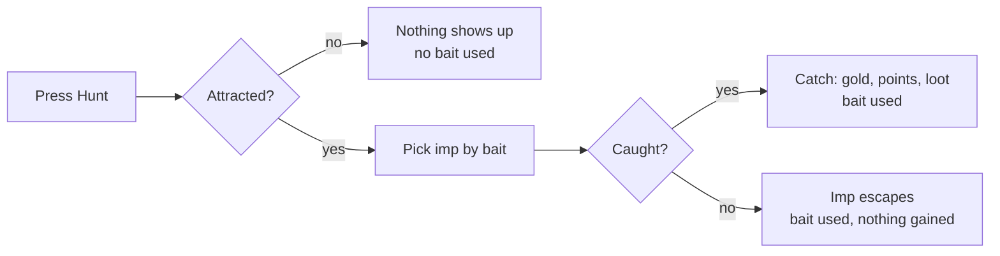

# The Naughty List: design and v1 plan

Living design document. It is updated in every pull request that changes the game, so it always matches `main`.
Original review copy: https://claude.ai/artifact/VRKBh16CBkcZuN8FiqeWn9 (this file is now the source of truth).

## Implementation status

| Milestone | Status | PR |
| --- | --- | --- |
| 1. Skeleton: server, client, Docker image, CI | Done | #1 |
| 2. Hunt engine, content files, tests, balance simulator | Done | #1 |
| 3. Playable client on the server: accounts, invites, server-side hunts, SQLite saves | Done | #2 |
| 4a. NAS deploy: compose file, Cloudflare Tunnel option, deploy guide, image smoke test | Done | #3 |
| 4b. Friends: leaderboard and catch feed | Done | #11 |
| Flavour text for every item and imp | Done | #9 (shown in the UI since #11) |
| Art for every UI slot: 97 original SVGs + manifest, named by game id | Done | #10 (shown in the UI since #11) |
| Custom PNG portraits for all 10 cookie-pantry/wrapping-room/toy-workshop/reindeer-stables imps | Done | #13 |
| Custom AI-generated PNGs for the rest of the game art (traps, bases, baits, charms, materials, trap types, brand, locations, map, how-to, remaining imps) — progress tracked in [ART_PROGRESS.md](ART_PROGRESS.md) | In progress | #14 |
| New phone-first UI (layout D2): bottom menu, hunt log with events and full history, Arsenal, Elf Emporium, Santa's Workshop, More pages, open sign-up with admin switch | Done | #11 |
| Holly power type renamed Starlight; its three traps reworked (Starlit Stocking, Star Lantern, Constellation Wreath) with new text and SVG art, old saves migrated | In review | #17 |
| Intro letter from Santa: the game's backstory as the first hunt-log entry of every new game, and on How to play | In review | #12 |
| Location objectives: a simple Cookie Pantry start, then a unique loop per location (Wrapping Room bait ladder, Toy Workshop order board, Stables sleigh run), plus first-visit intros, a hint button and a mechanic panel on each Hunt screen; see [Location objectives](#location-objectives-planned) | Planned (design only) | #16 |
| Pillage on escape: escaped imps may take gold, points and bait (bosses most, mini bosses less, others rarely), with safety rails; see [Pillage on escape](#pillage-on-escape-planned) | Planned (design only) | #18 |
| 5. Tune from play-test | Planned | |

The server runs every hunt and saves each player in SQLite. To play locally, follow "Run it locally" below.

## Summary

**The Naughty List** is an original Christmas trap-and-catch browser game for eddy and friends. Imps sent by Scrinch, ruler of the imps, are raiding Santa's secret lair at the North Pole and stealing toy supplies. Santa hires you as an imp hunter. You arm a trap, pick a bait, press Hunt, and the game rolls attraction and catch odds against the imp's power. There is no wait timer: every press is a hunt. Bait cost, not a clock, paces progress.

v1 covers 5 ranks and 4 lair locations. Each location has 3 common imps, a rare imp, a mini boss and a local boss: 24 imps in all. Bosses drop the loot used to craft stronger gear. From the second location on, each location will also have its own local objective (planned; see [Location objectives](#location-objectives-planned)). Expect roughly 1,400 hunts, or about 1 to 1.5 hours of active play, to reach the last v1 rank.

The stack is one small Docker container (Node.js + SQLite) on the UGREEN NAS, with open sign-up (the admin can close it) and a leaderboard so friends can play. The stamina meter is built but switched off.

**Decided by eddy (25 Nov 2026):** Christmas theme and the name The Naughty List; stamina off but kept as a toggle; for eddy and friends; repository cheesezilla/naughty-list; this plan lives in the repo and is updated with each PR.

## Theme and setting

Scrinch, a horned devil who rules the imps, wants Christmas cancelled. His imps sneak into Santa's secret lair under the North Pole, wreck the workshops and steal the cookies, paper, toy parts and reindeer gear that Santa needs. Santa hires you as an imp hunter. Every imp you catch goes on The Naughty List.

You start in the Cookie Pantry and work deeper into the lair as you rank up. Each location has its own imps: 3 common kinds, a rare imp, a mini boss and a local boss who is one of Scrinch's lieutenants. Bosses drop the parts Santa's elves use to craft you stronger traps.

The tone is a cheeky Christmas storybook. Every imp, place, trap, bait, rank and material name is invented for this game. Art is original vector art in one storybook style, generated by `scripts/art/` and named by game id so any picture can be regenerated or swapped; see [Art](#art).

**Intro letter.** Every new game opens with "A letter from Santa" as the first entry in the hunt log: the lair, Scrinch and his imps, and the player's job as Santa's imp hunter. It is logged when an account is created and again after Start over, shows folded after the first paragraph with "Read the whole letter", and is also at the top of How to play, so players from before it was added can read it there. The text lives in `content/story.json` (title, up to 8 paragraphs of up to 500 characters, sign-off) and can be edited without code changes.

**Beyond v1:** Scrinch himself is the final boss of a later location. His loot crafts **The Naughty List**, a giant enchanted scroll trap and one of the strongest pieces of gear in the game.

## Core loop

The player spends gold on bait and gear, hunts to earn gold, points and materials, and uses points to rank up and unlock the next location.

**Trap setup** (four slots, changeable any time):

| Slot | What it gives | Consumed? |
| --- | --- | --- |
| Trap | Power, power type, luck, attraction bonus | No |
| Base | Power, luck, attraction bonus | No |
| Bait | Attraction rate, changes which imps show up | 1 per attracted hunt |
| Charm (optional) | A bonus such as +luck or +power % | 1 per attracted hunt |

**One hunt, step by step:**

1. **Attraction roll.** If nothing is attracted, no bait is used and the journal says nothing took the bait.
2. **Imp pick.** An imp is drawn from the location's table, weighted by the bait in use.
3. **Catch roll.** Trap power and luck are compared with the imp's power.
4. **Catch:** gold, points and a chance at loot. **Escape:** nothing gained. Bait is used either way.



Each hunt is written to the hunt log, the main feedback screen, together with the player's buys, sales, crafts, gear changes and travel. See [User interface](#user-interface).

## Formulas

All constants live in `content/constants.json` and the other content files, so they can be tuned without code changes. Code: `src/engine/odds.ts` and `src/engine/hunt.ts`.

- **Power** = (trap + base + charm power) x (1 + charm power bonus). **Luck** = trap + base + charm luck.
- **Attraction** = min(95%, bait attraction x (1 + trap, base and charm attraction bonuses)). In the Reindeer Stables it is halved unless the bait is Hot Cocoa.
- **Imp pick**: chance of imp i = its weight / sum of weights for that bait. A location's 3 commons share about 91%, the rare imp 5%, the mini boss 3% and the boss 1%. Fruitcake doubles the rare, mini boss and boss weights.
- **Effectiveness** E of the trap's power type against an imp: 0 (immune), 0.5 (resists), 1 (normal) or 1.5 (weak). Types: Clockwork (toy machines), Starlight (Christmas-star magic, strong against shadowy imps; called Holly before PR #17), Frost (ice magic).
- **Catch chance** = clamp((P x E + L^2) / (P x E + M), 0, 98%), where M is the imp's power. Luck only counts when E > 0.
  - Example: a 150 power Clockwork trap on a 20 power base with luck 2, against a normal 90 power imp: (170 + 4) / (170 + 90) = 67%.
- **Rewards**: a catch pays the imp's gold and points and rolls its loot list; bosses always drop their crafting part. An escape pays nothing; some imps also steal one extra bait when they escape. Planned: escapes may pillage gold, points and bait, more for bosses; see [Pillage on escape](#pillage-on-escape-planned).
- **RNG**: the engine takes a random source, so the simulator and tests replay exactly from a seed. The server rolls every hunt with a cryptographic random source, so results can't be edited in the browser.

## Pacing without a cooldown

Bait is the clock. With no timer, progress is limited by gold: every attracted hunt burns bait, and a hunt only turns a profit when your trap suits the location.

- **Bait is a real cost.** Each location's best bait costs roughly 40 to 70% of the average gold per attracted hunt with suitable gear. Weak or wrong-type gear in a deeper location loses gold.
- **Steep rank thresholds.** Points needed grow about 4x each rank, while points per catch grow about 2x per location.
- **Bosses drive gear goals.** Mini bosses and bosses drop the parts for the next crafted item.
- **No dead ends.** With no bait and under 50 gold, Mrs. Claus hands over 10 free Stale Cookies.
- **Fair play limits.** The server accepts at most 2 hunts a second per player; the page paces rapid clicks to match.

**Optional stamina meter (built, switched off).** `constants.json` > `stamina.enabled`. When on, a Cocoa meter costs 1 per hunt, holds 100 and refills 1 per minute.

**Left out of v1:** diminishing returns per location (a hidden timer), auto-hunt and idle rewards.

## Progression

| Rank | Name | Points needed | Unlocks | Target hunts in rank |
| --- | --- | --- | --- | --- |
| 1 | Snow Scout | 0 | Cookie Pantry, starter gear | 150 |
| 2 | Elf Deputy | 2,500 | Wrapping Room (250 gold to unlock) | 250 |
| 3 | Imp Tracker | 12,000 | Toy Workshop (1,500 gold), Nutcracker Jaws trap | 400 |
| 4 | Frost Warden | 46,000 | Reindeer Stables (5,000 gold), rank 4 crafting | 600 |
| 5 | Yule Marshal | 160,000 | End of v1 | |

Ranks depend on points only. Location unlock fees are paid once; travel between unlocked locations is free.

## v1 content

The numbers below mirror `content/*.json`. Types: C = Clockwork, S = Starlight, F = Frost; unlisted types are normal (x1).

**Imps**

| Location | Imp | Tier | Power | Gold | Points | Weak (x1.5) | Resists (x0.5) / immune (x0) | Drops |
| --- | --- | --- | --- | --- | --- | --- | --- | --- |
| Cookie Pantry | Crumb Imp | Common | 40 | 12 | 20 | | | |
| Cookie Pantry | Sprinkle Snatcher | Common | 70 | 18 | 30 | C | | Candied Peel 10% |
| Cookie Pantry | Chimney Soot Imp | Common | 100 | 25 | 45 | | S | |
| Cookie Pantry | Gingerbread Imp | Rare | 160 | 60 | 100 | F | | Sugar Glass 50% |
| Cookie Pantry | Jarbelly the Glutton | Mini boss | 300 | 90 | 180 | C | S | Cookie Tin 100% |
| Cookie Pantry | Baron Crumblewick | Boss | 450 | 150 | 300 | C | S | Brass Spring 100% |
| Wrapping Room | Ribbon Tangler | Common | 150 | 40 | 60 | | | |
| Wrapping Room | Tape Biter | Common | 220 | 55 | 85 | S | | |
| Wrapping Room | Bow Burglar | Common | 280 | 70 | 100 | | C | Candied Peel 10% |
| Wrapping Room | Glitter Imp | Rare | 350 | 110 | 160 | F | | Sugar Glass 50% |
| Wrapping Room | Spoolwick | Mini boss | 600 | 160 | 300 | S | | Golden Ribbon 100% |
| Wrapping Room | Madame Shredwell | Boss | 1,100 | 300 | 550 | S | C | Enchanted Wrapping 100% |
| Toy Workshop | Cog Pincher | Common | 450 | 140 | 150 | | | |
| Toy Workshop | Paint Smudger | Common | 600 | 180 | 190 | S | | |
| Toy Workshop | Stuffing Ripper | Common | 750 | 220 | 230 | F | S | |
| Toy Workshop | Wind-up Imp | Rare | 900 | 300 | 320 | C | F immune | Sugar Glass 50% |
| Toy Workshop | Hammerhand | Mini boss | 1,600 | 400 | 650 | F | | Toymaker's Gear 100% |
| Toy Workshop | Foreman Grimbolt | Boss | 2,800 | 700 | 1,300 | C | | Clockwork Heart 100% |
| Reindeer Stables | Hay Hoarder | Common | 1,000 | 300 | 350 | | | |
| Reindeer Stables | Bell Thief | Common | 1,300 | 380 | 420 | | S | |
| Reindeer Stables | Harness Snipper | Common | 1,600 | 450 | 480 | C | F immune | |
| Reindeer Stables | Carrot Crook | Rare | 2,000 | 600 | 650 | C | F | Sugar Glass 50% |
| Reindeer Stables | Antler Ripper | Mini boss | 3,500 | 800 | 1,200 | C | S | Silver Sleighbell 100% |
| Reindeer Stables | Grizzlewick the Horned | Boss | 6,000 | 1,500 | 3,000 | C | S immune | Brimstone Coal 100% |

Jarbelly, Bow Burglar and Bell Thief steal an extra bait when they escape. Brimstone Coal has no use in v1; it is saved for later recipes, including The Naughty List.

**Traps**

| Trap | Type | Power | Luck | Attraction | Rank | Price |
| --- | --- | --- | --- | --- | --- | --- |
| Starlit Stocking | S | 60 | 0 | | 1 | Starter |
| Jack-in-the-Box | C | 150 | 1 | | 1 | 300 gold |
| Star Lantern | S | 300 | 2 | | 2 | 1,200 gold |
| Icicle Jar | F | 500 | 2 | +5% | 2 | 3,000 gold |
| Nutcracker Jaws | C | 900 | 3 | | 3 | 9,000 gold |
| Constellation Wreath | S | 1,400 | 5 | +5% | 3 | Crafted |
| Snow Globe Prison | F | 1,800 | 4 | | 4 | 25,000 gold |
| Sleigh-Bell Snapper | C | 2,600 | 6 | +5% | 4 | Crafted (v1 capstone) |

**Bases**

| Base | Power | Luck | Attraction | Rank | Price |
| --- | --- | --- | --- | --- | --- |
| Cardboard Box | 20 | 0 | | 1 | Starter |
| Gingerbread Slab | 80 | 1 | | 1 | 500 gold |
| Candy Cane Platform | 200 | 1 | +5% | 2 | 2,500 gold |
| Ice Block | 400 | 3 | | 3 | 8,000 gold |
| Yule Log Base | 600 | 5 | +10% | 3 | Crafted |

**Baits**

| Bait | Attraction | Effect | Rank | Price |
| --- | --- | --- | --- | --- |
| Stale Cookie | 70% | Works everywhere | 1 | 8 gold |
| Sugar Cookie | 78% | Draws more Chimney Soot Imps in the Pantry | 1 | 20 gold |
| Peppermint Bark | 82% | | 3 | 50 gold |
| Fruitcake | 85% | Doubles rare imp, mini boss and boss odds | 2 | Crafted |
| Hot Cocoa | 88% | Stable imps show up at half rate with any other bait | 4 | 90 gold |

**Charms** (one used per attracted hunt)

| Charm | Effect | Rank | Price |
| --- | --- | --- | --- |
| Mistletoe Charm | +4 luck | 1 | 30 gold |
| Jingle Bell Charm | +15% attraction | 2 | 25 gold |
| Wind-up Key Charm | +20% power | 3 | 60 gold |

## Location objectives (planned)

**Rules (eddy, 25 and 26 Nov 2026):** the first location, the Cookie Pantry, is a simple start with no special objective. From the second location on, every location has its own local objective, a loop that only exists there, and the tiered bait ladder starts in the second location. Nothing in this section is built yet, and eddy wants the UI planned before anything is built. The numbers are a first pass to check with the simulator when each loop is implemented. Every loop counts hunts and catches, never minutes, so it works with no wait timer and behaves the same with the stamina meter on or off (stamina only changes how fast a player can press Hunt in real time).

| Location | Rank | Local objective | Boss comes when |
| --- | --- | --- | --- |
| Cookie Pantry | 1 | None: hunt for gold, buy better gear and bait, rank up | No boss here |
| Wrapping Room | 2 | Bait ladder: three bait tiers, each crafted from the last tier's drops | Tier 3 bait is armed |
| Toy Workshop | 3 | Order board: catch with the trap type each order asks for | A Rush order is finished |
| Reindeer Stables | 4 | Sleigh run: 40 hunts to make the sleigh ready | The sleigh launches |

The Tangle Meter, first planned for the Wrapping Room, is kept as a spare loop for a later location.

**What the engine already does (checked on `main`):**

| Piece | Status | Where |
| --- | --- | --- |
| Per-imp loot list with a chance and amount; loot can name any item, including a bait | Built | `imps[].loot`, `src/engine/hunt.ts` |
| Bait changes which imps show up: `baitWeights` overrides an imp's weight for one bait, and a weight of 0 is allowed, so an imp can be locked behind a bait | Built, only used for Sugar Cookie → Chimney Soot Imp | `imps[].baitWeights`, `impWeights()` in `src/engine/odds.ts` |
| Bait that raises rare, mini boss and boss odds | Built (Fruitcake, x2) | `baits[].rareMultiplier` |
| Location that prefers one bait | Built (Reindeer Stables halves attraction without Hot Cocoa) | `preferredBait`, `otherBaitPenalty` |
| Crafting a bait from drops | Built, one recipe (Fruitcake from Candied Peel and Cookie Tin) | `content/recipes.json` |
| A chain of bait tiers where each tier's imps drop the next tier's ingredients and only the top tier draws the boss | Not built | |
| Any per-player, per-location progress (meters, orders, countdowns) | Not built: the save has no place for it | `src/engine/player.ts` |
| A location panel on the Hunt screen showing that progress | Not built | |

So the bait ladder is mostly content (new materials, baits, recipes and `baitWeights`); the order board and sleigh run need a small objective system in the engine.

**Shared engine design (for when it's built).** Each location in `content/locations.json` gets an optional `objective` block with a `type` (`bait_ladder`, `order_board`, `sleigh_run`, and later `tangle_meter`) and its numbers. The save gets `objectives: { [locationId]: state }`, so old saves load with empty state. The hunt runs two hooks: one that adjusts imp weights and power before the imp is picked, and one that updates the state after the catch or escape. Objective changes go into the hunt's journal entry (for example "Readiness 58 → 62"), and the Hunt screen shows a small panel for the current location under the banner. Gear swaps stay free, as now. The simulator gets a strategy per objective so balance can be checked.

### Cookie Pantry: a simple start (no local objective)

The first location teaches the basic loop and nothing else: catch imps, earn gold, buy a better trap, base and bait in the Elf Emporium, rank up and unlock the Wrapping Room. It has common, uncommon and rare imps and no mini boss or boss.

| Imp | Tier (proposed) | Power | Weight (Stale Cookie) | Weight (Sugar Cookie) | Drops (proposed) |
| --- | --- | --- | --- | --- | --- |
| `crumb_imp` | Common | 40 | 40 | 40 | |
| `sprinkle_snatcher` | Common | 70 | 30 | 30 | Candied Peel 10% (as now) |
| `chimney_soot_imp` | Uncommon (was common) | 100 | 15 | 22 | |
| `jarbelly` | Uncommon (was mini boss) | 180 (was 300) | 10 | 10 | Cookie Tin 30% (was 100%); still steals a bait on escape |
| `gingerbread_imp` | Rare | 160 | 5 | 8 | Sugar Glass 50% (as now), Brass Spring 15% (new) |

- **New tier, uncommon.** The engine, the content schema, the hunt log and the Naughty List gain an `uncommon` tier between common and rare, with its own portrait frame. Fruitcake doubles every tier above common.
- **Baron Crumblewick leaves the Pantry** and is parked for a later location or event; his art and text stay. His Brass Spring now comes from the Gingerbread Imp, so Constellation Wreath can still be crafted.
- **Sugar Cookie** is the "better bait" step: more uncommon and rare imps for 20 gold instead of 8.
- No panel on the Hunt screen. The hint and first-visit intro still apply.
- Gold and points are unchanged, so the rank 1 pace should hold; the simulator checks it when this is built.

### Wrapping Room: the Bait Ladder (bait tiers)

eddy's loop, starting in the second location: common bait catches common imps, who drop tier 2 ingredients; tier 2 bait draws new imps, who drop tier 3 ingredients; tier 3 bait draws the boss, who drops trap parts and a little general help. It reuses the Wrapping Room's existing drops where it can.

| Tier | Bait (how you get it) | Imps it draws (weight) | What they drop toward the next tier |
| --- | --- | --- | --- |
| 1 | Any shop bait (Stale Cookie, Sugar Cookie, later Peppermint Bark) | `ribbon_tangler` 36, `tape_biter` 30, `bow_burglar` 25. `glitter_imp`, `spoolwick` and `madame_shredwell` 0 | `ribbon_tangler`: Sugar Twist 25%. `tape_biter`: Sugar Twist 20%. `bow_burglar`: Candied Peel 30% (was 10%). Any common: 2% for 1 Ribbon Candy outright |
| 2 | **Ribbon Candy** (new bait, 82% attraction, not sold). Recipe: 2 Sugar Twist + 1 Candied Peel + 30 gold → 3 Ribbon Candy | commons 50 in total, `glitter_imp` 30, `spoolwick` 20, `madame_shredwell` 0 | `glitter_imp`: Sugar Glass 50% (as now). `spoolwick`: Golden Ribbon 100% (as now) |
| 3 | **Golden Bow Bonbon** (new bait, 86% attraction, not sold). Recipe: 1 Sugar Glass + 1 Golden Ribbon + 100 gold → 2 Bonbons | commons 30, `glitter_imp` 10, `spoolwick` 10, `madame_shredwell` 50 | `madame_shredwell`: Enchanted Wrapping 100% (trap part for Constellation Wreath, as now) and 25% for 5 Jingle Bell Charms |

- New ids (proposed): material `sugar_twist`; baits `ribbon_candy`, `golden_bow_bonbon`; recipes `ribbon_candy_x3`, `golden_bow_bonbon_x2`.
- Fruitcake uses the tier 1 weights here, so it can't skip the ladder (2 x 0 is still 0).
- Candied Peel and Golden Ribbon are also used by Fruitcake and the Yule Log Base, so players choose between bait and gear.
- Rough pace with the meant-for gear: about 20 attracted hunts per 3 Ribbon Candy and about 11 Ribbon Candy per 2 Bonbons, so about one boss attempt every 60 hunts. To be checked with the simulator.
- Panel: three bait tiers with what you own of each, and the next recipe's have / need.

### Toy Workshop: the Order Board (trap-type puzzle)

The elves pin toy orders to a board. Each order lists parts that must be caught with a given trap type, in order. It makes the player own and swap traps of all three types, which is the known gap from the simulator (nobody bought Snow Globe Prison or Constellation Wreath).

- **Order:** 3 slots, each a trap type (Clockwork, Starlight or Frost), rolled by the server when the last order finishes. A catch with the trap type of the next slot fills it. Catches with another type don't count; escapes don't undo filled slots.
- The puzzle is matching type to imp: the Stuffing Ripper resists Starlight, the Wind-up Imp is immune to Frost, so a Frost slot is best filled on Paint Smudgers, Cog Pinchers or Stuffing Rippers.
- **Order done:** a Toy Crate: 400 gold and one of Peppermint Bark x5, Wind-up Key Charm x3 or Sugar Glass x1.
- **Inspection:** every 3rd finished order, the next attracted hunt is Hammerhand (mini boss; weight 0 otherwise). He drops Toymaker's Gear as now.
- **Rush order:** after an Inspection, the player can take a 5-slot Rush order instead of a normal one. Finishing it makes the next attracted hunt Foreman Grimbolt (boss; weight 0 otherwise), who drops Clockwork Heart as now.
- Panel: the order slots as type badges, filled or empty, and orders until the next Inspection.

### Reindeer Stables: the Sleigh Run (countdown in hunts)

Get the sleigh ready before the countdown runs out, while thieves undo your work. The countdown is a number of hunts, not a clock.

- **Start a run** from the panel (free). The run lasts 40 hunts; every hunt counts, including quiet ones, so Hot Cocoa's better attraction matters more here.
- **Readiness** 0 to 100: a common catch adds 4, the rare adds 10, Antler Ripper adds 20. A Bell Thief escape takes 8 (it runs off with the bells); a Harness Snipper escape takes 5.
- Antler Ripper's weight is 0 below 50 Readiness and 6 from 50 up.
- **Launch:** reaching 100 before the countdown ends launches the sleigh: 2,000 gold and 1 Silver Sleighbell, and Grizzlewick ambushes it, so the next attracted hunt is him (weight 0 otherwise). He drops Brimstone Coal as now.
- **Run fails** when the countdown ends below 100: the player gets Readiness x 10 gold and can start another run straight away.
- Outside a run the Stables hunt as now, without the mini boss and boss.
- Panel: Readiness bar, hunts left, and a Start run button when no run is active.

### Spare loop for a later location: the Tangle Meter (push your luck)

Parked on 26 Nov 2026, when the Cookie Pantry became a simple start and the bait ladder moved to the Wrapping Room. It is still written with the Wrapping Room's imps, as a ready design to re-skin for a later location and its own imps and boss.

The room gets messier the longer you hunt, and a messy room pays better but is harder. The player chooses when to tidy up.

- **Tangle** runs 0 to 100 and starts at 0. Each attracted hunt adds 5; an escape adds 5 more; catching a Ribbon Tangler adds 10.
- **Tidying:** catching a Tape Biter cuts 15 (it chews through the knots; it is weak to Starlight). New charm **Sharp Shears** (`sharp_shears_charm`, shop, 35 gold, rank 2) cuts 25 on each attracted hunt it is used. Catching Madame Shredwell resets Tangle to 0.

| Band | Tangle | Imp power | Gold and points | Rare and mini boss weight | Madame Shredwell |
| --- | --- | --- | --- | --- | --- |
| Tidy | 0–39 | x1 | x1 | x1 | weight 0 |
| Messy | 40–79 | x1.15 | x1.25 | x2 | weight 0 |
| Knotted | 80–100 | x1.3 | x1.5 | x2 | weight 6 |

- The choice: stay tidy for safe catches, or let it knot up for richer hunts and a chance at the boss, then cut back down with Starlight or Shears.
- Spoolwick (mini boss) drops Golden Ribbon as now; Madame Shredwell drops Enchanted Wrapping as now.
- Panel: Tangle bar with the band name and what the band does.

### Location screens (UI plan)

eddy (25 Nov 2026): each location's Hunt screen should feel different. Three additions, all in the phone-first layout D2. **Status: planning; nothing is built until eddy signs off the UI.**

**1. First-visit intro in the hunt log.** The first time a player arrives in a location, the hunt log gets an "Arrived: <location>" entry with a short intro to the area: what the room is, which imps raid it and what's different here. It shows folded after the first sentence, like Santa's letter. The Cookie Pantry intro is logged right after Santa's letter when a game starts (sign-up and Start over); the others are logged the first time the player travels there. It is a new journal event, `arrival`, logged once per location, tracked by a `visited` list in the save (old saves count their current location as visited, so they get intros only for new places). The Full history "Events" filter includes it.

**2. Hint button.** A round "?" button on the location banner, next to Travel, opens a bottom sheet "How to clear <location>" with 2 to 4 short steps, the location's intro again (for players who skipped it) and a Close button. The hint never shows exact odds.

**3. Mechanic panel.** From the second location on, a card between the gear stats and the hunt log, styled per location (its own colour and icon), showing the local objective's state. Tapping it opens the same sheet as the hint button. It updates after every hunt, and a hunt that changes the objective gets a one-line note in its log entry (for example "Readiness 58 → 62").

Text lives in a new `locations` block in `content/story.json`, keyed by location id: `intro` (up to 400 characters) and `hint` (up to 4 steps of up to 120 characters). Loading fails if a location has no intro or hint, like `flavour.json`. First drafts:

| Location | Intro (first visit) | Hint steps |
| --- | --- | --- |
| Cookie Pantry | Santa's pantry: jars to the ceiling and crumbs on every shelf. Small-time imps raid it all night. Catch them, earn your pay, and kit yourself out before heading deeper into the lair. | 1. Hunt here to earn gold and points. 2. Buy a better trap and base in the Elf Emporium as soon as you can afford them. 3. Sugar Cookies draw more uncommon and rare imps. 4. Reach Elf Deputy to unlock the Wrapping Room. |
| Wrapping Room | Miles of ribbon and paper. The common imps here grab anything, but the Glitter Imp and Spoolwick only come for proper sweets, and Madame Shredwell only for the finest. Bake your way up. | 1. Catch commons with shop bait to collect Sugar Twists and Candied Peel. 2. Make Ribbon Candy in Santa's Workshop. 3. Ribbon Candy draws the Glitter Imp and Spoolwick: their drops make Golden Bow Bonbons. 4. Bonbons are the only bait Madame Shredwell will take. |
| Toy Workshop | The elves pin toy orders to the board, and each part must be caught with the right kind of trap. Finish enough orders and the bosses come to inspect. | 1. Check the order board: each slot needs a catch with that trap type, in order. 2. Swap traps to match, and pick imps that aren't immune. 3. Every 3rd order brings Hammerhand; then take a Rush order to bring Foreman Grimbolt. |
| Reindeer Stables | The sleigh must be ready by Christmas Eve, and the stable imps keep pinching the bells and snipping the harness. Load it in time and Grizzlewick will try to stop the launch. | 1. Start a sleigh run: you have 40 hunts. 2. Catches build Readiness; escaped Bell Thieves and Harness Snippers take it away. 3. Hot Cocoa keeps imps coming, so fewer hunts are wasted. 4. Reach 100 to launch and face Grizzlewick. |

**Hunt screen with the new parts (all locations):**

```
┌──────────────────────────────────┐
│ [banner art]          [?] [Travel]│  ← "?" opens the hint sheet
│ rank · name · points · gold       │
├──────────────────────────────────┤
│   trap on base     [bait] [charm] │
│   Power 230 · Luck 3 · Attr 78%   │
├──────────────────────────────────┤
│ ┌ MECHANIC PANEL (per location) ┐ │  ← tap = hint sheet
│ └────────────────────────────────┘ │
├──────────────────────────────────┤
│ Hunt log …                        │
│  ★ Arrived: Wrapping Room  (more) │  ← first-visit intro entry
├──────────────────────────────────┤
│           [   HUNT   ]            │
└──────────────────────────────────┘
```

**Mechanic panels, one per location:**

Cookie Pantry: no panel. The gear card is followed straight by the hunt log.

Wrapping Room, ribbon red with a candy icon. Three tier steps; the armed tier is highlighted, and the next recipe shows have / need. A "Make" link goes to that recipe in the Workshop.
```
┌ Bait Ladder ───────────────────────┐
│ ① Shop bait ▸ ② Ribbon Candy ▸ ③ Bonbon
│   owned 84       owned 2     owned 0│
│ Next: Golden Bow Bonbon            │
│ Sugar Glass 1/1 ✓ Golden Ribbon 0/1 ✗
│ Madame Shredwell: Bonbons only [Make]
└────────────────────────────────────┘
```

Toy Workshop, workshop green. Order slots as trap-type badges in a row; the next slot glows, filled slots are ticked. Shows the armed trap's type and whether it matches.
```
┌ Order Board ─────── Order 2 of 3 ──┐
│ [⚙ ✓] [🌿 ▸] [❄  ]                 │
│ Next: Starlight · your trap: Clockwork ✗│
│ Inspection after this order        │
└────────────────────────────────────┘
```

Reindeer Stables, frosty blue. Before a run: a "Start sleigh run" button. During a run: a Readiness bar and hunts left, with a small sleigh moving along the bar.
```
┌ Sleigh Run ──────── 23 hunts left ─┐
│ Readiness [■■■■■■■■■■■■░░░░] 62/100 │
│ Antler Ripper is about (50+)       │
│ Last: Bell Thief escaped −8        │
└────────────────────────────────────┘
```

The Cookie Pantry, and any future location without a local objective, shows no panel; the hint and intro are still required.

**Visual mockups** of these screens are on the UI canvas (https://claude.ai/artifact/7A6Y6w37aCDXneVGDSDCDs), in the row "Location screens".

### Build order

Nothing is built until eddy has signed off the UI above.

1. Location intros, hint button and the empty panel slot (shared by all locations).
2. Cookie Pantry simple start: the uncommon tier and the new imp table.
3. Objective system in the engine and save, and the Wrapping Room bait ladder (content plus `baitWeights`).
4. Toy Workshop order board.
5. Reindeer Stables sleigh run.

Each step re-runs `npm run simulate` and updates the balance numbers in this file.

## Pillage on escape (planned)

**Rule (eddy, 26 Nov 2026):** an imp that escapes may pillage the player, taking gold, points and/or bait. Bosses pillage more than mini bosses, and regular imps only rarely. This is a plan only; nothing is built until eddy says so.

**When it happens.** Only after an escape: an imp was attracted, the bait was used, and the catch roll failed. Quiet hunts and catches never pillage. The server rolls a pillage chance for the imp's tier; on a hit it rolls what is taken. Like everything else it counts hunts, not time, so it works the same with the stamina meter on or off.

| Tier | Chance on escape | What it takes |
| --- | --- | --- |
| Common | 3% | One of: 1 of the armed bait, or gold equal to the imp's gold reward |
| Uncommon | 5% | One of: 1 to 2 of the armed bait, or gold equal to 1.5 x the imp's gold reward |
| Rare | 8% | One of: 1 to 2 of the armed bait, or gold equal to 2 x the imp's gold reward |
| Mini boss | 35% | Two of: 5% of your gold (at most 10 x its gold reward), 2 to 3 of the armed bait, 1% of your points (at most 2 x its points reward) |
| Boss | 60% | All three: 8% of your gold (at most 15 x its gold reward), 3 to 5 of the armed bait, 2% of your points (at most 3 x its points reward) |

Example: Madame Shredwell (gold 300, points 550) escapes from a player with 6,000 gold, 20 Golden Bow Bonbons and 9,000 points. If she pillages: −480 gold (8%, under the 4,500 cap), −4 Bonbons, −180 points (2%, under the 1,650 cap).

**Bait thieves.** The old rule "some imps steal one extra bait when they escape" becomes part of pillage: Jarbelly, Bow Burglar and Bell Thief keep a guaranteed 1-bait pillage on every escape (`pillage: { chance: 1, bait: [1, 1] }` on the imp), shown and logged the same way as any other pillage. They roll their tier's normal pillage as well.

**Safety rails** (so it stings but never dead-ends a player):
- Gold never drops below 100 from a pillage.
- Points never drop below the current rank's threshold, so a pillage can't take a rank away. Rank 1 players lose no points.
- Only the armed bait is taken, never more than is owned. Charms, gear and materials are never taken.
- Mrs. Claus's free Stale Cookies (no bait and under 50 gold) are unchanged and still catch anyone who runs dry.
- With the gold floor at 100, a player can always buy bait again (Stale Cookie is 8 gold).

**Content.** A `pillage` block in `content/constants.json` holds the table above per tier (chance, gold %, gold cap multiplier, bait range, points %, points cap multiplier, how many kinds are taken). An imp can override it with its own `pillage` field. `stealsBait` is replaced by that override. All numbers are a first pass; the simulator will report gold, points and bait lost to pillage per location, and the rates get tuned so the bait-cost targets in Economy still hold.

**Hunt log.** An escape that pillages gets a red border, a "Pillaged" pill and the losses on one line:
- Common: "Bow Burglar escaped and pillaged you: −1 Sugar Cookie."
- Boss: "Madame Shredwell escaped and pillaged you: −480 gold, −4 Golden Bow Bonbons, −180 points."
- When a safety rail stops a loss, the line says so: "… −0 points (your rank is safe)."
The Full history gets a **Pillaged** filter. The Hunters catch feed adds boss pillages ("Madame Shredwell pillaged eddy") next to boss catches.

**On screen.**
- The gold and points in the player bar flash red and count down when a pillage lands, and the Hunt button shakes once.
- Imp files show a "Pillage risk" line: Rare, Sometimes, Often or Very often by tier, with "always steals a bait" for the three thieves. Uncaught imps hint at it in their rumour.
- The catch chance under the gear stays as it is; tapping it opens the odds for the location, which gains a "Pillage if it escapes" column.
- How to play gains a short "Pillage" section.

**Fits with the location objectives.** Pillaged bait counts against the bait ladder (losing crafted Ribbon Candy or Bonbons hurts, which makes a stronger trap worth it before trying for Madame Shredwell). In the Sleigh Run, Bell Thief and Harness Snipper escapes still take Readiness as planned, separately from pillage.

## Flavour text

Every trap, base, bait, charm, material and imp has text for its detail screen, in `content/flavour.json`, keyed by id. At load the text is copied onto each entry as a `flavour` field, so `GET /api/content` already returns it. The slots and limits come from the phone-first UI layout (option D):

| Field | Who has it | Limit | Shown |
| --- | --- | --- | --- |
| `tagline` | Items and imps | 60 characters | Under the name on cards and detail screens |
| `description` | Items and imps | 160 characters, 1 to 2 sentences | Detail screens and Elf Emporium (shop) cards; says what the thing does |
| `backstory` | Items and imps | 400 characters, 3 to 4 sentences | Detail screens; for imps, only after the first catch |
| `rumour` | Imps only | 100 characters | Before the first catch, in place of the portrait text |

Imp descriptions and rumours hint at each imp's weaknesses and resistances, so players can work out the right trap type from the text. Loading fails if any item or imp has no text, if text names an unknown id, or if a field is over its limit. The text is a first pass; edit `flavour.json` freely, no numbers live there.

## Economy

Gold comes in only from catches and sales, and goes out on bait, charms, gear, location unlocks and crafting fees.

- **Sources:** 300 starting gold and 100 Stale Cookies; imp gold on each catch; selling materials (5 to 200 gold each) and gear (40% of its price).
- **Sinks:** bait and charms every attracted hunt; gear; one-time unlock fees; crafting fees.

**Santa's Workshop recipes**

| Item | Ingredients | Gold fee | Rank |
| --- | --- | --- | --- |
| Mistletoe Charm x10 | 1 Sugar Glass | 150 | 1 |
| Fruitcake x5 | 3 Candied Peel, 1 Cookie Tin | 100 | 2 |
| Constellation Wreath (trap) | 3 Enchanted Wrapping, 2 Brass Spring | 6,000 | 3 |
| Yule Log Base | 3 Toymaker's Gear, 1 Golden Ribbon, 2 Sugar Glass | 4,000 | 3 |
| Sleigh-Bell Snapper (trap) | 3 Silver Sleighbell, 1 Clockwork Heart, 1 Nutcracker Jaws (used up) | 15,000 | 4 |

**Balance targets per location**

| Location | Meant-for gear | Bait cost / gold per attracted hunt | Catch rate (commons) |
| --- | --- | --- | --- |
| Cookie Pantry | Jack-in-the-Box + Gingerbread Slab | about 60% | 60 to 70% |
| Wrapping Room | Star Lantern or Icicle Jar + Candy Cane Platform | about 50% | 55 to 65% |
| Toy Workshop | Nutcracker Jaws + Ice Block | about 45% | 55 to 65% |
| Reindeer Stables | Nutcracker Jaws or Snow Globe Prison + Yule Log Base | about 45% | 45 to 55% |

**How we check it:** `npm run simulate` plays virtual hunters through v1 with the real engine and content, reports hunts per rank, catch rates and bait cost per location, and with `--strict` fails if a rank target is missed by more than 25%.

**Latest simulator run (PR #1, 100 players):** all reached rank 5, median 1,358 hunts. Median hunts in ranks 1 to 4: 177, 285, 401, 493 (targets 150, 250, 400, 600, all within 25%). Catch per attracted hunt: 64%, 58%, 56%, 58% by location. Known gaps: simulated players never bought Constellation Wreath or Snow Globe Prison and mostly used Stale Cookies, so the better baits and those traps need a stronger reason to use them.

## Art

Every picture has a fixed name, `src/client/public/art/<slot>/<id>.<ext>`, where the id is the game-data id (`traps/jack_in_the_box.svg`, `imps/crumb_imp.svg`, `locations/cookie_pantry.svg`). `art/manifest.json` lists each one with its size, a description and a prompt for regenerating it with an image tool. Full rules, sizes and how to swap in a PNG: [docs/ART.md](ART.md).

| Slot | Count | Size (px) | Notes |
| --- | --- | --- | --- |
| `brand` | 2 | icon 1024², key art 1170×1290 | Game icon, login key art |
| `traps`, `bases` | 8, 5 | 600×450, transparent | Same canvas; the trap stands on the base's top line (y = 340), so the two layer |
| `baits`, `charms`, `materials` | 5, 3, 10 | 512², transparent | Thumbnails |
| `trap_types` | 3 | 256² | Clockwork, Starlight, Frost badges |
| `locations` | 4 | 1170×470 | Hunt banners; centre floor left clear for the trap |
| `map` | 1 | 1600×900 | Travel map; manifest has pin positions per location |
| `imps` | 24 + `_locked` | 512² | Portrait cards; frame shows tier; `_locked` is the "?" card |
| `ranks` | 5 | 256², transparent | `rank_1` … `rank_5` |
| `icons` | 19 | 24², `currentColor` | Bottom nav, More menu, stat labels |
| `howto` | 7 | 640×360 | One diagram per How-to-play section |

`npm run art` regenerates the SVGs and the manifest. It never overwrites a custom file (a PNG/WebP/JPG with the same name, or an SVG without the generator's marker comment). `npm test` fails if any item, imp, location or rank has no picture. The client loads `/art/manifest.json` at start and looks every picture up by slot and id, so a PNG that replaces an SVG shows up after `npm run art` and a rebuild, with no code change.

## User interface

Phone first (layout D2, chosen by eddy on 25 Nov 2026; mockups: https://claude.ai/artifact/7A6Y6w37aCDXneVGDSDCDs). On a computer the same layout is centred in a phone-width column. Fonts are Lilita One (titles) and Nunito (text), bundled with the page.

**Frame.** Every main screen has a slim title strip (game icon and name), then a player bar (rank badge, username, rank and points, gold) and a rank progress bar. A bottom menu with icon and text: **Hunt**, **Naughty List**, **Emporium**, **Workshop**, **More**. Pages have their own address (`#/emporium/bait`), so the phone's back button works.

| Screen | What it shows |
| --- | --- |
| Hunt | Location banner with the player bar on top and a Travel button. Trap drawn standing on its base (tap for the Arsenal), bait and charm thumbnails (tap for the quick sheet). Power, luck, attraction and catch chance under the gear. The hunt log, then a sticky Hunt button. Space bar hunts on a computer |
| Hunt log | Starts with Santa's intro letter. Then the last 50 hunts plus the events between them: buy, sell, craft, gear change (equip or swap), travel and unlock, and rank-ups. Hunts show their number and time, events their time, in the viewer's own time zone. Uncaught imps show the "?" card; a first catch is marked "Portrait unlocked". Tapping an imp opens its file |
| Full history | Every saved row, newest first, grouped by day, with filters All, Catches, Escapes, Events, Bosses, and Load older |
| Quick bait and charm sheet | Owned bait or charms as picture cards, a preview of catch chance and attraction before and after, Use. Crafted bait asks once more if the setting is on |
| Arsenal | Full screen with Trap, Base, Bait, Charm tabs. Tap an item to preview the setup and power, luck, attraction and catch before → after, then Equip. Unowned shop items are listed with their price |
| Item details | Picture, stats, how you get it, tagline, description and backstory from `flavour.json`, Compare and Equip |
| Naughty List | Portrait grid per location with caught counts. Uncaught imps show "?" and "seen N times, never caught" |
| Imp file | Caught: portrait, power, gold, points, catches, weaknesses, drops, first-catch time, tagline, description, backstory. Not caught: "?", only the rumour and "File sealed" |
| Elf Emporium | Traps, Bases, Bait, Charms, Sell tabs. Cards with thumbnail, stats, description, price and amount owned. Bait and charms have an amount picker and "Buy for N"; gear is bought once. Next-rank items are greyed with the rank that unlocks them |
| Santa's Workshop | Type filters with counts and "Only show what I can craft now". Each recipe: result, amount, owned, rank needed, ingredient thumbnails with have / need (green or red), gold fee, and a button that says what is missing or "Craft ×N" |
| More | Travel map (lair map with pins, unlock and go), Hunters (leaderboard by points or Naughty List size, and a feed of rare and boss catches and rank-ups; imps the viewer hasn't caught stay "?"), My stats, How to play (one picture per topic), Settings, Admin (admin only), Account, Log out |
| Settings | Kept on the device: sound effects (synthesised, no sound files), vibrate on a catch, ask before using rare bait, 24-hour clock, Space bar hunts. Shows whether the Cocoa meter is on |
| Admin | Players with rank, hunts, points and last active; **Allow new accounts** switch; Cocoa meter (shown, kept off: it is set in `constants.json`); restart log |
| Account | Change password, Start over (with the confirmation dialog), Log out |
| Login | Full-bleed key art, large game icon and title, a form card. "Create account" asks for a username and the password twice. The first account on a new server becomes the admin |

## Tech stack and architecture

| Part | Choice |
| --- | --- |
| Language | TypeScript everywhere; the engine is shared by server, client, tests and simulator |
| Server | Node.js 22 + Fastify, serving the API and the built page |
| Database | SQLite (Node's built-in `node:sqlite`) in the mounted `/data` folder |
| Web client | Vite + Preact, plain CSS, phone first (about 24 KB of script and 10 KB of CSS gzipped, plus the bundled fonts and the SVG art) |
| Game content | JSON in `content/` (numbers in the per-kind files, player-facing text in `flavour.json` and `story.json`), validated against a schema and cross-checked at startup |
| Accounts | First account is the admin; anyone with the address can create an account while the admin's **Allow new accounts** switch is on; username + password and a session cookie |
| Tests | Vitest for engine and server; the simulator for balance |

**API:**

| Call | What it does |
| --- | --- |
| `GET /api/health`, `GET /api/content`, `GET /api/setup-status` | Public: health, game content, whether the admin account exists yet and whether sign-up is open |
| `POST /api/auth/signup` | Create an account. The very first account becomes the admin; later ones are refused while the admin has closed sign-up |
| `POST /api/auth/login`, `POST /api/auth/logout` | Session cookie, 30 days, token stored hashed |
| `GET /api/me` | User, player state and the hunt log: the last 50 hunts plus the events between them |
| `GET /api/history?filter=&before=&limit=` | One page (up to 200 rows) of the full history, newest first; filter `all`, `catches`, `escapes`, `events` or `bosses`; `before` is a row id |
| `GET /api/stats` | Join date, rank-up times and first-catch times still in the log |
| `GET /api/hunters` | Leaderboard (username, rank, points, Naughty List size) and the latest 20 rare or boss catches and rank-ups from everyone |
| `POST /api/account/password` | Change password; needs the current one |
| `POST /api/hunt` | One hunt, rolled on the server; limited to `maxHuntsPerSecond` (2) per player |
| `POST /api/setup`, `/api/buy`, `/api/sell`, `/api/craft`, `/api/travel` | Engine actions on the saved player; each also writes an event to the hunt log and returns it |
| `POST /api/restart` with `{"confirm": true}` | Start over: wipes this player's progress and journal, keeps the account, logs the restart |
| `GET /api/restarts` | This player's own restart log |
| `GET /api/admin/players` | Admin only: every player with rank, points, hunts and last active time |
| `GET/POST /api/admin/settings` | Admin only: read or set `allowSignups` |
| `GET /api/admin/restarts` | Admin only: every player's restart log |

**Storage:** one SQLite file, `naughty-list.db`, in `DATA_DIR` (`/data` in Docker, `./data` locally), using Node's built-in `node:sqlite` so there are no native modules to compile. Tables: users, sessions, settings (`allowSignups`), players (state as JSON), journal (the hunt log: hunts and events, marked by a `kind` column, up to 10,000 rows per player, pruned every 100 hunts), restarts (one row per Start over, with the player's gold, points, rank, hunts, catches and Naughty List count at that moment; never deleted). Passwords are hashed with scrypt. The old invites table is left in place, unused, so saves from earlier versions open unchanged; the server adds the journal's `kind` column to old saves on start.

**Data stored per player:** gold, points, rank, current location, unlocked locations, setup, inventory counts, the hunt log, lifetime catch counts per imp (the Naughty List), lifetime encounters per imp (`seen`, for "seen, never caught") and gold earned from catches. `seen` and gold earned start counting from this version for older saves.

**Start over:** any player can wipe their own run from **More > Account > Start over**. A confirmation dialog lists what will be lost, and nothing is wiped unless the player confirms; the server also refuses a restart without an explicit confirm flag. The wipe replaces that player's state with a fresh one and deletes their journal in one transaction. Their account, other players and the restart log are untouched. The admin sees every restart on the Admin page.

**Playing with friends:** eddy is the admin and shares the game address privately. Anyone with it can create an account while **Allow new accounts** is on (More > Admin); eddy turns it off once everyone has joined. The Hunters page ranks players by points or Naughty List size and shows a feed of rare and boss catches and rank-ups. No trading in v1.

## Run it locally

Needs Node.js 22 or newer and git.

```sh
git clone https://github.com/cheesezilla/naughty-list
cd naughty-list
npm install
npm run play        # builds, then serves on http://localhost:8080
```

The first account you create is the admin. Friends create their own accounts from the login screen; close sign-up under More > Admin. Saves go to `./data/naughty-list.db`; deleting that file resets the whole server. For development with hot reload, use `npm run dev` and open http://localhost:5173.

## Deployment

The game ships as one Docker image (`ghcr.io/cheesezilla/naughty-list`), built and published by GitHub Actions on each push to `main`. The UGREEN DXP4800 has an Intel x86 processor, so the amd64 image works.

Step-by-step guide: [docs/DEPLOY.md](DEPLOY.md). In short:

1. Make the GitHub package public once, or log the NAS in to ghcr.io with a `read:packages` token.
2. In the UGOS Docker app, create a project from `compose.yaml`. Saves go to `/volume1/docker/naughty-list`.
3. Open `http://<nas-address>:8081` and create the admin account. The container listens on 8080; compose maps it to 8081 on the NAS.
4. Optional: uncomment the `cloudflared` service and paste a tunnel token for a public HTTPS address.

The container starts as root only to fix the save folder's ownership, then drops to the unprivileged `node` user (`docker/entrypoint.sh`). If the `node` user still can't write the folder or the save files, it keeps running as root and logs a warning. The server checks the save folder and files before opening them and prints a plain explanation (who owns what, which user the game runs as, how to fix it) instead of a raw SQLite error. Pull requests build the image and smoke-test it with a root-owned save folder: sign up, hunt, restart, and check the save survived.

**Letting friends in (chosen):** eddy uses a WireGuard VPN to the home network and plain HTTP at `http://<nas-address>:8081`. HTTPS was considered and dropped: the VPN already encrypts traffic, and a trusted certificate would need a paid domain. **Alternative:** a Cloudflare Tunnel gives the game a public HTTPS address without opening router ports, as a second small container in the same Compose project. It needs a free Cloudflare account and a domain on Cloudflare. Tailscale is the alternative if every friend installs it.

**Telegram mini app (later, optional):** needs the same public HTTPS address plus a bot from BotFather. The client is already a small mobile-first page, so it's about a day of work.

**Backups:** the save is one SQLite file (plus its `-wal` file) in the data folder; a UGOS scheduled backup of that folder is enough.

## Still to sort out

- [ ] A domain on Cloudflare for the friends' address (or choose Tailscale), needed at milestone 4.
- [ ] Make the GitHub package public, or give the NAS a read token (DEPLOY.md part 1).

## Changelog

| Date | PR | Change |
| --- | --- | --- |
| 2026-11-26 | #18 | Planned pillage on escape: chance and losses per imp tier (common 3% to boss 60%; bosses take gold, bait and points), bait thieves folded in, safety rails (gold floor 100, no rank loss, armed bait only, Mrs. Claus unchanged), hunt log text and on-screen feedback. Design only, no code or numbers changed |
| 2026-11-26 | #17 | Power type Holly renamed **Starlight** (Christmas-star magic, strong against shadowy imps). Its traps reworked: Stocking Snare -> Starlit Stocking (`starlit_stocking`), Holly Noose -> Star Lantern (`star_lantern`), Wreath of Thorns -> Constellation Wreath (`constellation_wreath`, recipe id too), with new flavour text and imp weakness hints. Simple generated SVGs for the three traps and the Starlight badge replace the old Holly PNGs/SVGs and are queued for Gemini in ART_PROGRESS.md. Saves and hunt-log entries with the old ids are rewritten when the server starts. No numbers changed; simulator run unchanged apart from names (100/100 reach rank 5) |
| 2026-11-25 | #16 | Planned location objectives: Cookie Pantry becomes a simple start (common, uncommon and rare imps, no boss), Wrapping Room bait ladder (eddy's tiered bait-ingredient loop), Toy Workshop order board, Reindeer Stables sleigh run, Tangle Meter kept as a spare; first-visit intro log entries, a hint button and a mechanic panel per location (UI sketches, canvas mockups and first-draft text); recorded what the engine already supports. Design only, no code or numbers changed |
| 2026-11-25 | #15 | Added docs/ART_PROGRESS.md tracking which of the 56 remaining non-icon art assets still need custom AI-generated pictures (per slot, with ids), linked from docs/ART.md and docs/PLAN.md. No art files or game numbers changed |
| 2026-11-25 | #14 | Custom PNG art for the 8 traps and 4 of 5 bases (`cardboard_box`, `gingerbread_slab`, `candy_cane_platform`, `ice_block`; `yule_log_base` still generated SVG), generated with Gemini on a plain background then cut out locally with `rembg`. Rest of the non-icon art (baits, charms, materials, trap types, brand, locations, map, how-to, remaining 15 imps) still queued, paused on Gemini's daily image-generation limit. No game numbers changed |
| 2026-11-25 | #13 | Custom PNG portraits for all 10 cookie-pantry/wrapping-room/toy-workshop/reindeer-stables imps (`crumb_imp`, `gingerbread_imp`, `baron_crumblewick`, `glitter_imp`, `madame_shredwell`, `windup_imp`, `foreman_grimbolt`, `carrot_crook`, `grizzlewick`, `_locked`), generated with an AI image tool and dropped in per docs/ART.md; `npm run art` picked them up as custom and left the other 15 imps on generated SVG. No game numbers changed |
| 2026-11-25 | #12 | Intro letter from Santa (`content/story.json`), logged as a Story event when a game starts (sign-up and Start over) and shown on How to play. No numbers changed |
| 2026-11-25 | #11 | New phone-first UI (layout D2) with all art and flavour text wired in: bottom menu, hunt log with events and full history, Arsenal, quick bait sheet, item and imp files, Elf Emporium, Santa's Workshop, More pages (travel map, Hunters leaderboard and catch feed, stats, how to play, settings, admin, account). Open sign-up with an admin switch replaces invite codes; password change. Engine records first catches, imps seen and gold earned (no numbers changed; simulator results unchanged: 200/200 reach rank 5, median 1,357 hunts). Pull requests also publish a test image `:pr-<number>` |
| 2026-11-25 | #10 | Art: 97 original SVG assets for every UI slot (icon, key art, traps, bases, baits, charms, materials, trap types, locations, map, imp portraits and locked card, ranks, icons, How-to-play diagrams), `npm run art` generator, `art/manifest.json` with regeneration prompts, naming guide in docs/ART.md, manifest coverage test. No game numbers changed |
| 2026-11-25 | #8 | Deploy guide: playing away from home over a WireGuard VPN with plain HTTP, and a fix for Chrome switching to HTTPS; Cloudflare kept as an optional alternative |
| 2026-11-25 | #9 | Flavour text: tagline, description and backstory for all 34 items and 24 imps, plus a rumour for each imp, in `content/flavour.json` with length limits and completeness checks. No numbers changed |
| 2026-11-25 | #7 | NAS port changed to 8081 and time zone set to Asia/Singapore in compose.yaml and the guides |
| 2026-11-25 | #6 | Save-file start-up fix: entrypoint repairs root-owned save files or falls back to root, server explains save-folder problems in plain words, smoke test covers locked save files |
| 2026-11-25 | #4 | Start over: per-player wipe with a confirmation dialog, restart log (own and admin view); Invites tab renamed Admin |
| 2026-11-25 | #3 | NAS deploy: compose file with optional Cloudflare Tunnel, DEPLOY.md guide, entrypoint that fixes save-folder ownership, image smoke test in CI |
| 2026-11-25 | #2 | Milestone 3: accounts (first one is admin), invite codes, server-side hunts with rate limit, SQLite saves, login screen and Invites tab; local run steps |
| 2026-11-25 | #1 | Plan added to the repo; milestones 1 and 2 built; first simulator run recorded |
