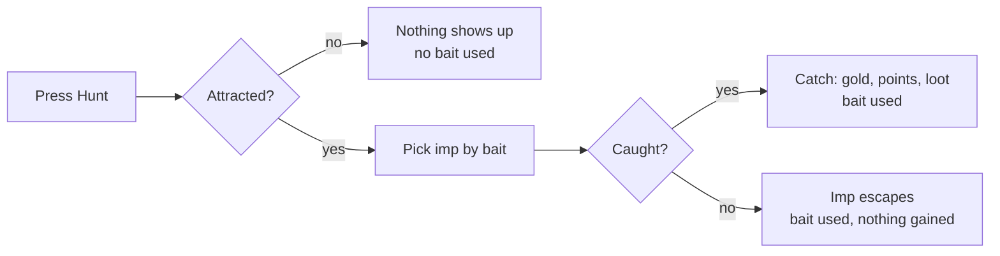

# The Naughty List: design and v1 plan

Living design document. It is updated in every pull request that changes the game, so it always matches `main`.
Original review copy: https://claude.ai/artifact/VRKBh16CBkcZuN8FiqeWn9 (this file is now the source of truth).

## Implementation status

| Milestone | Status | PR |
| --- | --- | --- |
| 1. Skeleton: server, client, Docker image, CI | Done | #1 |
| 2. Hunt engine, content files, tests, balance simulator | Done | #1 |
| 3. Playable client on the server: accounts, invites, server-side hunts, SQLite saves | Done | #2 |
| 4a. NAS deploy: compose file, Cloudflare Tunnel option, deploy guide, image smoke test | Done | #3 |
| 4b. Friends: leaderboard and catch feed | Next | |
| 5. Tune from play-test | Planned | |

The server runs every hunt and saves each player in SQLite. To play locally, follow "Run it locally" below.

## Summary

**The Naughty List** is an original Christmas trap-and-catch browser game for eddy and friends. Imps sent by Scrinch, ruler of the imps, are raiding Santa's secret lair at the North Pole and stealing toy supplies. Santa hires you as an imp hunter. You arm a trap, pick a bait, press Hunt, and the game rolls attraction and catch odds against the imp's power. There is no wait timer: every press is a hunt. Bait cost, not a clock, paces progress.

v1 covers 5 ranks and 4 lair locations. Each location has 3 common imps, a rare imp, a mini boss and a local boss: 24 imps in all. Bosses drop the loot used to craft stronger gear. Expect roughly 1,400 hunts, or about 1 to 1.5 hours of active play, to reach the last v1 rank.

The stack is one small Docker container (Node.js + SQLite) on the UGREEN NAS, with invite-only accounts and a leaderboard so friends can play. The stamina meter is built but switched off.

**Decided by eddy (25 Nov 2026):** Christmas theme and the name The Naughty List; stamina off but kept as a toggle; for eddy and friends; repository cheesezilla/naughty-list; this plan lives in the repo and is updated with each PR.

## Theme and setting

Scrinch, a horned devil who rules the imps, wants Christmas cancelled. His imps sneak into Santa's secret lair under the North Pole, wreck the workshops and steal the cookies, paper, toy parts and reindeer gear that Santa needs. Santa hires you as an imp hunter. Every imp you catch goes on The Naughty List.

You start in the Cookie Pantry and work deeper into the lair as you rank up. Each location has its own imps: 3 common kinds, a rare imp, a mini boss and a local boss who is one of Scrinch's lieutenants. Bosses drop the parts Santa's elves use to craft you stronger traps.

The tone is a cheeky Christmas storybook. Every imp, place, trap, bait, rank and material name is invented for this game. Art starts as emoji and simple icons and can be replaced later.

**Beyond v1:** Scrinch himself is the final boss of a later location. His loot crafts **The Naughty List**, a giant enchanted scroll trap and one of the strongest pieces of gear in the game.

## Core loop

The player spends gold on bait and gear, hunts to earn gold, points and materials, and uses points to rank up and unlock the next location.

**Trap setup** (four slots, changeable any time):

| Slot | What it gives | Consumed? |
| --- | --- | --- |
| Trap | Power, power type, luck, attraction bonus | No |
| Base | Power, luck, attraction bonus | No |
| Bait | Attraction rate, changes which imps show up | 1 per attracted hunt |
| Charm (optional) | A bonus such as +luck or +power % | 1 per attracted hunt |

**One hunt, step by step:**

1. **Attraction roll.** If nothing is attracted, no bait is used and the journal says nothing took the bait.
2. **Imp pick.** An imp is drawn from the location's table, weighted by the bait in use.
3. **Catch roll.** Trap power and luck are compared with the imp's power.
4. **Catch:** gold, points and a chance at loot. **Escape:** nothing gained. Bait is used either way.



Each hunt is written to a journal the player can scroll, which is the main feedback screen.

## Formulas

All constants live in `content/constants.json` and the other content files, so they can be tuned without code changes. Code: `src/engine/odds.ts` and `src/engine/hunt.ts`.

- **Power** = (trap + base + charm power) x (1 + charm power bonus). **Luck** = trap + base + charm luck.
- **Attraction** = min(95%, bait attraction x (1 + trap, base and charm attraction bonuses)). In the Reindeer Stables it is halved unless the bait is Hot Cocoa.
- **Imp pick**: chance of imp i = its weight / sum of weights for that bait. A location's 3 commons share about 91%, the rare imp 5%, the mini boss 3% and the boss 1%. Fruitcake doubles the rare, mini boss and boss weights.
- **Effectiveness** E of the trap's power type against an imp: 0 (immune), 0.5 (resists), 1 (normal) or 1.5 (weak). Types: Clockwork (toy machines), Holly (Christmas greenery), Frost (ice magic).
- **Catch chance** = clamp((P x E + L^2) / (P x E + M), 0, 98%), where M is the imp's power. Luck only counts when E > 0.
  - Example: a 150 power Clockwork trap on a 20 power base with luck 2, against a normal 90 power imp: (170 + 4) / (170 + 90) = 67%.
- **Rewards**: a catch pays the imp's gold and points and rolls its loot list; bosses always drop their crafting part. An escape pays nothing; some imps also steal one extra bait when they escape.
- **RNG**: the engine takes a random source, so the simulator and tests replay exactly from a seed. The server rolls every hunt with a cryptographic random source, so results can't be edited in the browser.

## Pacing without a cooldown

Bait is the clock. With no timer, progress is limited by gold: every attracted hunt burns bait, and a hunt only turns a profit when your trap suits the location.

- **Bait is a real cost.** Each location's best bait costs roughly 40 to 70% of the average gold per attracted hunt with suitable gear. Weak or wrong-type gear in a deeper location loses gold.
- **Steep rank thresholds.** Points needed grow about 4x each rank, while points per catch grow about 2x per location.
- **Bosses drive gear goals.** Mini bosses and bosses drop the parts for the next crafted item.
- **No dead ends.** With no bait and under 50 gold, Mrs. Claus hands over 10 free Stale Cookies.
- **Fair play limits.** The server accepts at most 2 hunts a second per player; the page paces rapid clicks to match.

**Optional stamina meter (built, switched off).** `constants.json` > `stamina.enabled`. When on, a Cocoa meter costs 1 per hunt, holds 100 and refills 1 per minute.

**Left out of v1:** diminishing returns per location (a hidden timer), auto-hunt and idle rewards.

## Progression

| Rank | Name | Points needed | Unlocks | Target hunts in rank |
| --- | --- | --- | --- | --- |
| 1 | Snow Scout | 0 | Cookie Pantry, starter gear | 150 |
| 2 | Elf Deputy | 2,500 | Wrapping Room (250 gold to unlock) | 250 |
| 3 | Imp Tracker | 12,000 | Toy Workshop (1,500 gold), Nutcracker Jaws trap | 400 |
| 4 | Frost Warden | 46,000 | Reindeer Stables (5,000 gold), rank 4 crafting | 600 |
| 5 | Yule Marshal | 160,000 | End of v1 | |

Ranks depend on points only. Location unlock fees are paid once; travel between unlocked locations is free.

## v1 content

The numbers below mirror `content/*.json`. Types: C = Clockwork, H = Holly, F = Frost; unlisted types are normal (x1).

**Imps**

| Location | Imp | Tier | Power | Gold | Points | Weak (x1.5) | Resists (x0.5) / immune (x0) | Drops |
| --- | --- | --- | --- | --- | --- | --- | --- | --- |
| Cookie Pantry | Crumb Imp | Common | 40 | 12 | 20 | | | |
| Cookie Pantry | Sprinkle Snatcher | Common | 70 | 18 | 30 | C | | Candied Peel 10% |
| Cookie Pantry | Chimney Soot Imp | Common | 100 | 25 | 45 | | H | |
| Cookie Pantry | Gingerbread Imp | Rare | 160 | 60 | 100 | F | | Sugar Glass 50% |
| Cookie Pantry | Jarbelly the Glutton | Mini boss | 300 | 90 | 180 | C | H | Cookie Tin 100% |
| Cookie Pantry | Baron Crumblewick | Boss | 450 | 150 | 300 | C | H | Brass Spring 100% |
| Wrapping Room | Ribbon Tangler | Common | 150 | 40 | 60 | | | |
| Wrapping Room | Tape Biter | Common | 220 | 55 | 85 | H | | |
| Wrapping Room | Bow Burglar | Common | 280 | 70 | 100 | | C | Candied Peel 10% |
| Wrapping Room | Glitter Imp | Rare | 350 | 110 | 160 | F | | Sugar Glass 50% |
| Wrapping Room | Spoolwick | Mini boss | 600 | 160 | 300 | H | | Golden Ribbon 100% |
| Wrapping Room | Madame Shredwell | Boss | 1,100 | 300 | 550 | H | C | Enchanted Wrapping 100% |
| Toy Workshop | Cog Pincher | Common | 450 | 140 | 150 | | | |
| Toy Workshop | Paint Smudger | Common | 600 | 180 | 190 | H | | |
| Toy Workshop | Stuffing Ripper | Common | 750 | 220 | 230 | F | H | |
| Toy Workshop | Wind-up Imp | Rare | 900 | 300 | 320 | C | F immune | Sugar Glass 50% |
| Toy Workshop | Hammerhand | Mini boss | 1,600 | 400 | 650 | F | | Toymaker's Gear 100% |
| Toy Workshop | Foreman Grimbolt | Boss | 2,800 | 700 | 1,300 | C | | Clockwork Heart 100% |
| Reindeer Stables | Hay Hoarder | Common | 1,000 | 300 | 350 | | | |
| Reindeer Stables | Bell Thief | Common | 1,300 | 380 | 420 | | H | |
| Reindeer Stables | Harness Snipper | Common | 1,600 | 450 | 480 | C | F immune | |
| Reindeer Stables | Carrot Crook | Rare | 2,000 | 600 | 650 | C | F | Sugar Glass 50% |
| Reindeer Stables | Antler Ripper | Mini boss | 3,500 | 800 | 1,200 | C | H | Silver Sleighbell 100% |
| Reindeer Stables | Grizzlewick the Horned | Boss | 6,000 | 1,500 | 3,000 | C | H immune | Brimstone Coal 100% |

Jarbelly, Bow Burglar and Bell Thief steal an extra bait when they escape. Brimstone Coal has no use in v1; it is saved for later recipes, including The Naughty List.

**Traps**

| Trap | Type | Power | Luck | Attraction | Rank | Price |
| --- | --- | --- | --- | --- | --- | --- |
| Stocking Snare | H | 60 | 0 | | 1 | Starter |
| Jack-in-the-Box | C | 150 | 1 | | 1 | 300 gold |
| Holly Noose | H | 300 | 2 | | 2 | 1,200 gold |
| Icicle Jar | F | 500 | 2 | +5% | 2 | 3,000 gold |
| Nutcracker Jaws | C | 900 | 3 | | 3 | 9,000 gold |
| Wreath of Thorns | H | 1,400 | 5 | +5% | 3 | Crafted |
| Snow Globe Prison | F | 1,800 | 4 | | 4 | 25,000 gold |
| Sleigh-Bell Snapper | C | 2,600 | 6 | +5% | 4 | Crafted (v1 capstone) |

**Bases**

| Base | Power | Luck | Attraction | Rank | Price |
| --- | --- | --- | --- | --- | --- |
| Cardboard Box | 20 | 0 | | 1 | Starter |
| Gingerbread Slab | 80 | 1 | | 1 | 500 gold |
| Candy Cane Platform | 200 | 1 | +5% | 2 | 2,500 gold |
| Ice Block | 400 | 3 | | 3 | 8,000 gold |
| Yule Log Base | 600 | 5 | +10% | 3 | Crafted |

**Baits**

| Bait | Attraction | Effect | Rank | Price |
| --- | --- | --- | --- | --- |
| Stale Cookie | 70% | Works everywhere | 1 | 8 gold |
| Sugar Cookie | 78% | Draws more Chimney Soot Imps in the Pantry | 1 | 20 gold |
| Peppermint Bark | 82% | | 3 | 50 gold |
| Fruitcake | 85% | Doubles rare imp, mini boss and boss odds | 2 | Crafted |
| Hot Cocoa | 88% | Stable imps show up at half rate with any other bait | 4 | 90 gold |

**Charms** (one used per attracted hunt)

| Charm | Effect | Rank | Price |
| --- | --- | --- | --- |
| Mistletoe Charm | +4 luck | 1 | 30 gold |
| Jingle Bell Charm | +15% attraction | 2 | 25 gold |
| Wind-up Key Charm | +20% power | 3 | 60 gold |

## Economy

Gold comes in only from catches and sales, and goes out on bait, charms, gear, location unlocks and crafting fees.

- **Sources:** 300 starting gold and 100 Stale Cookies; imp gold on each catch; selling materials (5 to 200 gold each) and gear (40% of its price).
- **Sinks:** bait and charms every attracted hunt; gear; one-time unlock fees; crafting fees.

**Elf Forge recipes**

| Item | Ingredients | Gold fee | Rank |
| --- | --- | --- | --- |
| Mistletoe Charm x10 | 1 Sugar Glass | 150 | 1 |
| Fruitcake x5 | 3 Candied Peel, 1 Cookie Tin | 100 | 2 |
| Wreath of Thorns (trap) | 3 Enchanted Wrapping, 2 Brass Spring | 6,000 | 3 |
| Yule Log Base | 3 Toymaker's Gear, 1 Golden Ribbon, 2 Sugar Glass | 4,000 | 3 |
| Sleigh-Bell Snapper (trap) | 3 Silver Sleighbell, 1 Clockwork Heart, 1 Nutcracker Jaws (used up) | 15,000 | 4 |

**Balance targets per location**

| Location | Meant-for gear | Bait cost / gold per attracted hunt | Catch rate (commons) |
| --- | --- | --- | --- |
| Cookie Pantry | Jack-in-the-Box + Gingerbread Slab | about 60% | 60 to 70% |
| Wrapping Room | Holly Noose or Icicle Jar + Candy Cane Platform | about 50% | 55 to 65% |
| Toy Workshop | Nutcracker Jaws + Ice Block | about 45% | 55 to 65% |
| Reindeer Stables | Nutcracker Jaws or Snow Globe Prison + Yule Log Base | about 45% | 45 to 55% |

**How we check it:** `npm run simulate` plays virtual hunters through v1 with the real engine and content, reports hunts per rank, catch rates and bait cost per location, and with `--strict` fails if a rank target is missed by more than 25%.

**Latest simulator run (PR #1, 100 players):** all reached rank 5, median 1,358 hunts. Median hunts in ranks 1 to 4: 177, 285, 401, 493 (targets 150, 250, 400, 600, all within 25%). Catch per attracted hunt: 64%, 58%, 56%, 58% by location. Known gaps: simulated players never bought Wreath of Thorns or Snow Globe Prison and mostly used Stale Cookies, so the better baits and those traps need a stronger reason to use them.

## Tech stack and architecture

| Part | Choice |
| --- | --- |
| Language | TypeScript everywhere; the engine is shared by server, client, tests and simulator |
| Server | Node.js 22 + Fastify, serving the API and the built page |
| Database | SQLite (Node's built-in `node:sqlite`) in the mounted `/data` folder |
| Web client | Vite + Preact, plain CSS, mobile first (about 12 KB gzipped today) |
| Game content | JSON in `content/`, validated against a schema and cross-checked at startup |
| Accounts | First account is the admin; everyone else signs up with an invite code, then username + password and a session cookie |
| Tests | Vitest for engine and server; the simulator for balance |

**API:**

| Call | What it does |
| --- | --- |
| `GET /api/health`, `GET /api/content`, `GET /api/setup-status` | Public: health, game content, whether the admin account exists yet |
| `POST /api/auth/signup` | Create an account. The very first account becomes the admin and needs no invite; every later one needs an unused invite code |
| `POST /api/auth/login`, `POST /api/auth/logout` | Session cookie, 30 days, token stored hashed |
| `GET /api/me` | User, player state and the last 50 journal entries |
| `POST /api/hunt` | One hunt, rolled on the server; limited to `maxHuntsPerSecond` (2) per player |
| `POST /api/setup`, `/api/buy`, `/api/sell`, `/api/craft`, `/api/travel` | Engine actions on the saved player |
| `POST /api/restart` with `{"confirm": true}` | Start over: wipes this player's progress and journal, keeps the account, logs the restart |
| `GET /api/restarts` | This player's own restart log |
| `GET/POST /api/admin/invites`, `DELETE /api/admin/invites/:code` | Admin only: list, create and revoke invite codes |
| `GET /api/admin/restarts` | Admin only: every player's restart log |

**Storage:** one SQLite file, `naughty-list.db`, in `DATA_DIR` (`/data` in Docker, `./data` locally), using Node's built-in `node:sqlite` so there are no native modules to compile. Tables: users, sessions, invites, players (state as JSON), journal (last 200 per player), restarts (one row per Start over, with the player's gold, points, rank, hunts, catches and Naughty List count at that moment; never deleted). Passwords are hashed with scrypt.

**Data stored per player:** gold, points, rank, current location, unlocked locations, setup, inventory counts, the last 200 journal entries and lifetime catch counts per imp (for The Naughty List collection page).

**Start over:** any player can wipe their own run from the **Start over** link at the bottom of the page. A confirmation dialog lists what will be lost, and nothing is wiped unless the player confirms; the server also refuses a restart without an explicit confirm flag. The wipe replaces that player's state with a fresh one and deletes their journal in one transaction. Their account, other players and the restart log are untouched. The admin sees every restart in the Admin tab.

**Playing with friends:** eddy is the admin and creates invite codes. A leaderboard ranks players by points, with tabs for total catches and bosses caught. A shared feed shows notable catches. No trading in v1.

## Run it locally

Needs Node.js 22 or newer and git.

```sh
git clone https://github.com/cheesezilla/naughty-list
cd naughty-list
npm install
npm run play        # builds, then serves on http://localhost:8080
```

The first account you create is the admin. Open the Admin tab to make invite codes for friends; a code link looks like `http://<address>:8080/?invite=SNOW-XXXX-XXXX`. Saves go to `./data/naughty-list.db`; deleting that file resets the whole server. For development with hot reload, use `npm run dev` and open http://localhost:5173.

## Deployment

The game ships as one Docker image (`ghcr.io/cheesezilla/naughty-list`), built and published by GitHub Actions on each push to `main`. The UGREEN DXP4800 has an Intel x86 processor, so the amd64 image works.

Step-by-step guide: [docs/DEPLOY.md](DEPLOY.md). In short:

1. Make the GitHub package public once, or log the NAS in to ghcr.io with a `read:packages` token.
2. In the UGOS Docker app, create a project from `compose.yaml`. Saves go to `/volume1/docker/naughty-list`.
3. Open `http://<nas-address>:8080` and create the admin account.
4. Optional: uncomment the `cloudflared` service and paste a tunnel token for a public HTTPS address.

The container starts as root only to fix the save folder's ownership, then drops to the unprivileged `node` user (`docker/entrypoint.sh`). Pull requests build the image and smoke-test it with a root-owned save folder: sign up, hunt, restart, and check the save survived.

**Letting friends in:** a Cloudflare Tunnel gives the game a public HTTPS address without opening router ports, as a second small container in the same Compose project. It needs a free Cloudflare account and a domain on Cloudflare. Tailscale is the alternative if every friend installs it.

**Telegram mini app (later, optional):** needs the same public HTTPS address plus a bot from BotFather. The client is already a small mobile-first page, so it's about a day of work.

**Backups:** the save is one SQLite file (plus its `-wal` file) in the data folder; a UGOS scheduled backup of that folder is enough.

## Still to sort out

- [ ] A domain on Cloudflare for the friends' address (or choose Tailscale), needed at milestone 4.
- [ ] Make the GitHub package public, or give the NAS a read token (DEPLOY.md part 1).

## Changelog

| Date | PR | Change |
| --- | --- | --- |
| 2026-11-25 | #4 | Start over: per-player wipe with a confirmation dialog, restart log (own and admin view); Invites tab renamed Admin |
| 2026-11-25 | #3 | NAS deploy: compose file with optional Cloudflare Tunnel, DEPLOY.md guide, entrypoint that fixes save-folder ownership, image smoke test in CI |
| 2026-11-25 | #2 | Milestone 3: accounts (first one is admin), invite codes, server-side hunts with rate limit, SQLite saves, login screen and Invites tab; local run steps |
| 2026-11-25 | #1 | Plan added to the repo; milestones 1 and 2 built; first simulator run recorded |
